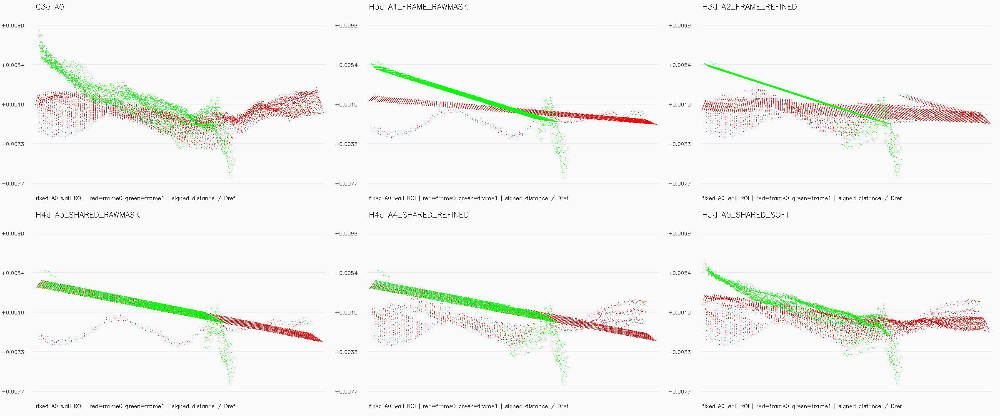

# H6a E0 참고 수치·벽 확대 단면·공유 평면색

H6의 전체 audit 이후, 계획의 E0 raw 참고 수치와 육안 확인용 확대 단면을 보완했다. 최적화·마스크·점군은 다시 계산하지 않았다. E0의 원래 K로 얻은 matching 지표와 C3a K의 matching 지표를 구분하며 C3a 고정 관측 ID·평면으로 E0 벽을 참고 측정했다. GT 비교가 아니다.

확대 축은 보정 결과를 보지 않고 A0의 signed distance p0.1/p99.9에 15% 여백을 더해 고정했다. 모든 군에 같은 축을 사용했고 잘린 점 수를 기록했다. 빨강=frame0, 초록=frame1이며 기존 벽 ROI에 frame2 지지는 없다. 공유 평면색 overlay는 같은 shared ID를 같은 색으로, hard gate 거절은 자홍색으로 표시한다. RGB/프레임색 PLY는 원본 그대로다.

실행 Stage: `results/c3a_plane_refinement/tum-freiburg1_desk-H6a-20261113-001/stages/H6a`. 대형 NPZ/PLY는 기존 규칙대로 results에 보관한다. GT 기하 정확도는 평가하지 않았다.
