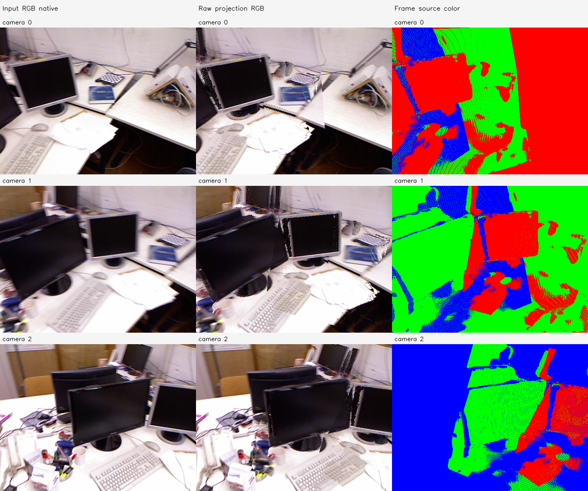
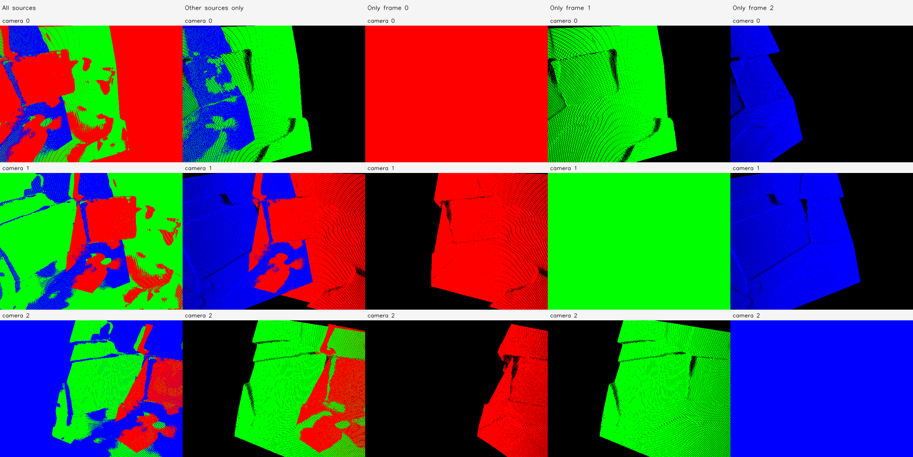

# C1 원본 기준선·영상 대응

실행: `tum-freiburg1_desk-C1-20261112-001`. **NOT_ENOUGH_SUPPORT**.

점 수 589,824, 처리 해상도 [512, 384]. 카메라·Depth·RGB를 보존하며 융합/최적화하지 않았다.

| 카메라 쌍 | 전체 | fit | validation | 양 영상 4×4 격자 점유 | 지원 통과 |
| --- | --- | --- | --- | --- | --- |
| [0, 1] | 30 | 24 | 6 | [7, 8] | False |
| [0, 2] | 11 | 8 | 3 | [5, 5] | False |
| [1, 2] | 16 | 15 | 1 | [6, 5] | False |

고정 track·anchor tile 단위 split으로 같은 track이 fit/validation에 동시에 들어가지 않는다. 영상 기반 대응은 대응 GT가 아니다.

- 6변수 rank: `{'rank': 6, 'dimension': 6, 'singular_values': [2.9709118686476663, 2.276914644484848, 1.7247412985963078, 1.545845828872334, 1.3466215328725661, 0.6848795963559301], 'condition': 4.337860091693681, 'identifiable': True}`
- 공통 1변수 rank: `{'rank': 1, 'dimension': 1, 'singular_values': [4.512005944074153], 'condition': 1.0, 'identifiable': True}`
- 원본 저장 좌표와 재역투영 차이: 1.91e-07 모델 단위.
- nearest 지표는 고정 512 query/프레임과 상대 프레임 전체 target의 정확한 float32 거리다.
- 벽 의미가 검증된 ROI는 확보하지 않았다. 고정 중앙 ROI의 층 통계는 다른 물체/가림도 포함하므로 벽 전용 정확도로 해석하지 않는다.

실행 Stage: `results/camera_fov_alignment/tum-freiburg1_desk-C1-20261112-001/stages/C1`. 대형 NPZ/PLY는 기존 규칙대로 results에 보관한다. GT 기하 정확도는 평가하지 않았다.
