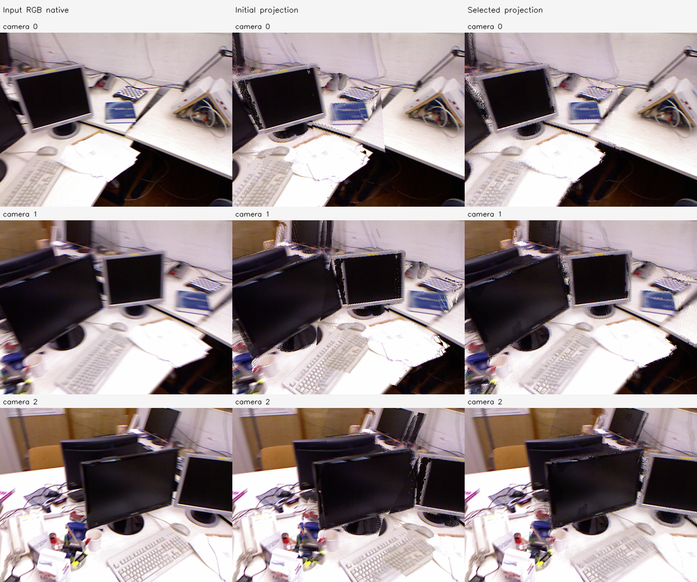
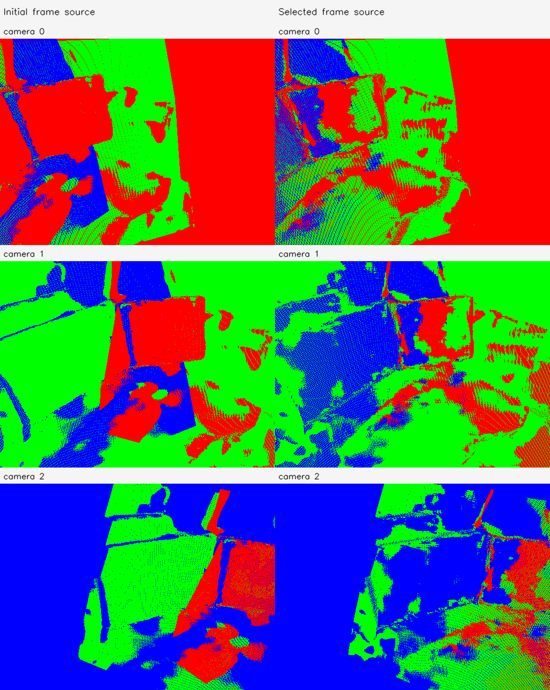

# C2a FoV 1변수 보정

실행 `tum-freiburg1_desk-C2a-20261112-001`. **LOW_SUPPORT_DIAGNOSTIC_ONLY**.

- 지원 조건 통과: False; 데이터 rank: `{'rank': 1, 'dimension': 1, 'singular_values': [4.512005944074153], 'condition': 1.0, 'identifiable': True}`.
- 실제 최적화 실행: True; 수렴: True.
- 선택 iteration: 9; 제안값 경계 제한: False; 제안값 coverage 거절: False.
- 최종 선택 β: `[1.0790553210764477, 1.0790553210764477, 1.0790553210764477, 1.0790553210764477, 1.0790553210764477, 1.0790553210764477]`.
- 실제 solver 제안 β: `[1.0790553210764477, 1.0790553210764477, 1.0790553210764477, 1.0790553210764477, 1.0790553210764477, 1.0790553210764477]`. 선택되지 않은 제안도 별도 PLY/NPZ로 보존한다.
- 입력 원본 Depth/RGB/pose 및 원본 K 불변 검사 통과. 보정 K는 별도로 저장했다.

| 고정 validation 지표 | 초기 | 선택 결과 |
| --- | --- | --- |
| 양방향 상대 3D median | 0.03301693851620094 | 0.004125088584932654 |
| 양방향 상대 Z median | 0.009654042580962878 | 0.002566445928695268 |

| camera | βx/βy | 초기 fx/fy | 보정 fx/fy | 보정 수평/수직 FoV degree |
| --- | --- | --- | --- | --- |
| 0 | [1.0790553210764477, 1.0790553210764477] | [464.26080322265625, 465.84686279296875] | [430.24745270661134, 431.7173120727931] | [61.505835106134626, 47.95282276040284] |
| 1 | [1.0790553210764477, 1.0790553210764477] | [462.2010498046875, 463.164306640625] | [428.3386039407167, 429.23128925269555] | [61.72997706180409, 48.199013523043455] |
| 2 | [1.0790553210764477, 1.0790553210764477] | [456.2193603515625, 456.6012268066406] | [422.7951537243203, 423.1490433235089] | [62.38932156397747, 48.81147185735558] |

지원 부족의 원래 계획에서는 β=1을 유지하며 효과를 주장하지 않는다. diagnostic_override가 true인 보조 실행은 관측 부족의 탐색적 수치 진단이다. 동일 입력 3장의 일부 대응을 보류했으며 새로운 카메라나 실제 3D 정확도의 검증은 아니다.

실행 Stage: `results/camera_fov_alignment/tum-freiburg1_desk-C2a-20261112-001/stages/C2a`. 대형 NPZ/PLY는 기존 규칙대로 results에 보관한다. GT 기하 정확도는 평가하지 않았다.
