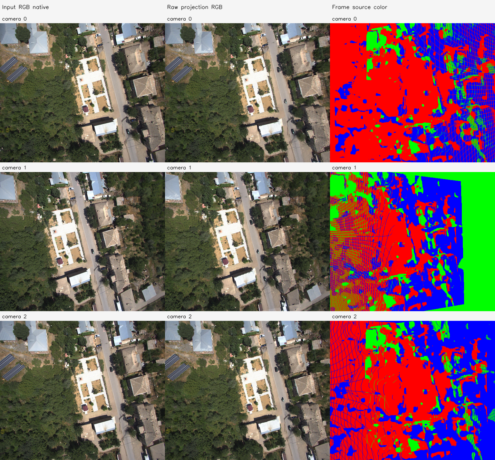
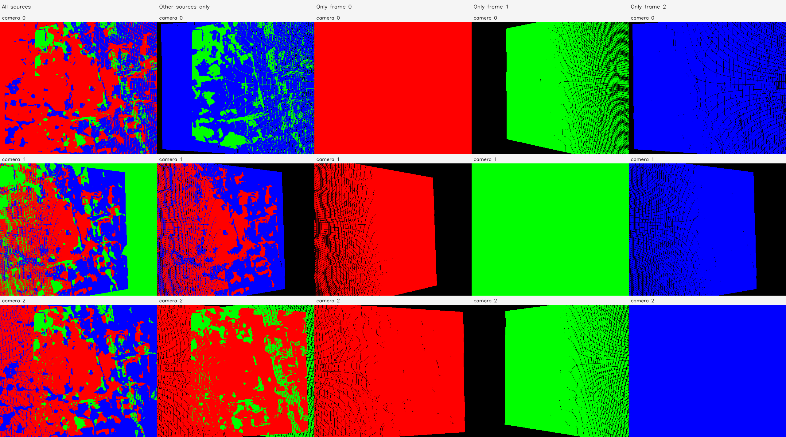
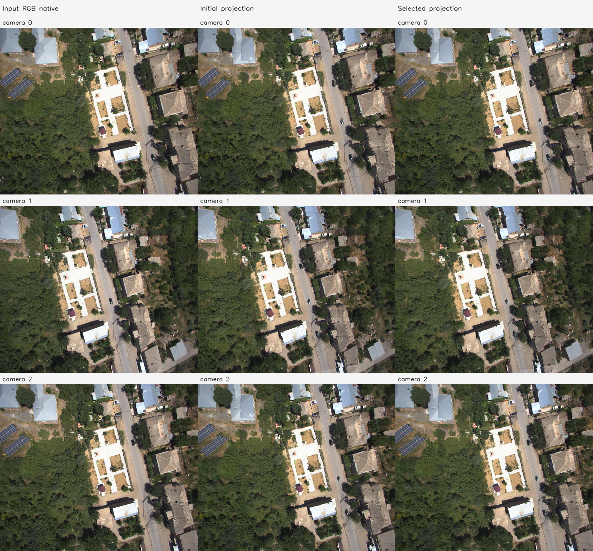
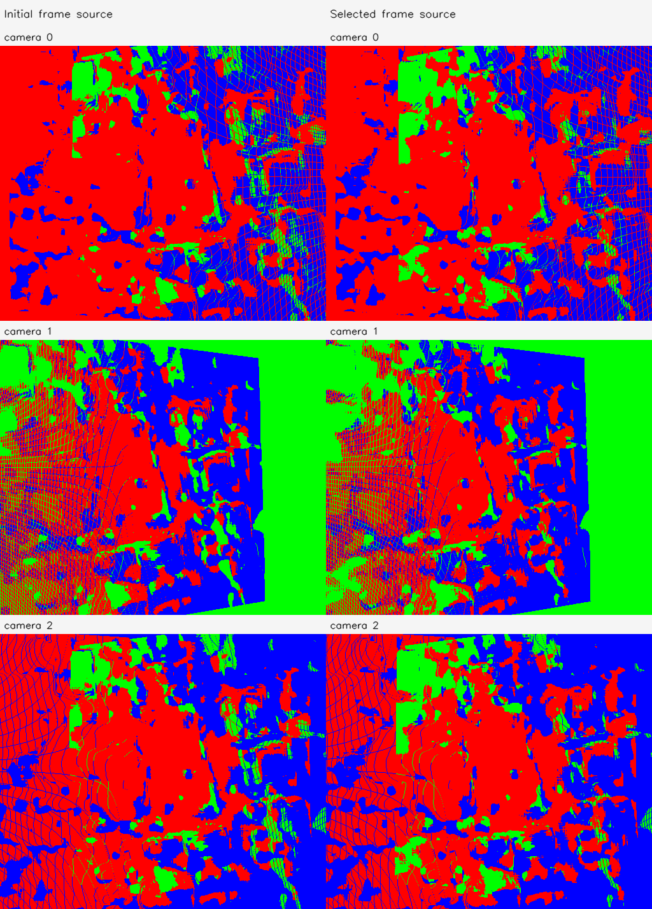
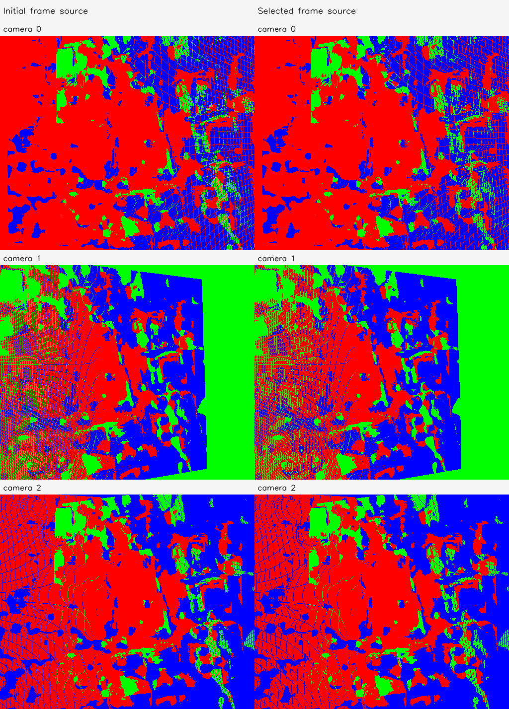

# C4 원본 기준선·영상 대응

실행: `amtown01-C4-20261113-001`. **BASELINE_READY**.

점 수 663,552, 처리 해상도 [512, 432]. 카메라·Depth·RGB를 보존하며 융합/최적화하지 않았다.

| 카메라 쌍 | 전체 | fit | validation | 양 영상 4×4 격자 점유 | 지원 통과 |
| --- | --- | --- | --- | --- | --- |
| [0, 1] | 937 | 758 | 179 | [16, 13] | True |
| [0, 2] | 1066 | 870 | 196 | [16, 16] | True |
| [1, 2] | 912 | 758 | 154 | [16, 16] | True |

고정 track·anchor tile 단위 split으로 같은 track이 fit/validation에 동시에 들어가지 않는다. 영상 기반 대응은 대응 GT가 아니다.

- 6변수 rank: `{'rank': 6, 'dimension': 6, 'singular_values': [29.615281440598068, 26.82720507720689, 25.40691249614045, 22.06217643481401, 10.095252598807242, 1.0328486951226201], 'condition': 28.673397740103773, 'identifiable': True}`
- 공통 1변수 rank: `{'rank': 1, 'dimension': 1, 'singular_values': [17.555927279933417], 'condition': 1.0, 'identifiable': True}`
- 원본 저장 좌표와 재역투영 차이: 0 모델 단위.
- nearest 지표는 고정 512 query/프레임과 상대 프레임 전체 target의 정확한 float32 거리다.
- 벽 의미가 검증된 ROI는 확보하지 않았다. 고정 중앙 ROI의 층 통계는 다른 물체/가림도 포함하므로 벽 전용 정확도로 해석하지 않는다.

# C4 FoV 1변수 보정

실행 `amtown01-C4-20261113-001`. **INTERNAL_3D_IMPROVED**.

- 지원 조건 통과: True; 데이터 rank: `{'rank': 1, 'dimension': 1, 'singular_values': [17.555927279933417], 'condition': 1.0, 'identifiable': True}`.
- 실제 최적화 실행: True; 수렴: True.
- 선택 iteration: 8; 제안값 경계 제한: False; 제안값 coverage 거절: False.
- 최종 선택 β: `[0.9847073571789656, 0.9847073571789656, 0.9847073571789656, 0.9847073571789656, 0.9847073571789656, 0.9847073571789656]`.
- 실제 solver 제안 β: `[0.9847073571789656, 0.9847073571789656, 0.9847073571789656, 0.9847073571789656, 0.9847073571789656, 0.9847073571789656]`. 선택되지 않은 제안도 별도 PLY/NPZ로 보존한다.
- 입력 원본 Depth/RGB/pose 및 원본 K 불변 검사 통과. 보정 K는 별도로 저장했다.

| 고정 validation 지표 | 초기 | 선택 결과 |
| --- | --- | --- |
| 양방향 상대 3D median | 0.007241247631988519 | 0.005976537110481261 |
| 양방향 상대 Z median | 0.0033065970289841 | 0.003285462892989667 |

| camera | βx/βy | 초기 fx/fy | 보정 fx/fy | 보정 수평/수직 FoV degree |
| --- | --- | --- | --- | --- |
| 0 | [0.9847073571789656, 0.9847073571789656] | [302.4351501464844, 301.4715270996094] | [307.132010278581, 306.15342203116944] | [79.62361667529142, 70.40812667827676] |
| 1 | [0.9847073571789656, 0.9847073571789656] | [301.4679870605469, 300.5784912109375] | [306.14982701480574, 305.246517170389] | [79.80418797658353, 70.56834200813654] |
| 2 | [0.9847073571789656, 0.9847073571789656] | [297.04833984375, 295.84814453125] | [301.6615420593054, 300.44270754593447] | [80.63808369687851, 71.42766710552672] |

지원 부족의 원래 계획에서는 β=1을 유지하며 효과를 주장하지 않는다. diagnostic_override가 true인 보조 실행은 관측 부족의 탐색적 수치 진단이다. 동일 입력 3장의 일부 대응을 보류했으며 새로운 카메라나 실제 3D 정확도의 검증은 아니다.

# C4 FoV 6변수 보정

실행 `amtown01-C4-20261113-001`. **EFFECT_NOT_ESTABLISHED**.

- 지원 조건 통과: True; 데이터 rank: `{'rank': 6, 'dimension': 6, 'singular_values': [29.615281440598068, 26.82720507720689, 25.40691249614045, 22.06217643481401, 10.095252598807242, 1.0328486951226201], 'condition': 28.673397740103773, 'identifiable': True}`.
- 실제 최적화 실행: True; 수렴: True.
- 선택 iteration: 0; 제안값 경계 제한: False; 제안값 coverage 거절: True.
- 최종 선택 β: `[1.0, 1.0, 1.0, 1.0, 1.0, 1.0]`.
- 실제 solver 제안 β: `[0.985173277237457, 0.985311176040687, 0.9879401010947353, 0.9829909049783903, 0.9803359035253658, 0.9779429742397853]`. 선택되지 않은 제안도 별도 PLY/NPZ로 보존한다.
- 입력 원본 Depth/RGB/pose 및 원본 K 불변 검사 통과. 보정 K는 별도로 저장했다.

| 고정 validation 지표 | 초기 | 선택 결과 |
| --- | --- | --- |
| 양방향 상대 3D median | 0.007241247631988519 | 0.007241247631988519 |
| 양방향 상대 Z median | 0.0033065970289841 | 0.0033065970289841 |

| camera | βx/βy | 초기 fx/fy | 보정 fx/fy | 보정 수평/수직 FoV degree |
| --- | --- | --- | --- | --- |
| 0 | [1.0, 1.0] | [302.4351501464844, 301.4715270996094] | [302.4351501464844, 301.4715270996094] | [80.49332221290318, 71.24210331781781] |
| 1 | [1.0, 1.0] | [301.4679870605469, 300.5784912109375] | [301.4679870605469, 300.5784912109375] | [80.67437024303305, 71.40312838820499] |
| 2 | [1.0, 1.0] | [297.04833984375, 295.84814453125] | [297.04833984375, 295.84814453125] | [81.5103549179878, 72.26668419595262] |

지원 부족의 원래 계획에서는 β=1을 유지하며 효과를 주장하지 않는다. diagnostic_override가 true인 보조 실행은 관측 부족의 탐색적 수치 진단이다. 동일 입력 3장의 일부 대응을 보류했으며 새로운 카메라나 실제 3D 정확도의 검증은 아니다.

실행 Stage: `results/camera_fov_alignment/amtown01-C4-20261113-001/stages/C4`. 대형 NPZ/PLY는 기존 규칙대로 results에 보관한다. GT 기하 정확도는 평가하지 않았다.
