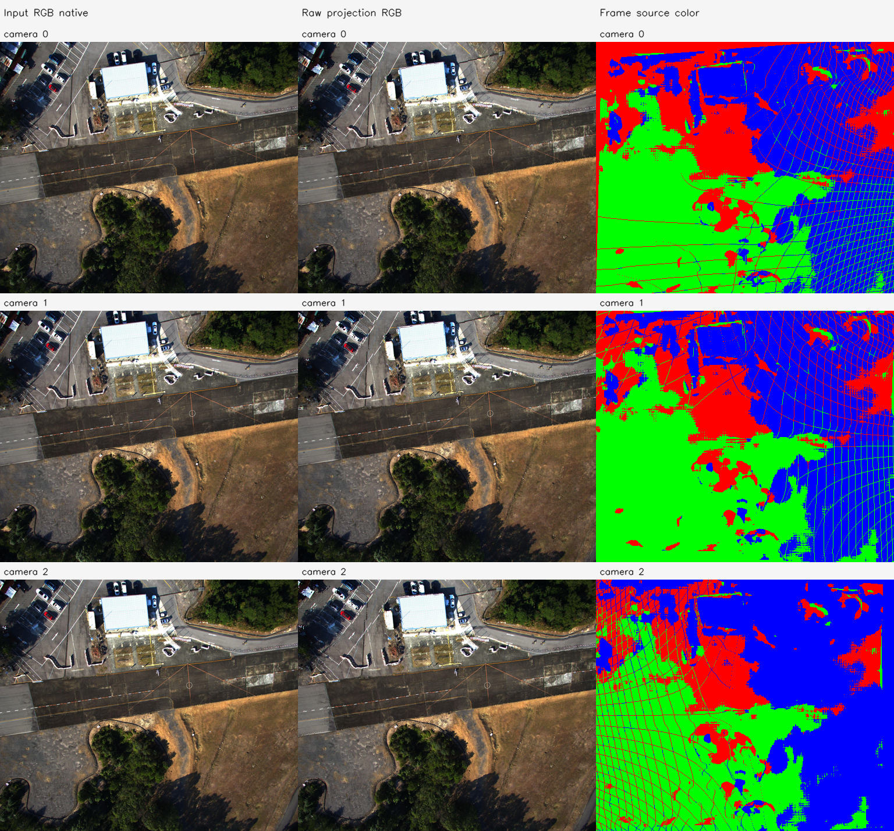
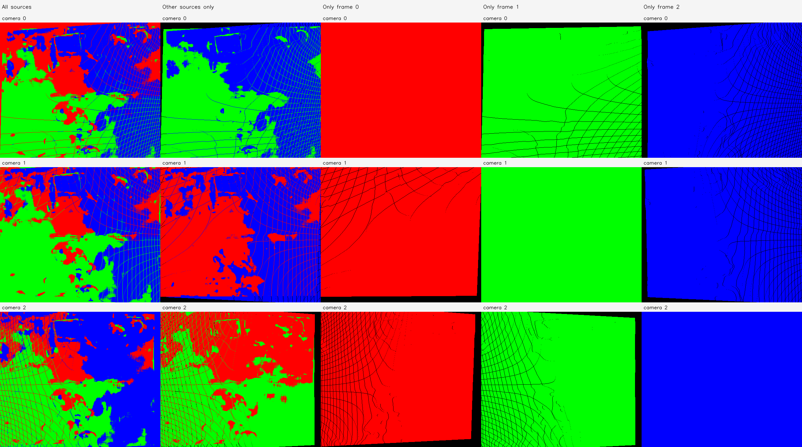
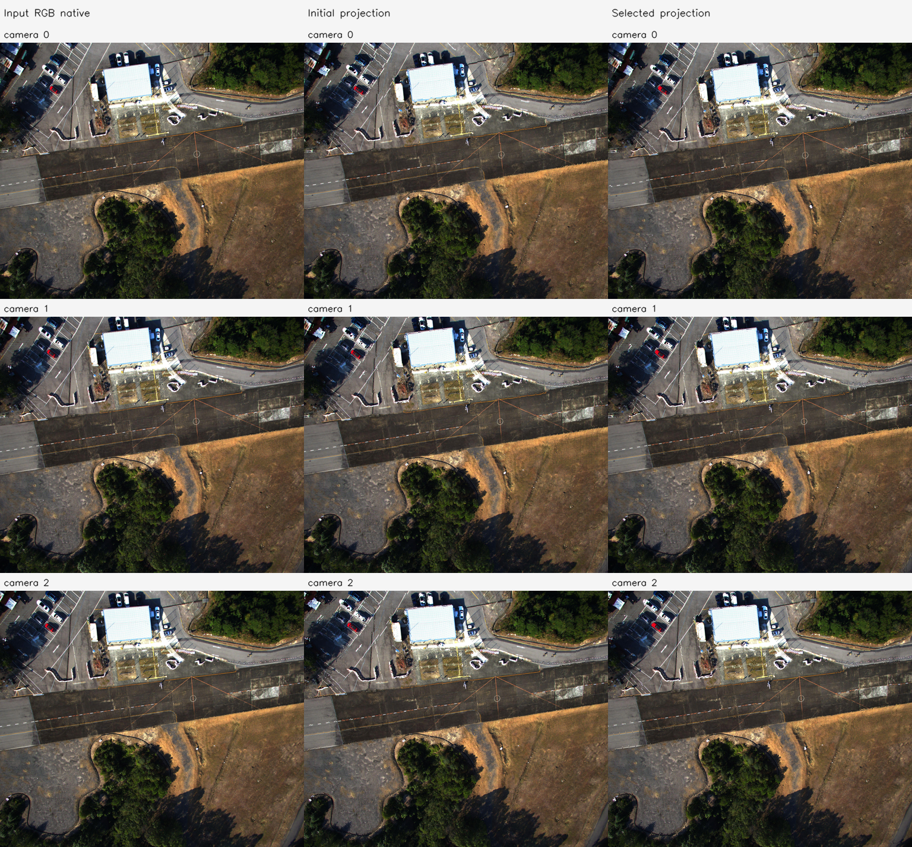
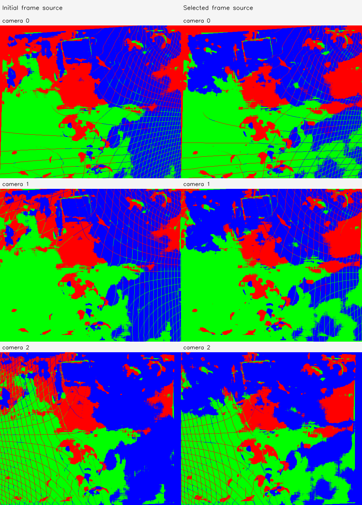
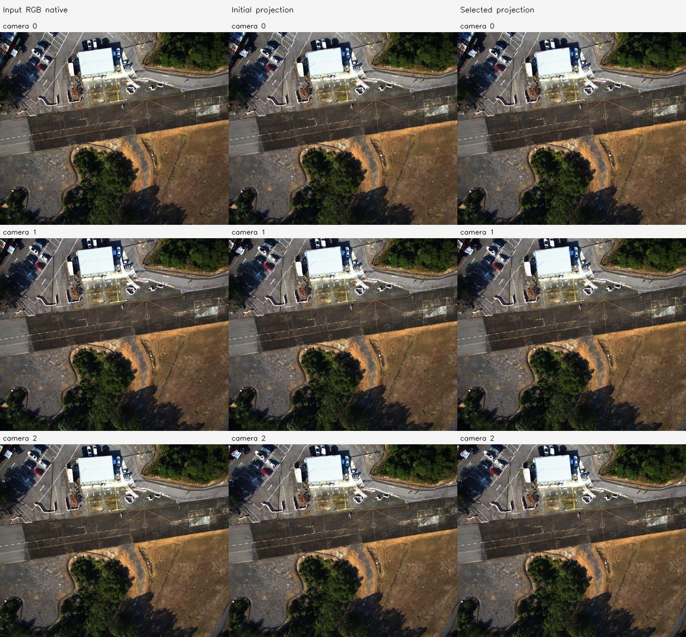
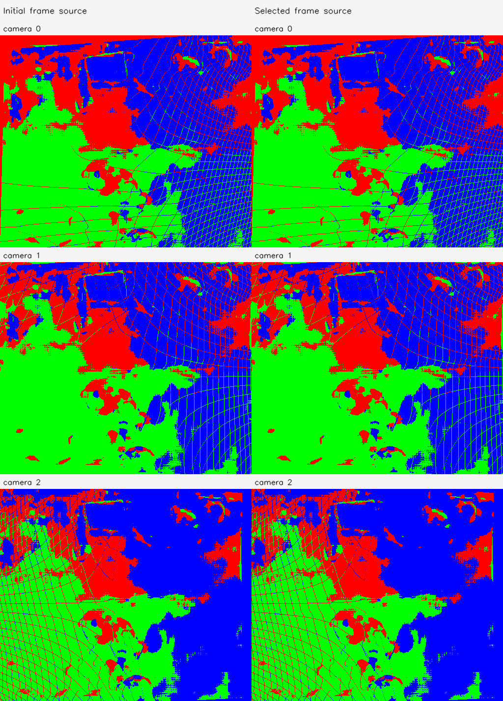

# C4 원본 기준선·영상 대응

실행: `hkairport01-C4-20261113-001`. **BASELINE_READY**.

점 수 663,552, 처리 해상도 [512, 432]. 카메라·Depth·RGB를 보존하며 융합/최적화하지 않았다.

| 카메라 쌍 | 전체 | fit | validation | 양 영상 4×4 격자 점유 | 지원 통과 |
| --- | --- | --- | --- | --- | --- |
| [0, 1] | 895 | 721 | 174 | [16, 16] | True |
| [0, 2] | 843 | 680 | 163 | [16, 16] | True |
| [1, 2] | 933 | 747 | 186 | [16, 16] | True |

고정 track·anchor tile 단위 split으로 같은 track이 fit/validation에 동시에 들어가지 않는다. 영상 기반 대응은 대응 GT가 아니다.

- 6변수 rank: `{'rank': 6, 'dimension': 6, 'singular_values': [24.397236394542762, 23.19088440687448, 21.809086624070385, 20.5188837165668, 2.1509355084892143, 1.1918758196532195], 'condition': 20.46961268300688, 'identifiable': True}`
- 공통 1변수 rank: `{'rank': 1, 'dimension': 1, 'singular_values': [4.191368207005048], 'condition': 1.0, 'identifiable': True}`
- 원본 저장 좌표와 재역투영 차이: 0 모델 단위.
- nearest 지표는 고정 512 query/프레임과 상대 프레임 전체 target의 정확한 float32 거리다.
- 벽 의미가 검증된 ROI는 확보하지 않았다. 고정 중앙 ROI의 층 통계는 다른 물체/가림도 포함하므로 벽 전용 정확도로 해석하지 않는다.

# C4 FoV 1변수 보정

실행 `hkairport01-C4-20261113-001`. **EFFECT_NOT_ESTABLISHED**.

- 지원 조건 통과: True; 데이터 rank: `{'rank': 1, 'dimension': 1, 'singular_values': [4.191368207005048], 'condition': 1.0, 'identifiable': True}`.
- 실제 최적화 실행: True; 수렴: True.
- 선택 iteration: 8; 제안값 경계 제한: False; 제안값 coverage 거절: False.
- 최종 선택 β: `[0.9604202040357686, 0.9604202040357686, 0.9604202040357686, 0.9604202040357686, 0.9604202040357686, 0.9604202040357686]`.
- 실제 solver 제안 β: `[0.9604202040357686, 0.9604202040357686, 0.9604202040357686, 0.9604202040357686, 0.9604202040357686, 0.9604202040357686]`. 선택되지 않은 제안도 별도 PLY/NPZ로 보존한다.
- 입력 원본 Depth/RGB/pose 및 원본 K 불변 검사 통과. 보정 K는 별도로 저장했다.

| 고정 validation 지표 | 초기 | 선택 결과 |
| --- | --- | --- |
| 양방향 상대 3D median | 0.0054460574866446836 | 0.005617949464890333 |
| 양방향 상대 Z median | 0.0022684223190304483 | 0.002109841336106091 |

| camera | βx/βy | 초기 fx/fy | 보정 fx/fy | 보정 수평/수직 FoV degree |
| --- | --- | --- | --- | --- |
| 0 | [0.9604202040357686, 0.9604202040357686] | [348.3797607421875, 351.8713073730469] | [362.7368096571331, 366.37224612149276] | [70.42474557633417, 61.04416788565154] |
| 1 | [0.9604202040357686, 0.9604202040357686] | [348.2563171386719, 350.0933532714844] | [362.6082788296922, 364.521020903519] | [70.44387866885492, 61.29843766670947] |
| 2 | [0.9604202040357686, 0.9604202040357686] | [345.7070007324219, 348.2242736816406] | [359.95390276019936, 362.5749148324579] | [70.84104109256897, 61.56780858471362] |

지원 부족의 원래 계획에서는 β=1을 유지하며 효과를 주장하지 않는다. diagnostic_override가 true인 보조 실행은 관측 부족의 탐색적 수치 진단이다. 동일 입력 3장의 일부 대응을 보류했으며 새로운 카메라나 실제 3D 정확도의 검증은 아니다.

# C4 FoV 6변수 보정

실행 `hkairport01-C4-20261113-001`. **EFFECT_NOT_ESTABLISHED**.

- 지원 조건 통과: True; 데이터 rank: `{'rank': 6, 'dimension': 6, 'singular_values': [24.397236394542762, 23.19088440687448, 21.809086624070385, 20.5188837165668, 2.1509355084892143, 1.1918758196532195], 'condition': 20.46961268300688, 'identifiable': True}`.
- 실제 최적화 실행: True; 수렴: True.
- 선택 iteration: 0; 제안값 경계 제한: False; 제안값 coverage 거절: True.
- 최종 선택 β: `[1.0, 1.0, 1.0, 1.0, 1.0, 1.0]`.
- 실제 solver 제안 β: `[0.9432725081456751, 0.996914728658751, 0.9436102497760913, 0.9911588661085373, 0.9491958898924634, 0.9996451074921293]`. 선택되지 않은 제안도 별도 PLY/NPZ로 보존한다.
- 입력 원본 Depth/RGB/pose 및 원본 K 불변 검사 통과. 보정 K는 별도로 저장했다.

| 고정 validation 지표 | 초기 | 선택 결과 |
| --- | --- | --- |
| 양방향 상대 3D median | 0.0054460574866446836 | 0.0054460574866446836 |
| 양방향 상대 Z median | 0.0022684223190304483 | 0.0022684223190304483 |

| camera | βx/βy | 초기 fx/fy | 보정 fx/fy | 보정 수평/수직 FoV degree |
| --- | --- | --- | --- | --- |
| 0 | [1.0, 1.0] | [348.3797607421875, 351.8713073730469] | [348.3797607421875, 351.8713073730469] | [72.61914539979027, 63.08826472844291] |
| 1 | [1.0, 1.0] | [348.2563171386719, 350.0933532714844] | [348.2563171386719, 350.0933532714844] | [72.63852485035481, 63.347370132707844] |
| 2 | [1.0, 1.0] | [345.7070007324219, 348.2242736816406] | [345.7070007324219, 348.2242736816406] | [73.04074476587813, 63.621818579160646] |

지원 부족의 원래 계획에서는 β=1을 유지하며 효과를 주장하지 않는다. diagnostic_override가 true인 보조 실행은 관측 부족의 탐색적 수치 진단이다. 동일 입력 3장의 일부 대응을 보류했으며 새로운 카메라나 실제 3D 정확도의 검증은 아니다.

실행 Stage: `results/camera_fov_alignment/hkairport01-C4-20261113-001/stages/C4`. 대형 NPZ/PLY는 기존 규칙대로 results에 보관한다. GT 기하 정확도는 평가하지 않았다.
