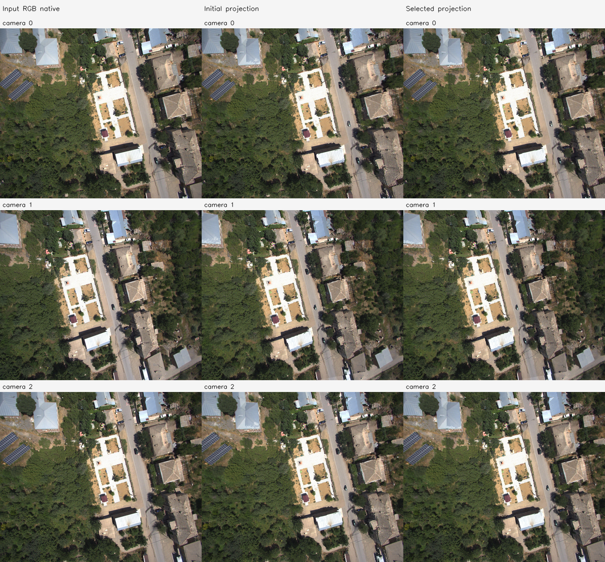
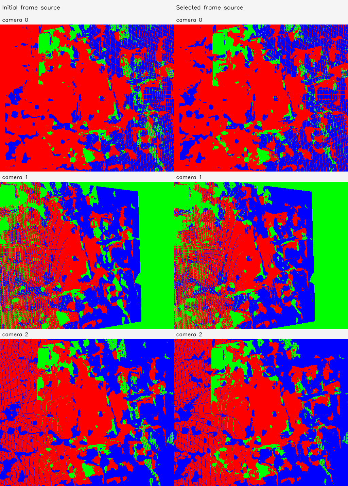

# C4a FoV 6변수 보정

실행 `amtown01-C4a-20261113-001`. **INTERNAL_3D_IMPROVED**.

- 지원 조건 통과: True; 데이터 rank: `{'rank': 6, 'dimension': 6, 'singular_values': [29.615281440598068, 26.82720507720689, 25.40691249614045, 22.06217643481401, 10.095252598807242, 1.0328486951226201], 'condition': 28.673397740103773, 'identifiable': True}`.
- 실제 최적화 실행: True; 수렴: True.
- 선택 iteration: 112; 제안값 경계 제한: False; 제안값 coverage 거절: True.
- 최종 선택 β: `[0.9888799579280927, 0.9889833820305152, 0.9909550758210515, 0.9872431787337927, 0.9852519276440244, 0.9834572306798389]`.
- 실제 solver 제안 β: `[0.985173277237457, 0.985311176040687, 0.9879401010947353, 0.9829909049783903, 0.9803359035253658, 0.9779429742397853]`. 선택되지 않은 제안도 별도 PLY/NPZ로 보존한다.
- 입력 원본 Depth/RGB/pose 및 원본 K 불변 검사 통과. 보정 K는 별도로 저장했다.

| 고정 validation 지표 | 초기 | 선택 결과 |
| --- | --- | --- |
| 양방향 상대 3D median | 0.007241247631988519 | 0.005564450223524261 |
| 양방향 상대 Z median | 0.0033065970289841 | 0.0032771301439970895 |

| camera | βx/βy | 초기 fx/fy | 보정 fx/fy | 보정 수평/수직 FoV degree |
| --- | --- | --- | --- | --- |
| 0 | [0.9888799579280927, 0.9889833820305152] | [302.4351501464844, 301.4715270996094] | [305.83606000079965, 304.82971966692503] | [79.86201688814937, 70.64218715073035] |
| 1 | [0.9909550758210515, 0.9872431787337927] | [301.4679870605469, 300.5784912109375] | [304.21963055264325, 304.4624644522235] | [80.1610417176774, 70.70736626066618] |
| 2 | [0.9852519276440244, 0.9834572306798389] | [297.04833984375, 295.84814453125] | [301.49480707341974, 300.8246167723407] | [80.6693405698301, 71.35868602043493] |

지원 부족의 원래 계획에서는 β=1을 유지하며 효과를 주장하지 않는다. diagnostic_override가 true인 보조 실행은 관측 부족의 탐색적 수치 진단이다. 동일 입력 3장의 일부 대응을 보류했으며 새로운 카메라나 실제 3D 정확도의 검증은 아니다.

## C4a 해석

원래 C4를 보존한 뒤 추가한 탐색적 실행이다. 초기값→solver 제안의 선분을 α=0,1/16,…,1의 고정 17개 값으로 평가했다. 선택은 같은 fit 목적함수와 같은 coverage 기준만 사용했다. 기존 대응/split·손실·범위·허용 coverage는 변경하지 않았다. validation을 보고 후보를 고르지 않았지만 원래 결과 확인 후의 보완이므로 독립적인 확인 실험으로 해석하지 않는다.

실행 Stage: `results/camera_fov_alignment/amtown01-C4a-20261113-001/stages/C4a`. 대형 NPZ/PLY는 기존 규칙대로 results에 보관한다. GT 기하 정확도는 평가하지 않았다.
