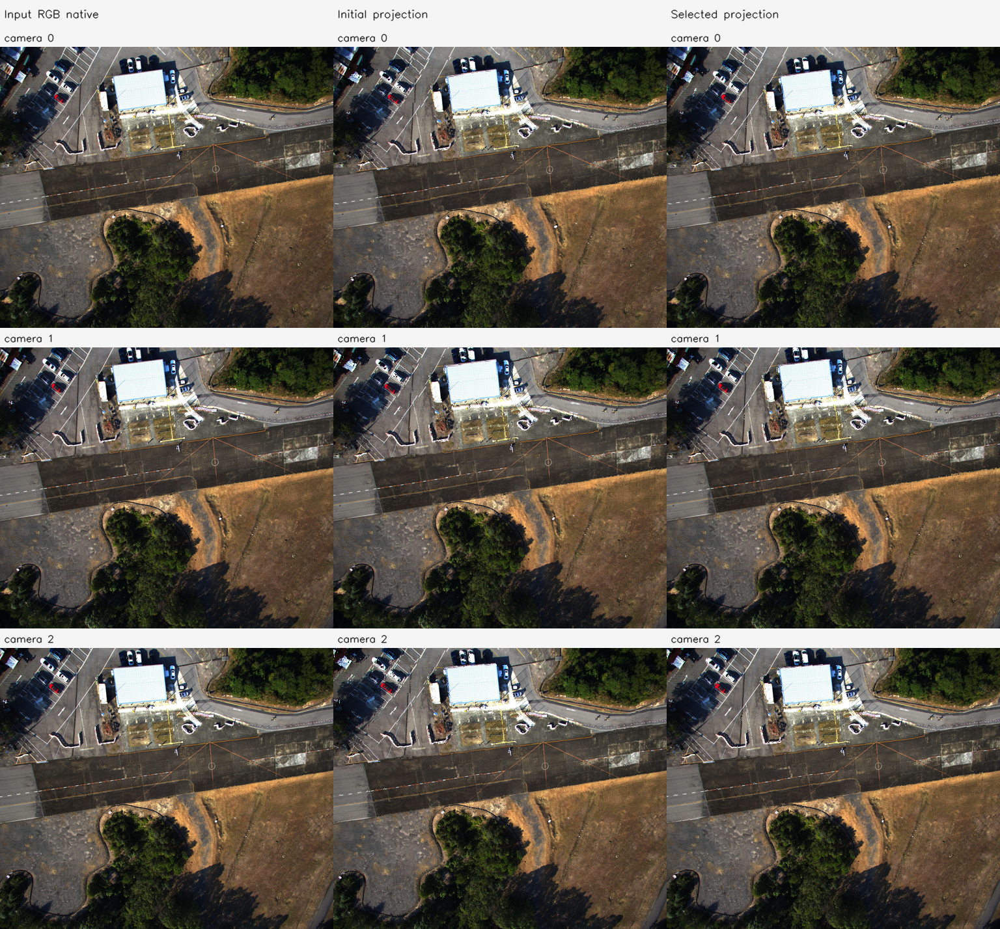
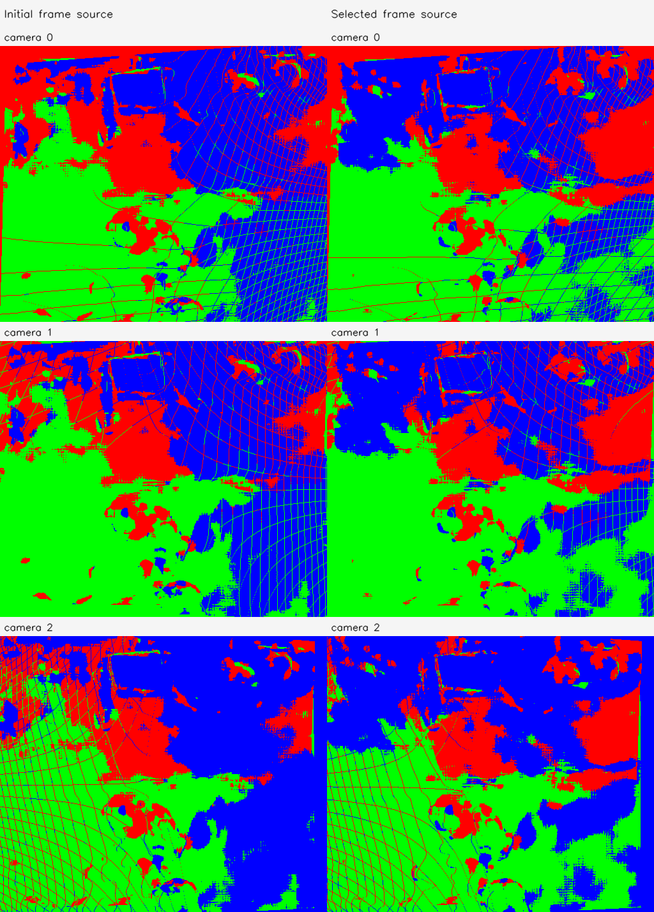

# C4a FoV 6변수 보정

실행 `hkairport01-C4a-20261113-001`. **INTERNAL_3D_IMPROVED**.

- 지원 조건 통과: True; 데이터 rank: `{'rank': 6, 'dimension': 6, 'singular_values': [24.397236394542762, 23.19088440687448, 21.809086624070385, 20.5188837165668, 2.1509355084892143, 1.1918758196532195], 'condition': 20.46961268300688, 'identifiable': True}`.
- 실제 최적화 실행: True; 수렴: True.
- 선택 iteration: 114; 제안값 경계 제한: False; 제안값 coverage 거절: True.
- 최종 선택 β: `[0.9503634446274657, 0.997300387576407, 0.9506589685540799, 0.9922640078449702, 0.9555464036559055, 0.9996894690556132]`.
- 실제 solver 제안 β: `[0.9432725081456751, 0.996914728658751, 0.9436102497760913, 0.9911588661085373, 0.9491958898924634, 0.9996451074921293]`. 선택되지 않은 제안도 별도 PLY/NPZ로 보존한다.
- 입력 원본 Depth/RGB/pose 및 원본 K 불변 검사 통과. 보정 K는 별도로 저장했다.

| 고정 validation 지표 | 초기 | 선택 결과 |
| --- | --- | --- |
| 양방향 상대 3D median | 0.0054460574866446836 | 0.004878868196056904 |
| 양방향 상대 Z median | 0.0022684223190304483 | 0.002285576338657688 |

| camera | βx/βy | 초기 fx/fy | 보정 fx/fy | 보정 수평/수직 FoV degree |
| --- | --- | --- | --- | --- |
| 0 | [0.9503634446274657, 0.997300387576407] | [348.3797607421875, 351.8713073730469] | [366.5752957056859, 352.8237948730253] | [69.85749544987543, 62.950237118537] |
| 1 | [0.9506589685540799, 0.9922640078449702] | [348.2563171386719, 350.0933532714844] | [366.3314907430558, 352.82278758838385] | [69.89328756060986, 62.950382800695046] |
| 2 | [0.9555464036559055, 0.9996894690556132] | [345.7070007324219, 348.2242736816406] | [361.7898611828294, 348.33244168371726] | [70.5659208808281, 63.60587758801794] |

지원 부족의 원래 계획에서는 β=1을 유지하며 효과를 주장하지 않는다. diagnostic_override가 true인 보조 실행은 관측 부족의 탐색적 수치 진단이다. 동일 입력 3장의 일부 대응을 보류했으며 새로운 카메라나 실제 3D 정확도의 검증은 아니다.

## C4a 해석

원래 C4를 보존한 뒤 추가한 탐색적 실행이다. 초기값→solver 제안의 선분을 α=0,1/16,…,1의 고정 17개 값으로 평가했다. 선택은 같은 fit 목적함수와 같은 coverage 기준만 사용했다. 기존 대응/split·손실·범위·허용 coverage는 변경하지 않았다. validation을 보고 후보를 고르지 않았지만 원래 결과 확인 후의 보완이므로 독립적인 확인 실험으로 해석하지 않는다.

실행 Stage: `results/camera_fov_alignment/hkairport01-C4a-20261113-001/stages/C4a`. 대형 NPZ/PLY는 기존 규칙대로 results에 보관한다. GT 기하 정확도는 평가하지 않았다.
