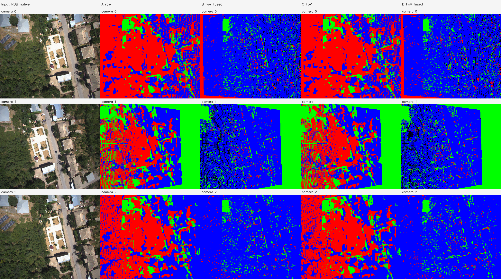
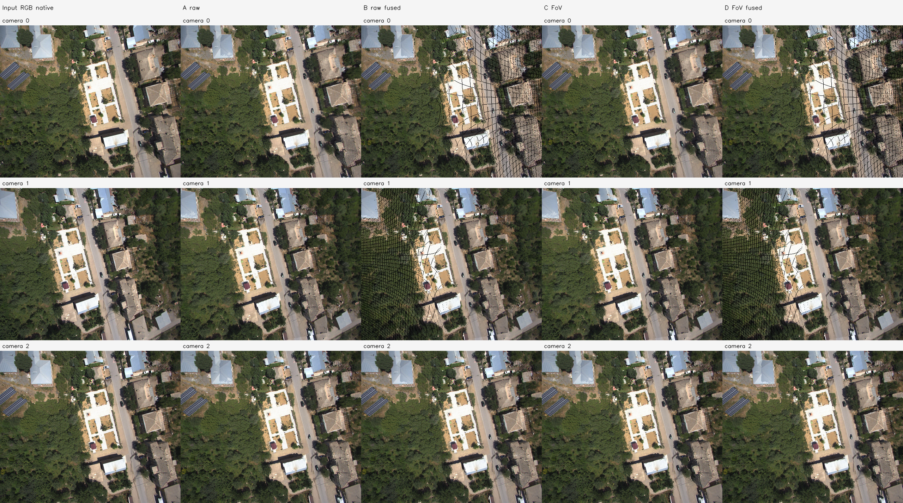

# C5 원본 RGB·깊이 근접 융합 — amtown01

실행 `amtown01-C5-20261113-001`. **COMPRESSION_CRITERIA_NOT_MET**.

색은 원본 8비트 RGB 그룹 범위 ≤30, 깊이는 새 카메라에서 전체 원본 구성점과 현재 대표점의 Z 범위/새 Depth ≤3%다. 후보를 추가할 때마다 전체 그룹을 확인한다. 대표점의 깊이만 산술 평균하고 표시 RGB는 새 owner의 원본 색을 사용한다.

| arm | 대표점 수 | 미융합 입력 대비 감소 | 지도 core 배열 bytes | provenance 포함 map 배열 bytes |
| --- | --- | --- | --- | --- |
| A | 663,552 | 0.000% | 30,523,392 | 55,738,376 |
| B | 342,799 | 48.339% | 15,768,754 | 33,927,172 |
| C | 663,552 | 0.000% | 30,523,392 | 55,738,376 |
| D | 342,799 | 48.339% | 15,768,754 | 33,927,172 |

- A_to_B: **COMPRESSION_CRITERIA_NOT_MET**, 점 수 감소 48.339%; camera coverage loss `[0.050926, 0.069838, 0.0]`.
- C_to_D: **COMPRESSION_CRITERIA_NOT_MET**, 점 수 감소 48.339%; camera coverage loss `[0.050926, 0.069838, 0.0]`.

FoV 보정 C/D 사용 가능: **True**; 선행 코드 `C4`, 보정 판정 `EFFECT_NOT_ESTABLISHED`. 지원 부족의 탐색 계수는 주 융합 입력으로 승격하지 않았다. C/D가 없으면 A/B 융합만 평가했으며 FoV 후 융합 효과는 미평가다. 보정 선택값이 초기값이면 C=A, D=B다. C5b는 C4a의 탐색적 후보 정책을 사용한 보조 비교이며 원래 C5와 구분한다.

평균 Z/광선·거절점 좌표 불변, 원본 관측의 중복·유실 없는 CSR, 단계별 색/깊이 범위를 검증했다. 다중 프레임 그룹의 출처는 NPZ membership에 보존한다. 그림 색은 최신 owner이며 유일한 관측 출처라는 뜻이 아니다.

점 수 감소와 coverage/표면 보존을 별도로 판단한다. 압축 기준은 ≥10% 점 수 감소, camera별 coverage 손실 ≤0.5%p, 공통 영역 front-Z 변화 p90 ≤3%다. raw 표면 보존 지표이며 GT 정확도가 아니다. 지도 core·provenance map·원본 보관 자료의 배열 논리 크기(중복 참조 포함)를 구분하고 실행 전체 peak RSS와 시간을 기록했다. 논리 크기는 실제 resident RAM과 다를 수 있다. arm별 peak RSS나 실제 SLAM 실시간성은 검증하지 않았다.

실행 Stage: `results/camera_fov_alignment/amtown01-C5-20261113-001/stages/C5`. 대형 NPZ/PLY는 기존 규칙대로 results에 보관한다. GT 기하 정확도는 평가하지 않았다.
