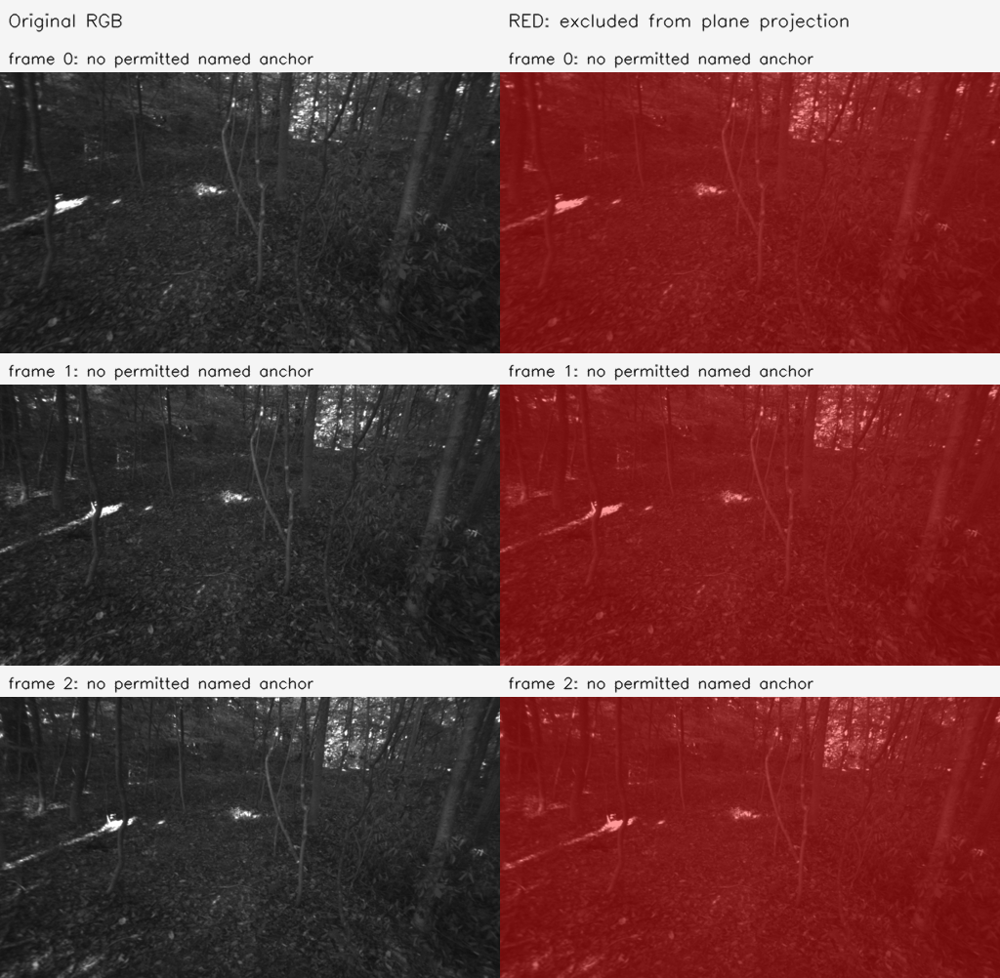

# I10 — eth3d-forest-rig: NO_NAMED_SUPPORT

모든 view에 허용 named anchor가 0개다. A1의 동일 출력 조기 종료를 적용했고 전체 I3/I4 기하 탐색은 완료하지 않았다. 네 출력 군의 XYZ가 FoV 출력과 bitwise 같음을 확인했다.

Stage: `results/global_planar_pointmap/eth3d-forest-rig-I10-20261114-001/stages/I10`. GT_NOT_EVALUATED.
