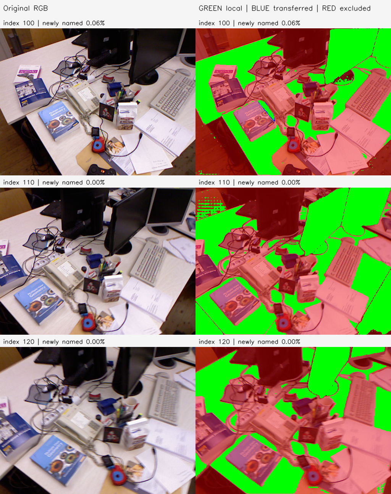
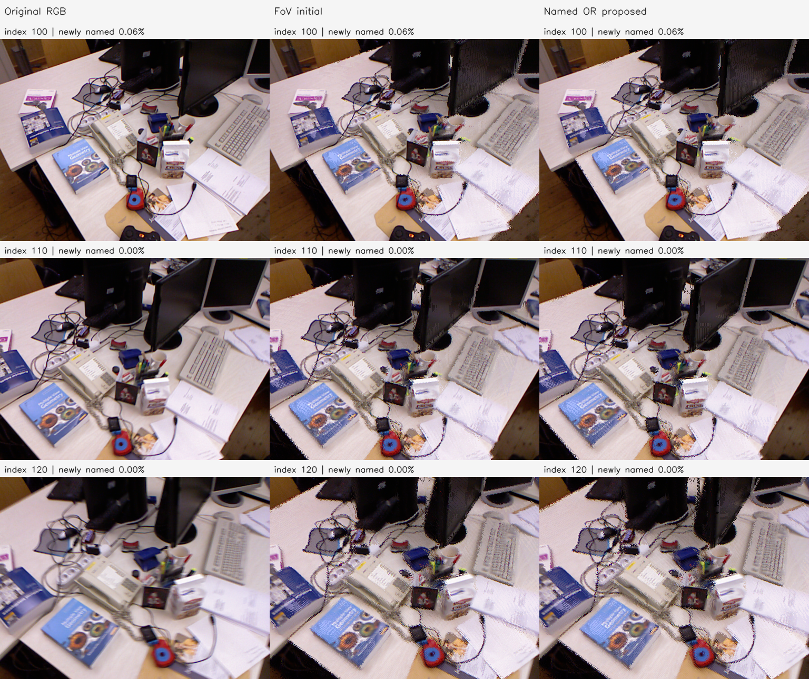

# I10 named OR 평면 투영

결과: local 194,834점 → OR 194,950점, 신규 unknown 116점. 최대 frustum 손실 0.58717%, retained=`initial`.

동일 표면으로 연결된 region의 named 정보를 OR했다. 서로 다른 카메라의 같은 픽셀 좌표를 OR하지 않았다. 원본 RGB의 동결 fit 대응 2개 이상과 기존 양방향 유한 평면 투영/기하 양립 조건을 만족한 cross-view 연결만 사용하고, 그룹 전체의 모든 쌍을 검사했다. 해당 연결을 못 찾은 관측은 보수적으로 미확정으로 남긴다.

첫 허용 목록은 exact `wall/table/screen`이다. 혼합 태그와 그 밖의 named는 보류하며, 원본 GroundedSAM의 screen도 유효한 평면 fit가 있으면 허용한다. AMG unknown 자체를 평면 근거로 사용하지 않고, 같은 표면의 다른 view에 named 근거가 있는 경우에만 소속을 전달한다. 명백한 평면 여부는 기존 fit-only robust plane/최소 지원/퇴화 조건으로 검사하며 semantic 또는 geometry GT는 아니다.

named_local과 named_OR를 함께 실행했다. 카메라·RGB·관측 ID·점 수를 고정하고 단일 world plane과 자기 픽셀 광선의 교차로 이동했다. I6 공동 최적화·수직/평행 prior·박스/원통/구 모델은 적용하지 않았다. 원래 오류 크기에 따른 이동 상한도 추가하지 않았다. 모든 view에서 named 근거가 없는 관측과 보류된 다른 named 영역의 XYZ bitwise 보존을 검사했다.

초록은 현재 view의 허용 named, 파랑은 다른 view에서 OR로 전달된 신규 후보, 빨강은 제외 영역이다. 파랑/초록 후보도 fit 또는 수치 교차가 실패하면 이동하지 않는다. 원래 마스크가 책·종이 등을 잘못 포함한 경우까지 semantic GT로 보장하지 않는다. 가시성 실패 시 retained는 initial이며 proposed를 별도 보존한다.

Stage: `results/global_planar_pointmap/tum-freiburg1_desk-extra-I10-20261113-001/stages/I10`. GT_NOT_EVALUATED.
