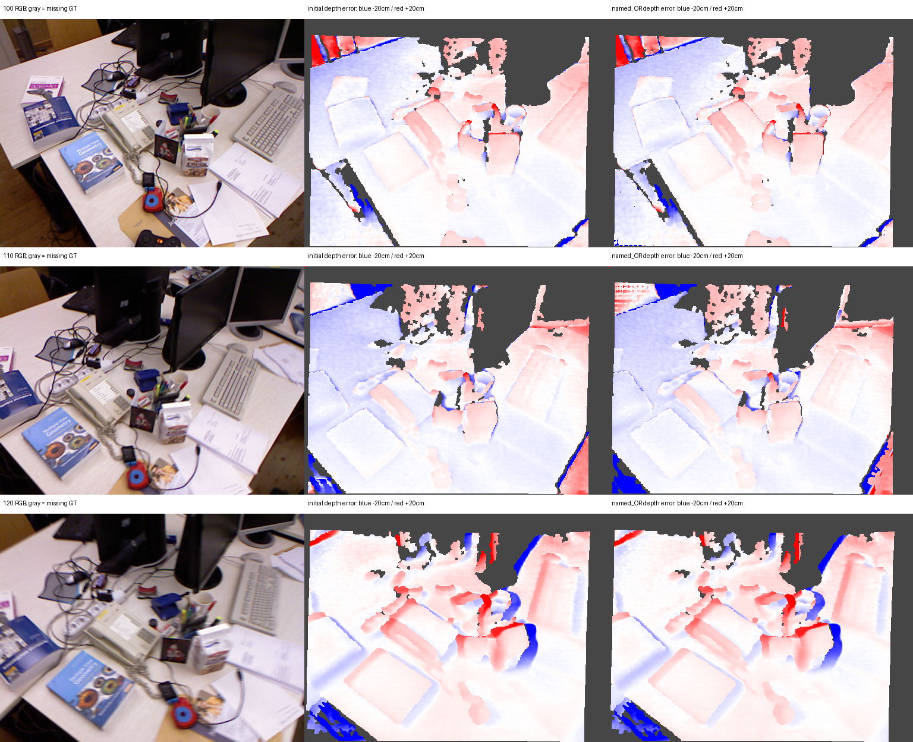

# I11 — 현재 I10 결과의 TUM GT 평가

대상 `tum-freiburg1_desk-extra`. **DEPTH_GT_MIXED_OR_WORSE**. 재구성·투영·retained 선택은 변경하지 않았다.

## 평가 규약

TUM depth PNG / 5000을 m 단위 camera-Z 참조로 사용. 1.035 배율은 배포본에 이미 반영되어 재적용하지 않았다. RGB-depth 최근접 대응 상한 20 ms. 원래 RGB SHA-256도 archive와 일치한다. [TUM 공식 규약](https://cvg.cit.tum.de/data/datasets/rgbd-dataset/file_formats).

640×480 RGB는 기존 PIL bicubic으로 512×384가 되었으며 crop은 없다. 평가 픽셀 중심을 원본으로 역매핑해 최근접 depth를 읽었다. depth 0은 제외한다. 비교군 공통 유효 센서 픽셀 438,481/589,824, 평가 픽셀 78,993개.

깊이 scale **1.2031863643 m/model-unit**는 initial의 기존 I0 FIT 픽셀 331,100개에서 GT/initial의 중앙값으로 한 번만 추정했다. shift 없음. 겹치지 않는 I0 validation에서 모든 비교군에 같은 scale·마스크를 사용했다. 비교군별 재정렬이나 GT를 이용한 모델 보정은 없다.

## 깊이 정확도 (공통 validation; 낮을수록 좋음)

| 출력 | MAE (cm) | RMSE (cm) | AbsRel | δ<1.25 |
|---|---:|---:|---:|---:|
| initial | 2.0196 | 4.8160 | 0.016647 | 99.652% |
| named_local | 2.0777 | 4.9718 | 0.017015 | 99.705% |
| named_OR | 2.1514 | 5.4576 | 0.017986 | 99.444% |
| retained | 2.0196 | 4.8160 | 0.016647 | 99.652% |

## 영역별 initial → named_OR

영역은 OR 결과로 고정한 동일 관측 집합이다. tag는 모델 추정이며 의미 GT가 아니다.

| 영역 | GT 평가 픽셀 | MAE 전→후 (cm) | RMSE 전→후 (cm) |
|---|---:|---:|---:|
| all | 78,993 | 2.0196 → 2.1514 | 4.8160 → 5.4576 |
| projected_OR | 21,111 | 1.6711 → 2.1641 | 3.9462 → 6.3432 |
| rescued_OR | 6 | 1.7814 → 1.5181 | 1.9951 → 1.6108 |
| eligible_OR | 21,111 | 1.6711 → 2.1641 | 3.9462 → 6.3432 |
| all_views_unknown | 55,750 | 2.1117 → 2.1117 | 5.1007 → 5.1007 |
| table | 20,043 | 1.3553 → 1.5060 | 3.3063 → 3.6656 |
| screen | 1,068 | 7.5983 → 14.5140 | 10.1322 → 23.3065 |

## 깊이 경계 민감도

센서 depth의 원본 3×3 이웃이 모두 유효하고 범위가 5 cm 이하인 고정 마스크로도 측정했다. GT 경계·등록 오차에 대한 보조 진단이며 기본 평가를 대체하지 않는다.

| 출력 | 픽셀 | MAE (cm) | RMSE (cm) |
|---|---:|---:|---:|
| initial | 75,568 | 1.8099 | 4.1124 |
| named_local | 75,568 | 1.8763 | 4.3302 |
| named_OR | 75,568 | 1.9299 | 4.7622 |
| retained | 75,568 | 1.8099 | 4.1124 |

## 대응 3D 점 보조 평가

공식 권장 ROS default K=(525,525,319.5,239.5), 추가 undistortion 없음. RGB timestamp에 mocap translation 선형보간·회전 SLERP. FIT 최대 30,000 대응점에서 initial만 Sim(3) 정렬하고 동일 변환으로 모든 출력의 validation 대응점 거리를 측정했다. scale=1.2543048072. 이는 NN Chamfer가 아니라 동일 관측 픽셀의 거리다. K 근사와 RGB-depth 시차의 영향을 포함한다.

| 출력 | 3D mean (cm) | 3D RMSE (cm) |
|---|---:|---:|
| initial | 2.7694 | 5.7420 |
| named_local | 2.8124 | 5.9314 |
| named_OR | 2.8958 | 6.3722 |
| retained | 2.7694 | 5.7420 |

## 해석 범위

깊이와 3D 수치는 서로 다른 baseline 공통 정렬을 사용하므로 직접 혼합하지 않는다. 보정되지 않은 metric scale 정확도, semantic GT, 이상적인 평면/직각 형태 정확도, 전체 시퀀스 SLAM 정확도를 입증하지 않는다. 센서 GT는 컵·종이·반사 screen에서 결측/오차가 있으며 결측부 정확도는 알 수 없다. 픽셀 수는 독립 장면 수가 아니므로 통계적 유의성을 주장하지 않는다.

GT 평가 전에 선택한 I10 retained는 그대로 평가했다. extra의 visibility 실패 출력은 proposed 진단만 수행하며 retained로 승격하지 않았다. all_views_unknown의 좌표 동일성, FIT/validation 분리, 고정 metadata·마스크, Sim(3) 회복과 metric sanity 검증을 통과했다.

Stage: `results/global_planar_pointmap/tum-freiburg1_desk-extra-I11-20261113-001/stages/I11`. GT_DEPTH_AND_REGISTERED_POINTMAP_EVALUATED.
