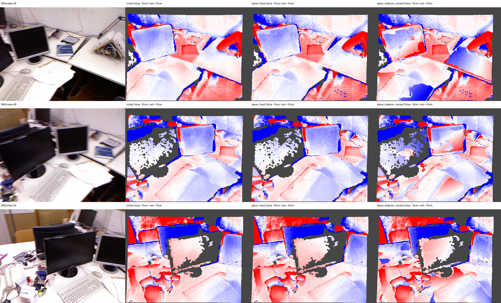

# I13 — 평면 RGB 최적화의 GT 평가: tum-freiburg1_desk

**NO_CONFIRMED_GAIN**. 기존 I11의 GT·정렬·평가 마스크를 그대로 사용했다.

I12 최적화 평면 24개, 소속 관측 149,990개, 해당 GT validation 23,168개. 전체 GT validation 81,111개.

주 처치군의 보류 RGB robust 손실 감소 -4.9822%, RGB/가시성 선택 통과=False, retained=`I10_retained`. GT로 retained를 바꾸지 않았다.

## 전체 깊이 정확도

| 출력 | MAE (cm) ↓ | RMSE (cm) ↓ | AbsRel ↓ | 보류 RGB robust 손실 ↓ |
|---|---:|---:|---:|---:|
| initial | 5.37673 | 15.48667 | 0.0310660 | — |
| plane_fixed | 5.51136 | 15.76121 | 0.0321471 | 0.48631877590648803 |
| plane_distance | 6.27508 | 15.95647 | 0.0392492 | 0.5720912710529585 |
| plane_distance_normal | 6.13638 | 15.95165 | 0.0375098 | 0.5105482691236731 |
| retained | 5.51136 | 15.76121 | 0.0321471 | — |

## 영역별 plane_fixed → 거리만 → 거리·법선

태그는 예측이며 semantic GT가 아니다. 모든 비교군에 같은 관측 집합을 사용했다.

| 영역 | GT 픽셀 | MAE fixed (cm) | 거리 (cm) | 거리·법선 (cm) |
|---|---:|---:|---:|---:|
| all | 81,111 | 5.51136 | 6.27508 | 6.13638 |
| projected | 33,624 | 3.18052 | 5.02285 | 4.68825 |
| optimized | 23,168 | 1.68003 | 4.35382 | 3.86822 |
| unknown_untouched | 47,487 | 7.16175 | 7.16175 | 7.16175 |
| wall | 1,969 | 17.48904 | 17.48904 | 17.48904 |
| table | 22,720 | 2.17690 | 4.93472 | 3.95674 |
| screen | 8,935 | 2.57939 | 2.49978 | 3.72743 |

## 센서 경계 제외 및 대응 3D 보조 평가

| 출력 | 경계 제외 MAE (cm) | 경계 제외 RMSE (cm) | 3D mean (cm) | 3D RMSE (cm) |
|---|---:|---:|---:|---:|
| initial | 4.62423 | 13.20581 | 6.55549 | 16.79798 |
| plane_fixed | 4.76506 | 13.54267 | 6.69327 | 17.10106 |
| plane_distance | 5.55096 | 13.77331 | 7.53075 | 17.36378 |
| plane_distance_normal | 5.41521 | 13.77096 | 7.37233 | 17.32802 |
| retained | 4.76506 | 13.54267 | 6.69327 | 17.10106 |

## 판정과 제한

성공 기준은 주 처치군의 전체 MAE가 initial 및 plane_fixed 양쪽보다 1% 이상 줄고 RMSE가 늘지 않으며, 보류 RGB 1% 개선 및 기존 frustum 손실 0.5% 기준을 통과하는 것이다. optimized GT validation 500개 미만이면 지지 부족으로 판정한다.

초기 두 비교군의 I11 지표를 정확히 재현했다. GT는 I12 출력을 완료한 뒤 별도 프로세스에서 읽었다. 같은 장면의 탐색 실험이므로 새 장면의 일반화·전체 SLAM·통계적 유의성을 주장하지 않는다. 대부분의 평면은 단일 source view 패치이며 타 view의 같은 태그가 같은 물리 표면을 보장하지 않는다. low-texture·가림·반사·노출·카메라 오차가 남는다.

Stage: `results/global_planar_pointmap/tum-freiburg1_desk-I13-20261114-001/stages/I13`. GT_DEPTH_AND_REGISTERED_POINTMAP_EVALUATED.
