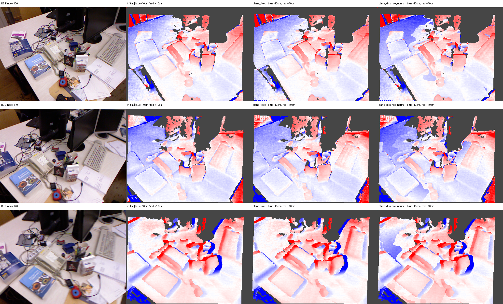

# I13 — 평면 RGB 최적화의 GT 평가: tum-freiburg1_desk-extra

**NO_CONFIRMED_GAIN**. 기존 I11의 GT·정렬·평가 마스크를 그대로 사용했다.

I12 최적화 평면 21개, 소속 관측 96,860개, 해당 GT validation 16,087개. 전체 GT validation 78,993개.

주 처치군의 보류 RGB robust 손실 감소 -5.8332%, RGB/가시성 선택 통과=False, retained=`I10_retained`. GT로 retained를 바꾸지 않았다.

## 전체 깊이 정확도

| 출력 | MAE (cm) ↓ | RMSE (cm) ↓ | AbsRel ↓ | 보류 RGB robust 손실 ↓ |
|---|---:|---:|---:|---:|
| initial | 2.01961 | 4.81599 | 0.0166475 | — |
| plane_fixed | 2.15136 | 5.45759 | 0.0179864 | 0.2397969995630355 |
| plane_distance | 2.64389 | 5.70567 | 0.0218972 | 0.26232955034536004 |
| plane_distance_normal | 2.45244 | 5.56713 | 0.0203780 | 0.2537848665912326 |
| retained | 2.01961 | 4.81599 | 0.0166475 | — |

## 영역별 plane_fixed → 거리만 → 거리·법선

태그는 예측이며 semantic GT가 아니다. 모든 비교군에 같은 관측 집합을 사용했다.

| 영역 | GT 픽셀 | MAE fixed (cm) | 거리 (cm) | 거리·법선 (cm) |
|---|---:|---:|---:|---:|
| all | 78,993 | 2.15136 | 2.64389 | 2.45244 |
| projected | 21,111 | 2.16410 | 4.00706 | 3.29071 |
| optimized | 16,087 | 1.44834 | 3.86685 | 2.92680 |
| unknown_untouched | 57,882 | 2.14671 | 2.14671 | 2.14671 |
| table | 20,043 | 1.50603 | 3.46657 | 2.71665 |
| screen | 1,068 | 14.51400 | 14.15025 | 14.06396 |

## 센서 경계 제외 및 대응 3D 보조 평가

| 출력 | 경계 제외 MAE (cm) | 경계 제외 RMSE (cm) | 3D mean (cm) | 3D RMSE (cm) |
|---|---:|---:|---:|---:|
| initial | 1.80988 | 4.11244 | 2.76942 | 5.74199 |
| plane_fixed | 1.92985 | 4.76220 | 2.89583 | 6.37218 |
| plane_distance | 2.43832 | 5.06924 | 3.30257 | 6.55686 |
| plane_distance_normal | 2.24300 | 4.91125 | 3.12856 | 6.43379 |
| retained | 1.80988 | 4.11244 | 2.76942 | 5.74199 |

## 판정과 제한

성공 기준은 주 처치군의 전체 MAE가 initial 및 plane_fixed 양쪽보다 1% 이상 줄고 RMSE가 늘지 않으며, 보류 RGB 1% 개선 및 기존 frustum 손실 0.5% 기준을 통과하는 것이다. optimized GT validation 500개 미만이면 지지 부족으로 판정한다.

초기 두 비교군의 I11 지표를 정확히 재현했다. GT는 I12 출력을 완료한 뒤 별도 프로세스에서 읽었다. 같은 장면의 탐색 실험이므로 새 장면의 일반화·전체 SLAM·통계적 유의성을 주장하지 않는다. 대부분의 평면은 단일 source view 패치이며 타 view의 같은 태그가 같은 물리 표면을 보장하지 않는다. low-texture·가림·반사·노출·카메라 오차가 남는다.

Stage: `results/global_planar_pointmap/tum-freiburg1_desk-extra-I13-20261114-001/stages/I13`. GT_DEPTH_AND_REGISTERED_POINTMAP_EVALUATED.
