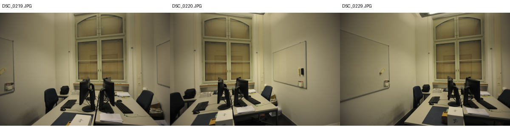

# I14 — ETH3D office RGB 사전 선택

공식 undistorted RGB에서 최소 pair 공유 RGB SfM track 수 최대 triple을 고정했다. pair 지원=[367, 366, 410]. 레이저 depth는 캐시만 했고 내용·오차를 선택에 사용하지 않았다.

Stage: `results/global_planar_pointmap/eth3d-office-I14-20261114-001/stages/I14`. GT_NOT_EVALUATED.
