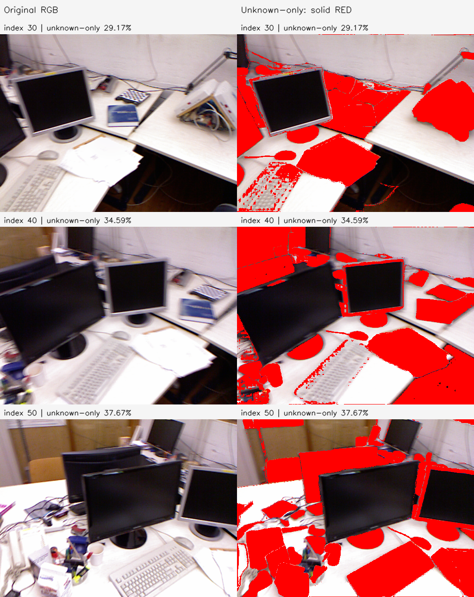
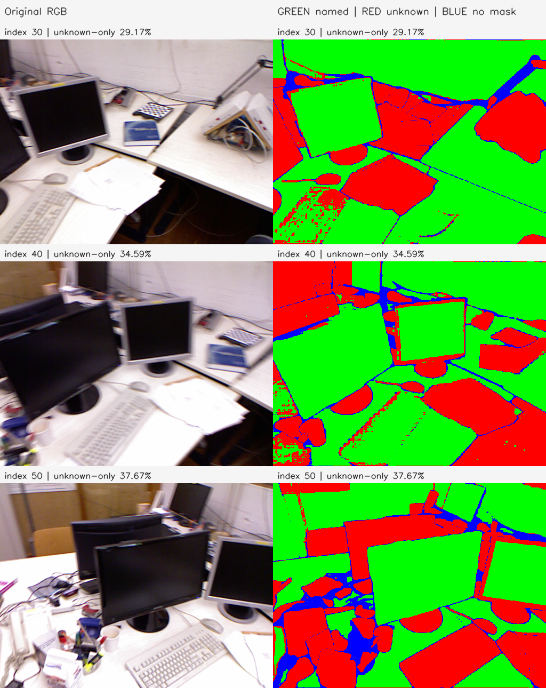
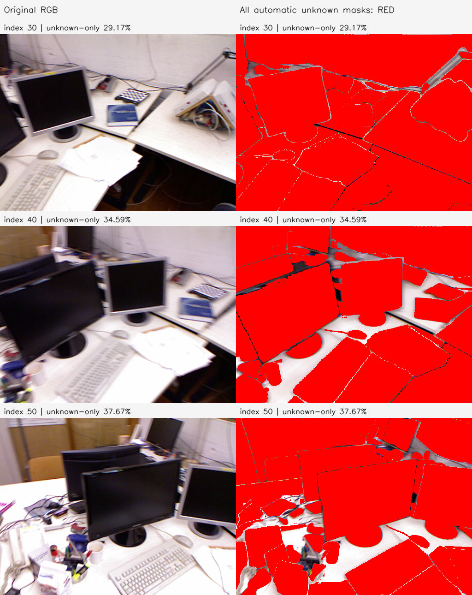

# I1u unknown 영역 시각화

기존 I1 마스크를 재사용했다. 재추론·의미 재분류·평면 보정은 수행하지 않았다. 512×384 처리 격자에서 원색으로 표시했으며 원본 RGB를 나란히 배치했다.

- 빨강: official automatic NMS 이후 unknown 마스크에 속하지만 이름 있는 GroundedSAM 마스크에는 속하지 않는 픽셀.
- 초록: 이름 있는 GroundedSAM 마스크의 합집합. `wall ceiling` 같은 혼합 태그와 다른 이름도 포함하며 정확한 대상 분류를 보장하지 않는다.
- 파랑: 두 경로 어디에도 포함되지 않는 미포함 픽셀.

| 원본 index | 이름 있는 영역 | unknown-only | 미포함 | automatic unknown 전체 |
| --- | --- | --- | --- | --- |
| 30 | 65.92% | 29.17% | 4.91% | 94.92% |
| 40 | 60.49% | 34.59% | 4.92% | 84.38% |
| 50 | 53.91% | 37.67% | 8.42% | 83.39% |

**unknown-only는 미지 물체의 정답 분류가 아니다.** 책·컵이 넓은 table 마스크에 포함되면 초록으로 표시될 수 있다. 반대로 automatic unknown 마스크는 이미 이름이 있는 벽·화면·책상과도 겹친다. 따라서 모든 unknown 마스크의 합집합을 무조건 보존 mask로 사용하면 의도한 보정 대상도 대부분 제외될 수 있다. exact `table/screen/wall` 합집합은 NPZ에 별도 저장했지만 보정 정책으로 적용하지 않았다.

Stage: `results/global_planar_pointmap/tum-freiburg1_desk-I1u-20261113-001/stages/I1u`. GT_NOT_EVALUATED.
