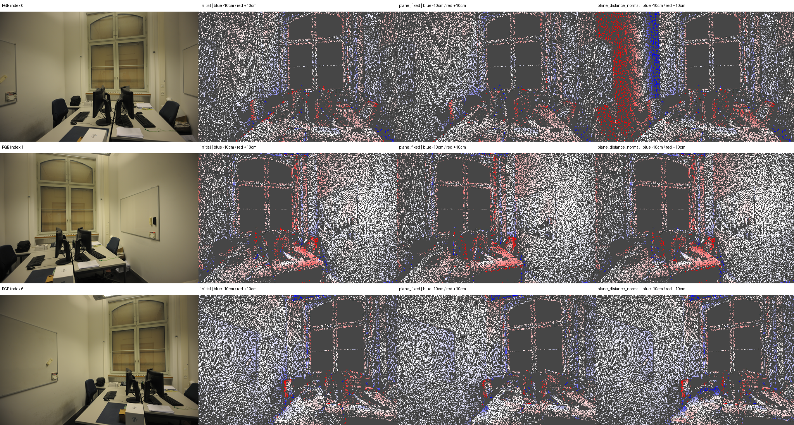

# I20 — eth3d-office 레이저 GT 평가

**NO_CONFIRMED_GAIN**. 원래 Kinect 장면이 아닌 ETH3D 실내 레이저 GT로 같은 평면 RGB 최적화를 평가했다.

최적화 평면 16개, 소속 62,359점, optimized GT validation 2,913개. 전체 GT validation 23,187개. 유효 GT 118,686/516,096.

보류 RGB 상대 감소 -8.6243%, RGB/가시성 통과=False, retained=`I10_retained`.

## 전체 camera-Z 깊이 정확도

| 출력 | MAE (cm) ↓ | RMSE (cm) ↓ | AbsRel ↓ | δ<1.25 ↑ |
|---|---:|---:|---:|---:|
| initial | 1.32859 | 3.47086 | 0.0065164 | 99.901% |
| plane_fixed | 1.60675 | 5.56290 | 0.0080843 | 99.625% |
| plane_distance | 1.99411 | 5.68038 | 0.0097368 | 99.633% |
| plane_distance_normal | 2.12353 | 5.22741 | 0.0102895 | 99.758% |
| retained | 1.60675 | 5.56290 | 0.0080843 | 99.625% |

## 영역별 plane_fixed → 거리 → 거리·법선

| 영역 | GT 픽셀 | fixed MAE(cm) | 거리 MAE(cm) | 거리·법선 MAE(cm) |
|---|---:|---:|---:|---:|
| all | 23,187 | 1.60675 | 1.99411 | 2.12353 |
| projected | 10,961 | 1.58502 | 2.40445 | 2.67821 |
| optimized | 2,913 | 3.02631 | 6.10966 | 7.13975 |
| unknown_untouched | 12,226 | 1.62623 | 1.62623 | 1.62623 |
| wall | 8,168 | 0.53996 | 1.63343 | 2.12347 |
| table | 2,090 | 1.34822 | 1.36828 | 1.80189 |
| screen | 703 | 14.43135 | 14.44326 | 11.72889 |

## 보정·정렬 검증과 제한

원본 왜곡된 RGB 격자의 4-byte camera-Z depth를 읽었다. processed pixel center→공식 PINHOLE 광선→공식 THIN_PRISM_FISHEYE→원본 depth 순서로 대응했다. 결측 infinity/비양수는 제외하고 보간·hole filling은 하지 않았다. COLMAP corner-origin과 공식 loader의 -0.5 pixel center shift를 일치시켰다. 각 이미지의 4096개 광선을 수정하지 않은 공식 standalone C++ 카메라 구현과 0.003 px 이하로 대조했고 원본/undistorted RGB 대응도 확인했다.

initial FIT 88,163개에서 단일 scale=2.3669780270을 구해 모든 비교군에 고정했다. validation과 분리했으며 비교군별 재정렬·GT 기반 보정은 없다. 대응 3D 보조 지표는 동일 baseline FIT-only Sim(3)로 별도 저장했다. 원래 왜곡 픽셀의 최근접 샘플과 processed 중심 광선의 미세 차이가 남는다.

SAM은 DSLR 전체 해상도 대신 동일 processed RGB에서 실행했다. 태그 허용은 wall/table/screen 그대로이며 floor·파이프·다른 primitive를 추가하지 않았다. most plane IDs는 단일 view 패치일 수 있고 RGB/geometry/의미 GT의 역할을 구분한다. 저텍스처·가림·반사·JPEG·카메라 추정 오차가 남는다. 공개 training split 샘플의 3장 소규모 평가이며 ETH3D 공식 benchmark 점수나 전체 SLAM 성능이 아니다.

[데이터 규약](https://eth3d.ethz.ch/documentation) · [공식 depth 생성 코드](https://github.com/ETH3D/dataset-pipeline/blob/master/src/exe/ground_truth_creator.cc)

Stage: `results/global_planar_pointmap/eth3d-office-I20-20261114-002/stages/I20`. GT_DEPTH_AND_REGISTERED_POINTMAP_EVALUATED.
