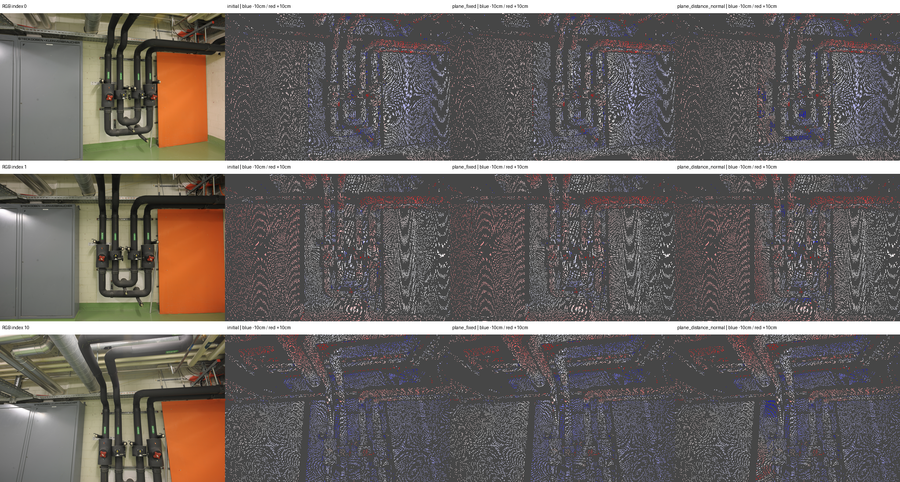

# I20 — eth3d-pipes 레이저 GT 평가

**NO_CONFIRMED_GAIN**. 원래 Kinect 장면이 아닌 ETH3D 실내 레이저 GT로 같은 평면 RGB 최적화를 평가했다.

최적화 평면 10개, 소속 31,628점, optimized GT validation 830개. 전체 GT validation 8,142개. 유효 GT 47,380/516,096.

보류 RGB 상대 감소 -95.5918%, RGB/가시성 통과=False, retained=`I10_retained`.

## 전체 camera-Z 깊이 정확도

| 출력 | MAE (cm) ↓ | RMSE (cm) ↓ | AbsRel ↓ | δ<1.25 ↑ |
|---|---:|---:|---:|---:|
| initial | 2.27311 | 3.60056 | 0.0109778 | 100.000% |
| plane_fixed | 2.20307 | 3.58901 | 0.0107216 | 100.000% |
| plane_distance | 2.35744 | 3.91102 | 0.0113421 | 100.000% |
| plane_distance_normal | 2.43253 | 4.02121 | 0.0116598 | 100.000% |
| retained | 2.20307 | 3.58901 | 0.0107216 | 100.000% |

## 영역별 plane_fixed → 거리 → 거리·법선

| 영역 | GT 픽셀 | fixed MAE(cm) | 거리 MAE(cm) | 거리·법선 MAE(cm) |
|---|---:|---:|---:|---:|
| all | 8,142 | 2.20307 | 2.35744 | 2.43253 |
| projected | 1,457 | 2.20541 | 3.06805 | 3.48771 |
| optimized | 830 | 1.89816 | 3.41247 | 4.14914 |
| unknown_untouched | 6,685 | 2.20256 | 2.20256 | 2.20256 |
| wall | 1,121 | 1.98418 | 3.10538 | 3.65082 |
| screen | 336 | 2.94351 | 2.94351 | 2.94351 |

## 보정·정렬 검증과 제한

원본 왜곡된 RGB 격자의 4-byte camera-Z depth를 읽었다. processed pixel center→공식 PINHOLE 광선→공식 THIN_PRISM_FISHEYE→원본 depth 순서로 대응했다. 결측 infinity/비양수는 제외하고 보간·hole filling은 하지 않았다. COLMAP corner-origin과 공식 loader의 -0.5 pixel center shift를 일치시켰다. 각 이미지의 4096개 광선을 수정하지 않은 공식 standalone C++ 카메라 구현과 0.003 px 이하로 대조했고 원본/undistorted RGB 대응도 확인했다.

initial FIT 36,514개에서 단일 scale=2.2868261650을 구해 모든 비교군에 고정했다. validation과 분리했으며 비교군별 재정렬·GT 기반 보정은 없다. 대응 3D 보조 지표는 동일 baseline FIT-only Sim(3)로 별도 저장했다. 원래 왜곡 픽셀의 최근접 샘플과 processed 중심 광선의 미세 차이가 남는다.

SAM은 DSLR 전체 해상도 대신 동일 processed RGB에서 실행했다. 태그 허용은 wall/table/screen 그대로이며 floor·파이프·다른 primitive를 추가하지 않았다. most plane IDs는 단일 view 패치일 수 있고 RGB/geometry/의미 GT의 역할을 구분한다. 저텍스처·가림·반사·JPEG·카메라 추정 오차가 남는다. 공개 training split 샘플의 3장 소규모 평가이며 ETH3D 공식 benchmark 점수나 전체 SLAM 성능이 아니다.

[데이터 규약](https://eth3d.ethz.ch/documentation) · [공식 depth 생성 코드](https://github.com/ETH3D/dataset-pipeline/blob/master/src/exe/ground_truth_creator.cc)

Stage: `results/global_planar_pointmap/eth3d-pipes-I20-20261114-001/stages/I20`. GT_DEPTH_AND_REGISTERED_POINTMAP_EVALUATED.
