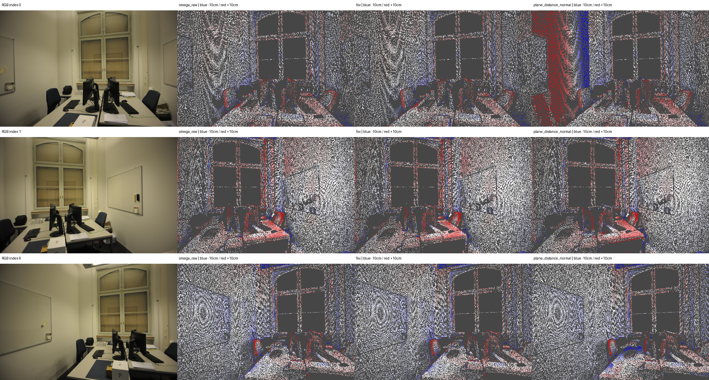

# I21 — eth3d-office: 무보정 Omega raw 기준군 추가

기존 모델 출력과 보정 결과를 수정하지 않고 평가 비교군을 추가했다. raw는 저장된 Omega depth·intrinsics·pose를 그대로 역투영한 점군이다. 이 캐시에는 별도 world_points head가 없으며 beta=1, FoV/평면/융합/정규화/점 제거를 적용하지 않았다.

raw 관측 수 516,096, XYZ hash `a553b7d8653859fa20634c3c6d97fec704f327cbfe54a33a3772ded60d1dd7ac`. I2의 원본 beta1 XYZ와 bitwise 동일하다. NPZ/PLY는 artifacts/omega_raw에 원래 모델 좌표로 저장했다.

## raw FIT 공통 정렬의 GT 평가

아래 scale·Sim(3)는 좌표 gauge를 맞추기 위한 평가용 변환이며 저장된 raw 점군을 보정한 것이 아니다. raw의 FIT 픽셀에서 한 번 구하고 모든 군에 같은 변환을 적용했다. 원래 validation/유효 GT 마스크는 고정했다. depth에는 scale만, 3D에는 별도 공통 Sim(3)를 사용하므로 두 지표를 혼합하지 않는다.

| 출력 | depth MAE(cm) | depth RMSE(cm) | 3D mean(cm) | 3D RMSE(cm) |
|---|---:|---:|---:|---:|
| omega_raw | 1.32859 | 3.47086 | 3.01330 | 4.51106 |
| fov | 1.32859 | 3.47086 | 3.75408 | 5.01214 |
| plane_fixed | 1.60675 | 5.56290 | 4.08157 | 6.86446 |
| plane_distance | 1.99411 | 5.68038 | 4.50291 | 7.14736 |
| plane_distance_normal | 2.12353 | 5.22741 | 4.58275 | 6.76435 |
| retained | 1.60675 | 5.56290 | 4.08157 | 6.86446 |

## 기존 FoV FIT 공통 정렬의 민감도 확인

이 정렬도 모든 군에 하나를 공통 적용하며 비교군별 재정렬이 아니다. 기존 평가의 비raw 지표가 재현됨을 확인했다. 기준 정렬이 어느 출력을 잘 맞추는지에 따른 차이를 숨기지 않도록 두 결과를 나눴다.

| 출력 | depth MAE(cm) | 3D mean(cm) | 3D RMSE(cm) |
|---|---:|---:|---:|
| omega_raw | 1.32859 | 3.44354 | 4.83394 |
| fov | 1.32859 | 3.21857 | 4.65420 |
| plane_fixed | 1.60675 | 3.52783 | 6.58053 |
| plane_distance | 1.99411 | 3.90877 | 6.77511 |
| plane_distance_normal | 2.12353 | 4.05877 | 6.48216 |
| retained | 1.60675 | 3.52783 | 6.58053 |

raw/FoV camera-Z 최대 차이는 1.33e-15 model units다. FoV는 원래 깊이를 유지하고 광선 방향을 바꾸므로 Z 오차가 같아도 3D 위치 오차는 달라질 수 있다.

원래 TUM/ETH3D 센서·왜곡 매핑·희소성·소규모 장면·FoV 지원·semantic 예측의 한계를 그대로 유지한다. GT를 본 뒤 모델·마스크·소속·RGB optimizer·retained를 바꾸지 않았다. 과거 initial이라는 이름은 이 문서에서 fov로 명확히 바꿨고 raw를 별도로 추가했다.

Stage: `results/global_planar_pointmap/eth3d-office-I21-20261114-001/stages/I21`. GT_DEPTH_AND_REGISTERED_POINTMAP_EVALUATED.
