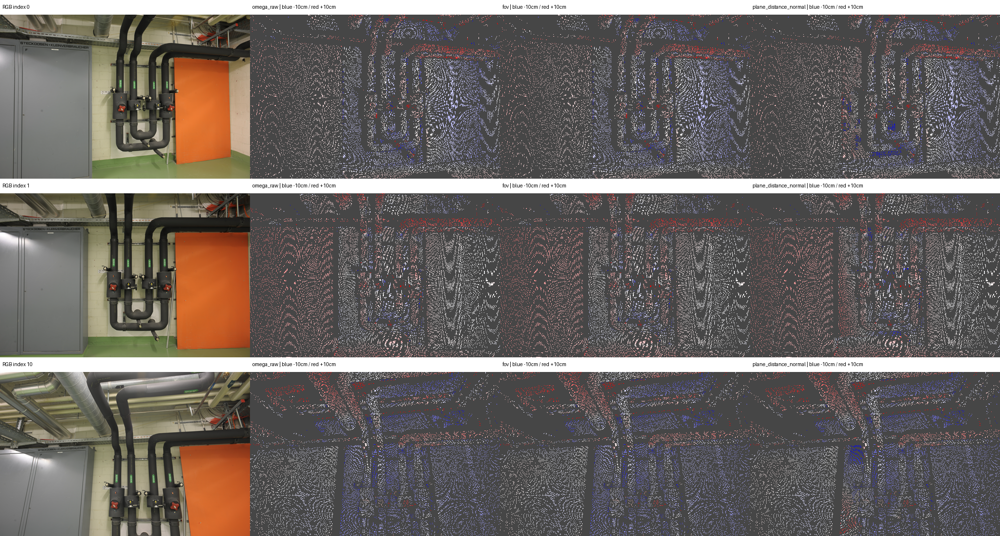

# I21 — eth3d-pipes: 무보정 Omega raw 기준군 추가

기존 모델 출력과 보정 결과를 수정하지 않고 평가 비교군을 추가했다. raw는 저장된 Omega depth·intrinsics·pose를 그대로 역투영한 점군이다. 이 캐시에는 별도 world_points head가 없으며 beta=1, FoV/평면/융합/정규화/점 제거를 적용하지 않았다.

raw 관측 수 516,096, XYZ hash `09ffdca2e06f0f91f75f92308231de6d345e0b8aba2ddd4b665f67a71f99237c`. I2의 원본 beta1 XYZ와 bitwise 동일하다. NPZ/PLY는 artifacts/omega_raw에 원래 모델 좌표로 저장했다.

## 후보 점군에 의존하지 않는 공통 정렬의 GT 평가

깊이는 raw FIT의 공통 scale, 3D는 카메라 pose만으로 구한 공통 Sim(3)를 사용한다. 회전은 카메라 자세로, scale/translation은 카메라 중심으로 계산하여 raw/FoV 어느 표면에도 맞추지 않았다. 합성 pose 복원 검증을 통과했다. 원래 validation/유효 GT 마스크를 고정했다. 평가용 변환은 저장된 raw 점군을 보정한 것이 아니다. 두 지표는 정렬이 다르므로 혼합하지 않는다.

| 출력 | depth MAE(cm) | depth RMSE(cm) | 3D mean(cm) | 3D RMSE(cm) |
|---|---:|---:|---:|---:|
| omega_raw | 2.27311 | 3.60056 | 10.67200 | 11.44188 |
| fov | 2.27311 | 3.60056 | 8.37577 | 9.17694 |
| plane_fixed | 2.20307 | 3.58901 | 8.31570 | 9.09384 |
| plane_distance | 2.35744 | 3.91102 | 8.37765 | 9.29003 |
| plane_distance_normal | 2.43253 | 4.02121 | 8.14170 | 9.10566 |
| retained | 2.20307 | 3.58901 | 8.31570 | 9.09384 |

## raw FIT 점군 정렬의 민감도 확인

첫 I21 실행의 raw 표면 FIT 공통 정렬도 보존했다. FoV FIT 정렬과 순위가 바뀌는 경우가 있어 어느 표면에도 맞추지 않는 camera-pose 정렬을 3D 주 표로 추가했다. 모델 출력·mask·optimizer는 변경하지 않았으며 기존 I21 실행은 보존했다.

| 출력 | 3D mean(cm) | 3D RMSE(cm) |
|---|---:|---:|
| omega_raw | 2.80949 | 4.19991 |
| fov | 4.05100 | 5.18685 |
| plane_fixed | 4.03438 | 5.22836 |
| plane_distance | 4.23210 | 5.48583 |
| plane_distance_normal | 4.35485 | 5.67075 |
| retained | 4.03438 | 5.22836 |

## 기존 FoV FIT 공통 정렬의 민감도 확인

이 정렬도 모든 군에 하나를 공통 적용하며 비교군별 재정렬이 아니다. 기존 평가의 비raw 지표가 재현됨을 확인했다. 기준 정렬이 어느 출력을 잘 맞추는지에 따른 차이를 숨기지 않도록 두 결과를 나눴다.

| 출력 | depth MAE(cm) | 3D mean(cm) | 3D RMSE(cm) |
|---|---:|---:|---:|
| omega_raw | 2.27311 | 4.27670 | 5.20215 |
| fov | 2.27311 | 2.80137 | 4.11104 |
| plane_fixed | 2.20307 | 2.77358 | 4.13611 |
| plane_distance | 2.35744 | 2.95525 | 4.46129 |
| plane_distance_normal | 2.43253 | 3.00899 | 4.58232 |
| retained | 2.20307 | 2.77358 | 4.13611 |

raw/FoV camera-Z 최대 차이는 6.66e-16 model units다. FoV는 원래 깊이를 유지하고 광선 방향을 바꾸므로 Z 오차가 같아도 3D 위치 오차는 달라질 수 있다.

원래 TUM/ETH3D 센서·왜곡 매핑·희소성·소규모 장면·FoV 지원·semantic 예측의 한계를 그대로 유지한다. GT를 본 뒤 모델·마스크·소속·RGB optimizer·retained를 바꾸지 않았다. 과거 initial이라는 이름은 이 문서에서 fov로 명확히 바꿨고 raw를 별도로 추가했다.

Stage: `results/global_planar_pointmap/eth3d-pipes-I21-20261114-002/stages/I21`. GT_DEPTH_AND_REGISTERED_POINTMAP_EVALUATED.
