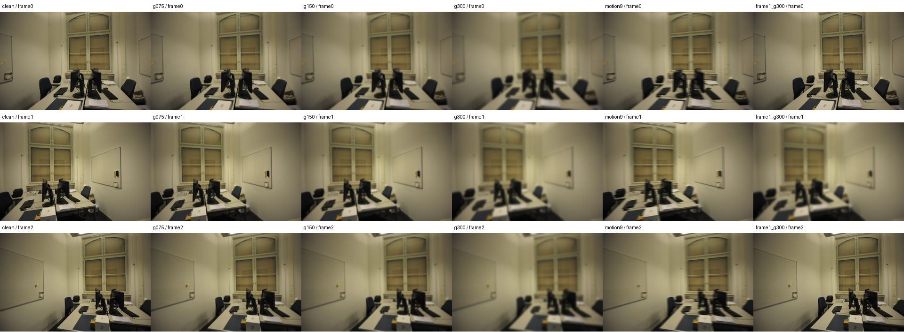

# I22 — eth3d-office 블러 개입 입력

같은 3장에 6개 고정 블러 조건을 적용했다. 원본/GT 좌표와 크기는 바꾸지 않았다. 장면 간 sharpness 수치는 texture·contrast에도 의존한다.

Stage: `results/global_planar_pointmap/eth3d-office-I22-20261114-001/stages/I22`. GT_NOT_EVALUATED.
