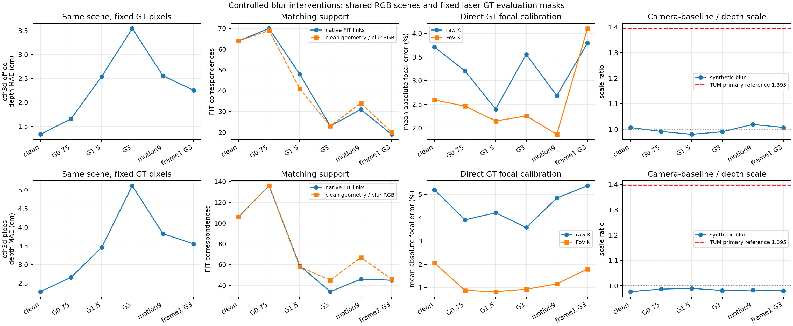
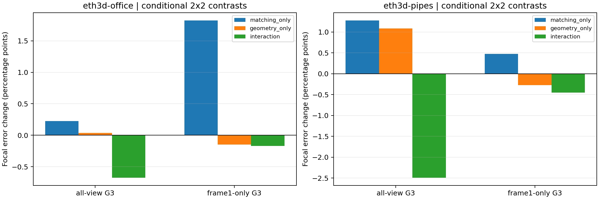
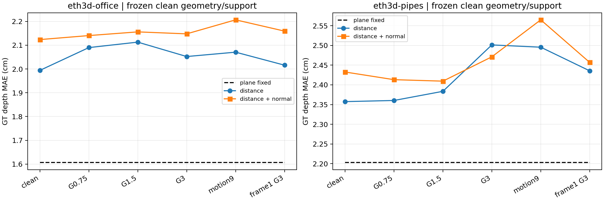

# I22–I25 — 블러의 원인 분리 실험 결과

**블러가 Omega 깊이 오차를 늘리는 인과 효과는 두 장면에서 관측됐다. 그러나 TUM 주 구간의 FoV/큰 3D 오차를 블러 하나로 설명할 근거는 확보하지 못했다.** 동일 이미지·GT에서 블러를 직접 조작했고, geometry와 대응점을 교차 고정해 영향을 분리했다.

[사전 계획](../../../vggt_omega_blur_causal_experiment_plan.md). ETH3D office/pipes 각 3장, clean/Gaussian σ0.75/1.5/3/motion9/frame1-only σ3의 6조건을 사용했다. GT·평가 픽셀은 고정했다. 12 joint Omega forward는 호스트 GPU에서 실행했고 clean depth/K/pose/confidence/images는 이전 캐시와 bitwise 동일했다. 원래 TUM 장면은 삭제하지 않았다.

## 확인된 결과

1. **Omega 깊이는 블러에 영향을 받았다.** Gaussian 강도를 높일 때 scale 정렬 후 MAE가 office 1.3286→1.6546→2.5399→3.5471 cm, pipes 2.2731→2.6564→3.4603→5.1150 cm로 증가했다. 순수 global scale 변화만으로 설명되는 차이는 평가용 scale 정렬로 제거된 상태다. motion9와 단일 view 블러도 두 장면 모두 clean보다 깊이 오차가 컸다.
2. **대응 지원은 줄었지만 FoV 추정이 항상 악화되지는 않았다.** 강한 균일 Gaussian에서 native FIT 대응은 office 64→23, pipes 106→34로 줄고 epipolar 위반 비율도 늘었다. 그러나 native FoV focal 오차는 office 2.5907→2.2522%, pipes 2.0600→0.9263%로 줄었다. 남은 대응·Omega 출력의 변화·필터링·비선형 상호작용 때문에 영상 품질과 FoV 오차는 단조 관계가 아니었다. 모든 조건의 system rank는 6이었지만 기존 pair 지원 기준은 충족하지 못해 LOW_SUPPORT 상태다.
3. **시점별 품질 불균형은 실제 FoV 악화를 만들었다.** office의 frame1만 σ3으로 흐리면 native FoV focal 오차가 2.5907→4.1054%로 증가하고, 그 조건의 raw K 3.7990%보다도 나빠졌다. clean geometry를 그대로 두고 블러 대응만 바꾸는 F01에서도 clean 대비 +1.8234 percentage points 악화됐다. 같은 clean UV에 블러 Omega 출력만 넣는 F10은 −0.1471 pp였다. 이 사례에서는 대응 변화의 조건부 영향이 직접 확인된다. pipes의 단일 view 블러에서는 같은 악화가 나오지 않아 모든 장면에 일반화하지 않는다.
4. **평면 RGB 목적함수 문제는 블러만의 문제가 아니다.** 고정 clean geometry/mask/support에서도 clean 조건부터 두 장면 모두 평면 최적화의 GT MAE가 더 컸다. office σ1.5에서는 보류 RGB 손실이 11.11% 개선됐지만 깊이 MAE는 fixed 1.6068→거리·법선 2.1559 cm로 악화됐다. 따라서 단순 FIT overfitting뿐 아니라 RGB 정합 손실이 원하는 기하 정확도를 충분히 규정하지 못하는 사례다. 어느 mask/반사/노출/카메라 오차가 주원인인지는 별도 분리가 필요하다.

한 view의 블러는 joint Omega의 다른 view 출력에도 영향을 줬다. frame1만 블러 처리했을 때 office의 frame0/1/2 깊이 MAE(cm)는 clean 1.621/1.190/1.226에서 1.697/3.015/1.955로, pipes는 2.523/1.477/2.872에서 2.559/2.528/6.011로 바뀌었다. 입력 frame0/2가 bitwise 동일함을 확인했다. 공통 GT scale의 영향도 포함된 수치이므로, GT를 쓰지 않고 각 depth head의 단일 비율을 제거한 공간적 출력 변화도 summary JSON에 기록했다. 단일 이미지의 국소 열화만으로 보기 어려운 multi-view 결합 효과다.

## TUM의 큰 3D 오차에 대한 해석 수정

실험 조건들의 camera-baseline/depth scale 비율은 약 **0.9767–1.0187**이었다. TUM 주 구간의 **1.3946**은 재현되지 않았다. 합성 Gaussian·수평 motion blur가 실제 TUM의 손떨림·노이즈·노출·JPEG·작은 baseline과의 상호작용을 모두 재현한 것은 아니므로, 이것이 실제 TUM 블러 가설을 반증한 것은 아니다.

추가 I25a는 **사후 보조 진단**이다. TUM 주 구간에서 XYZ·회전·카메라 centroid·GT mask를 고정하고 scale만 1.838에서 기존 depth FIT의 1.318로 바꾸자 raw 3D mean은 **58.3343→8.5040 cm**, FoV는 **59.8528→6.6259 cm**가 됐다. FoV의 전후 순위까지 바뀐다. 큰 58–60 cm 숫자와 FoV 악화 판정은 정렬 scale 규약에 매우 민감했다. 이 값을 순수한 표면 왜곡이나 이미지 블러의 영향으로 읽는 것은 부정확하다.

이 진단은 모델을 고친 결과가 아니고 새 우수 성능 점수로 선택하지 않는다. camera-baseline scale을 쓰면 pose/depth 추정의 일관성까지 평가하고, depth FIT scale을 쓰면 표면 depth 쪽 gauge를 맞추므로 평가 질문이 다르다. 왜 이 두 scale이 TUM에서 크게 달랐는지—짧은 baseline의 scale 추정 오차, pose/depth head의 상대 오차, 실제 영상 열화의 상호작용 등—는 아직 확정하지 못했다. [TUM 주 구간 scale 진단](../I25a/tum-freiburg1_desk-I25a-20261114-002/report.md) · [추가 구간](../I25a/tum-freiburg1_desk-extra-I25a-20261114-002/report.md).

## 블러 조건별 raw 깊이 및 대응 지원

| 장면 | 조건 | raw MAE(cm) | raw RMSE(cm) | native FIT 대응 | pose/depth scale 비율 |
|---|---|---:|---:|---:|---:|
| office | clean | 1.3286 | 3.4709 | 64 | 1.00651 |
| office | g075 | 1.6546 | 4.0345 | 70 | 0.99129 |
| office | g150 | 2.5399 | 5.1725 | 48 | 0.97998 |
| office | g300 | 3.5471 | 7.2801 | 23 | 0.99009 |
| office | motion9 | 2.5565 | 5.5258 | 31 | 1.01870 |
| office | frame1_g300 | 2.2523 | 4.2063 | 19 | 1.00692 |
| pipes | clean | 2.2731 | 3.6006 | 106 | 0.97672 |
| pipes | g075 | 2.6564 | 5.3006 | 136 | 0.98660 |
| pipes | g150 | 3.4603 | 7.3902 | 59 | 0.98946 |
| pipes | g300 | 5.1150 | 10.2467 | 34 | 0.98139 |
| pipes | motion9 | 3.8299 | 7.3797 | 46 | 0.98332 |
| pipes | frame1_g300 | 3.5541 | 5.8703 | 45 | 0.97984 |

깊이 scale은 각 Omega geometry의 raw FIT에서 추정해 그 geometry의 모든 FoV 군에 공통 적용했다. FoV는 Z를 바꾸지 않으므로 raw/FoV 깊이 지표 차이를 FoV 효과로 해석하지 않는다. camera-pose 및 raw-surface 공통 정렬의 3D 지표는 정확한 JSON에 별도로 남겼다.

## FoV 직접 보정 지표와 대응의 GT epipolar 잔차

공식 PINHOLE K를 실제 512×336 pixel-center 좌표계로 변환해 fx/fy 평균 상대 오차를 계산했다. 3D 정렬/scale 선택에 의존하지 않는다. 이 K/pose는 최적화에 사용하지 않았다. epipolar 잔차는 정확한 대응의 충분조건이 아니며, 같은 epipolar line의 잘못된 대응은 검출하지 못한다.

| 장면 | 조건 | raw focal 오차(%) | native FoV 오차(%) | FIT Sampson median(px) | FIT >1px |
|---|---|---:|---:|---:|---:|
| office | clean | 3.7125 | 2.5907 | 0.1037 | 3.12% |
| office | g075 | 3.2051 | 2.4600 | 0.1526 | 2.86% |
| office | g150 | 2.3971 | 2.1455 | 0.1893 | 4.17% |
| office | g300 | 3.5580 | 2.2522 | 0.1574 | 8.70% |
| office | motion9 | 2.6809 | 1.8637 | 0.1309 | 3.23% |
| office | frame1_g300 | 3.7990 | 4.1054 | 0.0660 | 0.00% |
| pipes | clean | 5.2038 | 2.0600 | 0.1134 | 0.94% |
| pipes | g075 | 3.9139 | 0.8744 | 0.0995 | 0.00% |
| pipes | g150 | 4.2152 | 0.8255 | 0.3299 | 3.39% |
| pipes | g300 | 3.5836 | 0.9263 | 0.3143 | 5.88% |
| pipes | motion9 | 4.8496 | 1.1578 | 0.2925 | 19.57% |
| pipes | frame1_g300 | 5.3775 | 1.7987 | 0.3345 | 13.33% |

## 2×2 조건부 영향

F00=clean geometry/clean UV, F01=clean geometry/blur UV, F10=blur geometry/clean UV, F11=blur geometry/blur UV. 단위는 focal MAE의 percentage points다. 양수는 악화다. F01/F11의 UV는 같고 F00/F10의 UV도 같다. F10/F11은 양수·유한 depth만 새 geometry에서 resample하며 원래 confidence/depth gate 결과는 기록하되 진단군의 UV를 삭제하지 않았다. native 군은 그 gate까지 새로 적용한다.

| 장면 | 조건 | 대응만 F01−F00 | geometry만 F10−F00 | interaction | total F11−F00 |
|---|---|---:|---:|---:|---:|
| office | clean | +0.0000 | +0.0000 | +0.0000 | +0.0000 |
| office | g075 | +0.0670 | -0.5371 | +0.3080 | -0.1621 |
| office | g150 | +0.1851 | -1.0281 | +0.4329 | -0.4101 |
| office | g300 | +0.2258 | +0.0354 | -0.6720 | -0.4108 |
| office | motion9 | -0.0478 | -0.7304 | +0.1965 | -0.5816 |
| office | frame1_g300 | +1.8234 | -0.1465 | -0.1677 | +1.5091 |
| pipes | clean | +0.0000 | +0.0000 | +0.0000 | +0.0000 |
| pipes | g075 | +0.2539 | -1.1097 | -0.2566 | -1.1124 |
| pipes | g150 | -0.0185 | +0.1228 | -0.7000 | -0.5956 |
| pipes | g300 | +1.2770 | +1.0835 | -2.4891 | -0.1285 |
| pipes | motion9 | +0.5940 | +0.9764 | +1.2851 | +2.8556 |
| pipes | frame1_g300 | +0.4754 | -0.2718 | -0.4548 | -0.2512 |

interaction은 F11−F10−F01+F00이다. 큰 상호작용과 비선형 solver/필터 효과가 있으므로 이를 고유한 원인 기여율로 환산하지 않는다. 가벼운 블러에서 대응 수나 focal 추정이 좋아진 경우도 그대로 보존했다.

## 평면 RGB 단계만 블러 처리한 결과

clean geometry/K/pose·고정 plane 소속·기존 I12 active plane과 photo support·clean SIFT·prior를 모두 고정했다. FIT/validation의 금지 색을 먼저 따로 대체한 다음 blur하여 convolution이 보류 RGB를 FIT로 섞지 않게 했다. 입력 전체를 흐리는 Omega/SIFT 개입과 구분한다. GT는 clean 정렬로 모든 plane 군에 공통 적용했다.

| 장면 | 조건 | fixed MAE(cm) | 거리 MAE(cm) | 거리·법선 MAE(cm) | 거리·법선 보류 RGB 개선 |
|---|---|---:|---:|---:|---:|
| office | clean | 1.6068 | 1.9941 | 2.1235 | -8.62% |
| office | g075 | 1.6068 | 2.0898 | 2.1404 | +5.34% |
| office | g150 | 1.6068 | 2.1128 | 2.1559 | +11.11% |
| office | g300 | 1.6068 | 2.0522 | 2.1476 | -4.68% |
| office | motion9 | 1.6068 | 2.0706 | 2.2065 | +3.10% |
| office | frame1_g300 | 1.6068 | 2.0159 | 2.1591 | +6.24% |
| pipes | clean | 2.2031 | 2.3574 | 2.4325 | -95.59% |
| pipes | g075 | 2.2031 | 2.3603 | 2.4131 | -91.16% |
| pipes | g150 | 2.2031 | 2.3836 | 2.4093 | -92.89% |
| pipes | g300 | 2.2031 | 2.5012 | 2.4711 | -69.60% |
| pipes | motion9 | 2.2031 | 2.4954 | 2.5648 | -74.80% |
| pipes | frame1_g300 | 2.2031 | 2.4355 | 2.4569 | -49.92% |

## 검증·범위·재현

- clean Omega 입력/출력은 기존 I15와 bitwise 일치했고, clean 평면 결과는 I12와 최대 XYZ 차이 1e-9 이하로 재현했다. 합성 exact correspondence의 GT Sampson 오차 0, FoV의 Z 불변, fixed UV/track/split, 보류 색 perturbation 후 split-safe blur 불변성을 검증했다.
- 기존 I0 FIT/excluded/validation pixel mask를 모든 개입에서 고정했다. 새 대응은 양쪽 bilinear footprint를 FIT 안으로 제한하고 whole track을 묶었다. office F00 beta는 기존 I2와 동일했고 pipes는 최대 0.003087 차이가 있다. 이는 strict footprint로 FIT 대응이 111→106개가 된 차이며 기존 I2를 덮어쓰지 않았다. 각 블러의 비교는 이 새 공통 clean 대조군을 기준으로 한다.
- 원래 2개 장면×6조건만 수행했다. synthetic blur 단독 효과의 근거이며 실제 TUM의 모든 저품질 요인을 고립한 실험은 아니다. 서로 다른 장면의 Laplacian/Sobel 수치는 texture/contrast에도 의존하므로 blur 정도의 정답으로 쓰지 않았다. SAM/의미/plane grouping 재추정에 미치는 영향은 이번 고정-plane 진단에 포함되지 않는다.
- 원래 모델·NumPy/SciPy/Torch 환경은 유지했다. scientific plot에만 별도 `.venvs/blur-report`와 matplotlib 3.10.8/NumPy 1.26.4를 사용했다. 모든 설치 버전과 plot source hash를 별도 기록했다. 모델 GT 수치 계산에는 그 환경을 사용하지 않았다.
- I25a 첫 실행은 보존했고 GT annotation을 명확히 한 `-002`를 canonical로 쓴다. 두 실행의 수치가 정확히 동일함을 검사했다. 평가 주석만 바뀌었으며 원래 I21 점수와 출력은 보존했다.

- eth3d-office: [원본/블러 입력](../I22/eth3d-office-I22-20261114-001/figures/blur_inputs.png) · [GPU clean 재현](../I23/eth3d-office-I23-20261114-001/report.md) · [최적화](../I24/eth3d-office-I24-20261114-001/report.md) · [GT 진단](eth3d-office-I25-20261114-001/report.md)
- eth3d-pipes: [원본/블러 입력](../I22/eth3d-pipes-I22-20261114-001/figures/blur_inputs.png) · [GPU clean 재현](../I23/eth3d-pipes-I23-20261114-001/report.md) · [최적화](../I24/eth3d-pipes-I24-20261114-001/report.md) · [GT 진단](eth3d-pipes-I25-20261114-001/report.md)

[전체 수치·조건·정렬·입력](summary.json) · [검증 및 stage hash](audit.json)

재현 순서: `blur_inputs.py prepare` → 호스트 `blur_inputs.py infer` → `blur_optimize.py` → `blur_evaluate.py` → `blur_alignment_diagnostic.py` → `blur_report.py`. Python은 `.venvs/p2a/bin/python`, CPU thread=2, GPU 단계는 I_HOST_GPU=1로 샌드박스 밖에서 실행한다. source/checkpoint·입력 PNG/NPZ·실패·matching UV·FoV beta·plane parameter·GT masks는 각 I22/I23/I24/I25/I25a stage에 보존했다. 모델·후보·threshold·blur 강도를 결과에 맞춰 다시 고르지 않았다.

## 그림

SVG/PDF도 figures 폴더에 보존했다.
