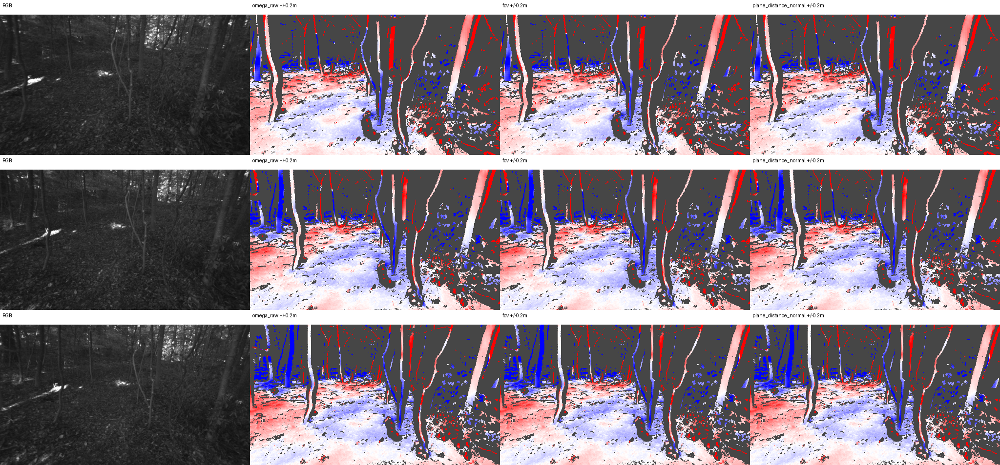

# I26 — eth3d-forest-rig 야외 LiDAR 평가

판정 **INSUFFICIENT_SUPPORT**, 최적화 평면 0, 최적화 영역 보류 GT 0개.

| arm | depth MAE (m) | RMSE (m) | focal error (%) |
|---|---:|---:|---:|
| omega_raw | 0.110948 | 0.377314 | 7.2131 |
| fov | 0.110948 | 0.377314 | 4.4395 |
| plane_fixed | 0.110948 | 0.377314 | 4.4395 |
| plane_distance | 0.110948 | 0.377314 | 4.4395 |
| plane_distance_normal | 0.110948 | 0.377314 | 4.4395 |
| retained | 0.110948 | 0.377314 | 4.4395 |

Raw FIT scale 하나와 고정 보류 mask를 모든 군에 공통 적용했다. raw/FoV는 Z가 같다. pose 및 raw FIT 표면 공통 3D 정렬은 JSON에 각각 기록했다. 동적 물체 제거 없이 기존 전체 화면 알고리즘을 전이했으며 forest는 흑백이다.

Stage: `results/global_planar_pointmap/eth3d-forest-rig-I26-20261114-001/stages/I26`. GT_DEPTH_AND_REGISTERED_POINTMAP_EVALUATED.
