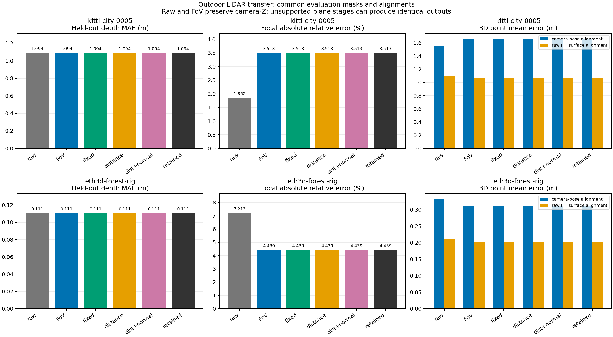

# I26 — 도시 길거리·숲의 Omega/FoV/평면 LiDAR 평가

두 야외 장면에서 원래의 3장을 사용해 기존 알고리즘을 전이했다. 무보정 Omega raw를 포함한 여섯 군의 출력을 생성하고 LiDAR GT로 비교했다. 지원 없는 단계는 아래에 구분했다. TUM·드론은 실행하지 않았다. [사전 규약](../../../vggt_omega_outdoor_lidar_experiment_plan.md).

- **kitti-city-0005: INSUFFICIENT_SUPPORT**. raw→FoV focal 평균 상대 오차 1.8617→3.5132%. named OR 투영 18,999개, RGB 최적화 평면 0개/0점, 그 영역의 보류 GT 0개. FoV 상태 `LOW_SUPPORT_PROPOSED_PRESERVED`. GT 유효 비율 12.19%.
- **eth3d-forest-rig: INSUFFICIENT_SUPPORT**. raw→FoV focal 평균 상대 오차 7.2131→4.4395%. named OR 투영 0개, RGB 최적화 평면 0개/0점, 그 영역의 보류 GT 0개. FoV 상태 `LOW_SUPPORT_PROPOSED_PRESERVED`. GT 유효 비율 44.77%.

**FoV 효과도 장면에 따라 갈렸다.** KITTI의 focal 오차는 커졌고 숲에서는 줄었다. 두 장면 모두 평면 RGB parameter 업데이트는 지원 부족으로 0개였으므로, 거리·법선 최적화의 개선/악화를 검증한 결과로 해석하지 않는다.

## 동일 보류 GT의 깊이·FoV

단위는 미터다. 각 장면 raw FIT에서 구한 depth scale 하나를 모든 군에 공통 적용했다. KITTI와 숲은 깊이 범위와 센서가 달라 장면 간 평균을 만들지 않는다.

| 장면 | 군 | depth MAE (m) | depth RMSE (m) | focal 평균 상대 오차 (%) |
|---|---|---:|---:|---:|
| kitti-city-0005 | omega_raw | 1.094496 | 2.466897 | 1.8617 |
| kitti-city-0005 | fov | 1.094496 | 2.466897 | 3.5132 |
| kitti-city-0005 | plane_fixed | 1.093736 | 2.466796 | 3.5132 |
| kitti-city-0005 | plane_distance | 1.093736 | 2.466796 | 3.5132 |
| kitti-city-0005 | plane_distance_normal | 1.093736 | 2.466796 | 3.5132 |
| kitti-city-0005 | retained | 1.093736 | 2.466796 | 3.5132 |
| eth3d-forest-rig | omega_raw | 0.110948 | 0.377314 | 7.2131 |
| eth3d-forest-rig | fov | 0.110948 | 0.377314 | 4.4395 |
| eth3d-forest-rig | plane_fixed | 0.110948 | 0.377314 | 4.4395 |
| eth3d-forest-rig | plane_distance | 0.110948 | 0.377314 | 4.4395 |
| eth3d-forest-rig | plane_distance_normal | 0.110948 | 0.377314 | 4.4395 |
| eth3d-forest-rig | retained | 0.110948 | 0.377314 | 4.4395 |

**FoV는 camera-Z를 바꾸지 않으므로 raw/FoV depth 지표가 같은 것이 정상이다.** FoV의 보정 여부는 focal/K와 3D 공통 정렬 지표로 판단한다. Focal은 GT K와 직접 비교하므로 전역 scale 선택에 의존하지 않는다.

평면 투영이 실제 적용된 영역만 보면 다음과 같다. KITTI는 243개의 보류 GT에서 국소 오차가 줄었지만, 전체 깊이 MAE 개선은 약 0.07%이며 1% 개선 기준에 미달한다. 이 국소 결과를 전체 장면의 확정 개선으로 확대하지 않는다.

| 장면 | 투영 영역 보류 GT 수 | raw MAE (m) | fixed MAE (m) |
|---|---:|---:|---:|
| kitti-city-0005 | 243 | 0.325065 | 0.295474 |
| eth3d-forest-rig | 0 | N/A | N/A |

## 공통 정렬에서의 3D 점 오차

각 정렬을 raw/FoV/평면 전체에 공통 적용했다. 주 지표는 camera pose 기반 정렬, 보조는 raw FIT 표면 기반 정렬이다. 별도 군별 정렬은 없다. KITTI의 OXTS pose와 숲의 짧은 camera baseline 때문에 두 규약의 차이를 반드시 함께 읽어야 한다.

| 장면 | 군 | pose 정렬 3D mean (m) | raw 표면 정렬 3D mean (m) |
|---|---|---:|---:|
| kitti-city-0005 | omega_raw | 1.560108 | 1.093616 |
| kitti-city-0005 | fov | 1.660692 | 1.065803 |
| kitti-city-0005 | plane_fixed | 1.659933 | 1.065226 |
| kitti-city-0005 | plane_distance | 1.659933 | 1.065226 |
| kitti-city-0005 | plane_distance_normal | 1.659933 | 1.065226 |
| kitti-city-0005 | retained | 1.659933 | 1.065226 |
| eth3d-forest-rig | omega_raw | 0.332101 | 0.210596 |
| eth3d-forest-rig | fov | 0.312573 | 0.202073 |
| eth3d-forest-rig | plane_fixed | 0.312573 | 0.202073 |
| eth3d-forest-rig | plane_distance | 0.312573 | 0.202073 |
| eth3d-forest-rig | plane_distance_normal | 0.312573 | 0.202073 |
| eth3d-forest-rig | retained | 0.312573 | 0.202073 |

## 범위·판정

평면은 기존 `wall/table/screen`만 허용했다. 이름이 없거나 다른 class인 관측, unknown은 같은 표면의 다른 view에서 named 근거를 전파하지 못하면 보정하지 않는다. 나무·잎·도로를 새 평면으로 강제하지 않았다. named mask가 기하 GT인 것은 아니므로 SAM/의미 오분류 가능성은 남는다. 지원이 없어서 출력이 같은 경우는 최적화의 개선이나 실패 효과로 읽지 않는다.

성공은 기존 기준대로 거리·법선 군이 raw와 plane_fixed 모두에 대해 MAE 1% 이상 개선, RMSE 비증가, RGB/가시성 통과를 함께 만족할 때다. 최적화 영역 보류 GT 500개 미만은 지지 부족이다. 전체·투영·최적화·unknown 영역과 프레임별 지표는 summary JSON에 있다.

KITTI는 공식 loader의 중앙 crop(246,0,996,375)→512×256을 GT/K에 동일 적용했다. forest는 원본 camera 모델을 통해 왜곡 GT를 512×288의 각 픽셀에 직접 대응했다. 결측 GT를 보간하지 않았다. forest의 RGB 3채널은 서로 같으며 컬러 효과를 평가하지 못한다. KITTI의 차량·자전거·보행자는 자동으로 제거하지 않았으므로 전체 화면 전이 및 동적 장면 스트레스 시험이다. GT를 보고 ROI나 hyperparameter를 다시 고르지 않았다.

이번 실행은 원본 입력 비교이며 합성 블러 6조건 반복이나 전체 시퀀스 SLAM 검증은 포함하지 않는다.

RGB 지원 평면이 0개면 보류 RGB 개선율은 정의되지 않아 null로 보고한다. 기존 I12의 빈 집계가 수식상 1.0을 반환하더라도 100% 개선으로 해석하지 않는다.

KITTI I26 첫 실행도 보존했다. `-002`는 지원 0개의 RGB 개선율을 null로 명시한 canonical 평가이며, 두 실행의 모든 GT 지표와 공통 정렬이 정확히 같음을 검사했다.

숲은 모든 view에서 허용 named anchor가 0개여서 [A1 동일 출력 조기 종료](../../../vggt_omega_outdoor_lidar_amendment_A1.md)를 적용했다. 진행 중이던 I3의 부분 결과는 superseded로 보존했고, 전체 I3/I4 기하 탐색은 완료하지 않았다. 빈 plane registry의 I10/I12 출력이 FoV와 bitwise 같음을 검사했다. GT 오차를 보고 조기 종료한 것이 아니다.

- kitti-city-0005: [GT 오차 그림](kitti-city-0005-I26-20261114-002/figures/GT_comparison.png) · [평면 소속/제외 영역](../I10/kitti-city-0005-I10-20261114-001/figures/named_OR_mask.png) · [상세 결과](kitti-city-0005-I26-20261114-002/report.md)
- eth3d-forest-rig: [GT 오차 그림](eth3d-forest-rig-I26-20261114-001/figures/GT_comparison.png) · [평면 소속/제외 영역](../I10/eth3d-forest-rig-I10-20261114-001/figures/named_OR_mask.png) · [상세 결과](eth3d-forest-rig-I26-20261114-001/report.md)

[정확한 지표·공통 정렬·입력](summary.json) · [FoV/평면 지원·의미 검출·RGB 손실](support.json) · [원본 보존·파일 해시 검증](audit.json)

## 비교 그림

