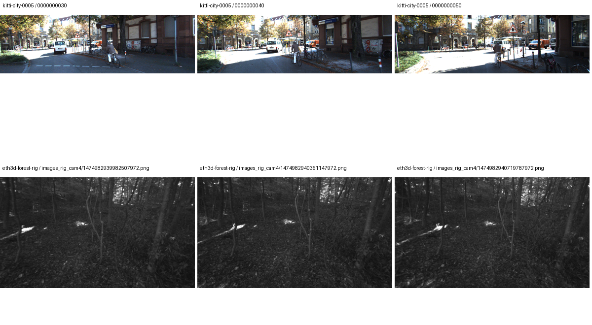

# O0 — 도시 길거리·숲 LiDAR 샘플 추가

후속 상태: [I26의 raw/FoV/평면 비교와 LiDAR GT 평가](../global_planar_pointmap/I26/index.md)를 완료했다. 아래는 원래 O0 데이터 확보 단계의 기록이다.

2026-11-14. 지상 촬영 야외 두 장면의 영상·캘리브레이션·공식 깊이 GT를 다운로드하고 각 3장을 동결했다. **데이터 확보와 입력 검증을 완료했으며 Omega 추론·보정·GT 정확도 실험은 아직 실행하지 않았다.**

| 구분 | 추가 샘플 | 영상 | GT | 선택된 영상에서 유효 GT |
| --- | --- | --- | --- | --- |
| 도시 길거리 | KITTI `2011_09_26_drive_0005_sync`, frame 30/40/50, left color `image_02` | 1242×375, 컬러 | 공식 annotated LiDAR depth | 11.2865 / 12.0998 / 8.5922% |
| 자연물 중심 | ETH3D `forest`, `images_rig_cam4`, timestamp 1474982939982507972 / 1474982940351147972 / 1474982940719787972 | 908×517, 흑백을 동일 RGB 3채널로 저장 | FARO 스캔에서 렌더한 camera-Z | 41.3713 / 46.3034 / 46.5993% |

KITTI는 차량에 장착한 컬러 카메라와 Velodyne HDL-64E를 사용한 지상 촬영 데이터다. 여기서는 단일 프레임 raw scan을 GT로 대체하지 않고, 공식 depth benchmark의 annotated depth를 받아 사용한다. 원본 Velodyne scan, OXTS, 센서 간 calibration도 별도로 확보했다. [공식 센서·데이터 논문](https://www.cvlibs.net/publications/Geiger2013IJRR.pdf) · [공식 깊이 데이터 설명](https://www.cvlibs.net/datasets/kitti/eval_depth_all.php).

ETH3D forest는 나무·가지·수풀·낙엽 중심의 지상 rig 장면이다. 공개 training 데이터는 영상과 레이저 GT를 함께 제공한다. GT는 FARO Focus X330 스캔에서 렌더한 깊이이며 원본 왜곡 영상 좌표에 대응한다. 원본 float32 깊이는 미터 단위이고 결측은 infinity다. [공식 다운로드](https://eth3d.ethz.ch/datasets) · [공식 GT·카메라 형식](https://eth3d.ethz.ch/documentation).

## 입력 검증

- KITTI는 RGB와 GT의 프레임명·해상도를 확인했다. uint16 깊이를 256으로 나누어 미터로 변환하고 0은 결측 mask로 분리했다. 선택된 프레임의 GT 범위는 약 3.50–79.88 m다. ZIP 파일별 CRC와 입력 SHA-256을 확인했다.
- forest는 네 카메라의 동일 timestamp를 카메라 디렉터리까지 포함해 구분했다. 같은 카메라에서 시간 간격 5/10/20의 triple 후보 중 최소 pair 공유 RGB SfM track 수, 전체 공유 수 순으로 선택했다. 선택 pair의 공유 track은 3012/2799/3065개다. 레이저 GT를 열기 전에 선택을 저장했다.
- forest 원본 깊이를 undistorted 영상에 매핑했다. 공식 C++ 카메라 구현과 2048개 좌표를 비교한 최대 차이는 0.0000632 px다. 원본 영상에서 매핑한 밝기와 제공 undistorted 영상의 평균 절대 차이는 0–1 범위에서 약 0.000211–0.000255다. GT 결측을 보간하지 않았다. 선택된 GT 범위는 약 1.17–9.87 m다.
- 입력·GT·전처리 배열 24개 record의 해시, 배열 크기, 양수·유한 유효 깊이, mask 개수를 검사했다. forest 영상의 세 채널이 완전히 같음을 확인했다.

## 사용 범위

KITTI GT는 전체 화면을 채우지 않는다. 하늘과 반환값 없는 영역은 평가에서 제외해야 하며 차량·자전거·보행자처럼 움직이는 물체는 정적 multiview 최적화에서 구분해야 한다. forest는 흑백이라 컬러 정보의 효과를 검증할 수 없고, 가는 가지·움직이는 잎·깊이 경계에 주의해야 한다. 두 데이터는 촬영 방식·해상도·깊이 범위·GT 지원율이 달라 오차를 단일 숫자로 합쳐 비교하지 않는다.

후속 실험 전 KITTI 좌표·resize·pose 처리와 forest 흑백 입력, 동적 물체·결측·경계 처리, FIT/보류 split을 동결한다. 기존 DSLR 전용 pipeline이나 블러 실험의 기본 데이터 목록에는 아직 연결하지 않았다. TUM·드론 데이터는 이번 추가 작업에서 사용하지 않았다.

## 저장·재현

추가 다운로드와 추출물은 약 2.2 GiB이며 `data/outdoor_lidar_samples/`에 저장했다. KITTI의 약 14.24 GB 깊이 ZIP 전체를 받지 않고 HTTP range로 선택 파일만 확보했다. HTTP 응답 header와 범위 cache도 보존했다. ETH3D archive 세 개는 원본으로 보존했다.

완료 run은 `O0-20261114-002`다. 첫 실행 `-001`은 rig의 같은 basename을 서로 다른 카메라로 구분하지 못해 pose 일치 검사에서 중단됐으며 실패 manifest를 보존했다. 카메라 디렉터리를 포함한 식별자로 수정한 뒤 새 run에서 검증했다.

[샘플·입력 해시·카메라·깊이 범위](O0-20261114-002/samples.json) · [완료 manifest](O0-20261114-002/manifest.json) · [공식 구현·입력 검증](O0-20261114-002/additional_checks.json) · [실행 명령](../../../experiments/outdoor_lidar_samples/README.md) · [샘플 목록](../../../experiments/outdoor_lidar_samples/catalog.json).
