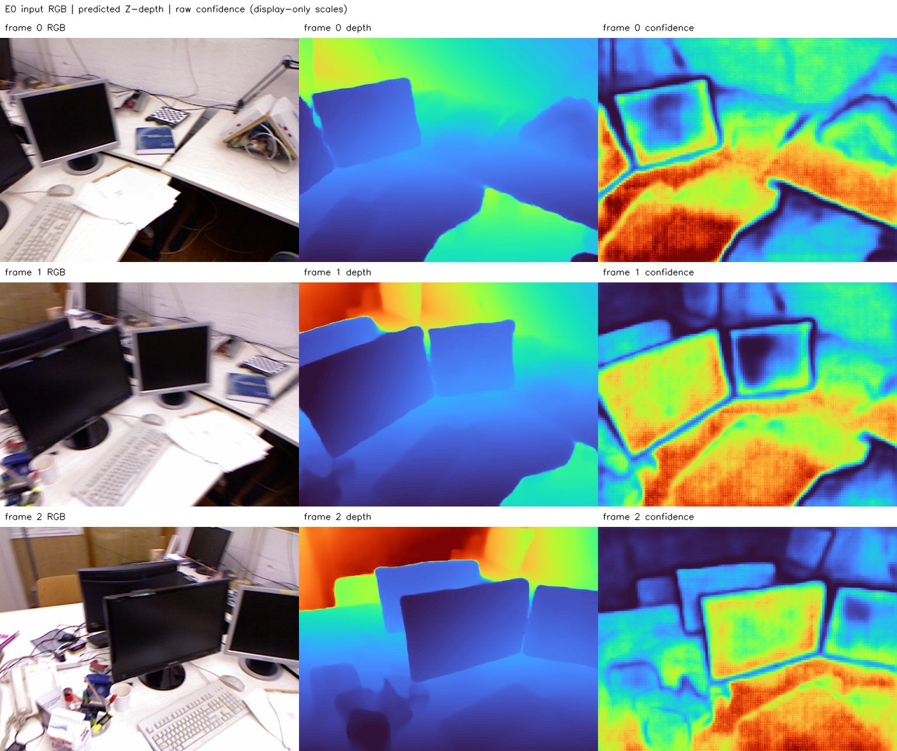
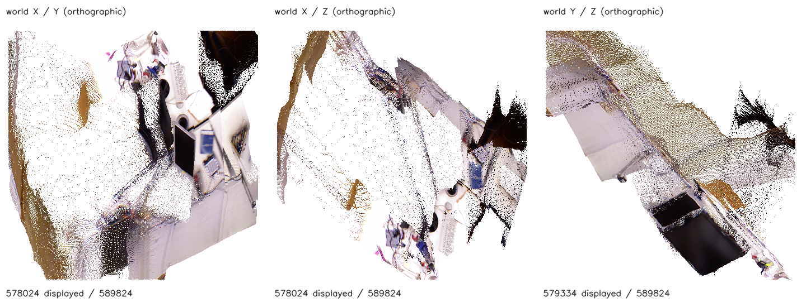

# E0 결과 보고서 — tum-freiburg1_desk-E0-20261112-001

**판정: 보정 전 원본 점군 기준선 확정 완료.** P0/P1에서 검증한 예측·관측을 재사용해 프레임별 점군과 전체 관측을 동결하고, 저장·재로딩·부모 해시 대조를 통과했다. 기하 개선 또는 RGB 재렌더링 품질을 평가한 결과는 아니다.

## 목적·출처·실행 조건

실행일은 2026-11-12, 시간대는 Asia/Seoul이다. 호스트 CPU에서 Python 3.11.18 / NumPy 1.26.4 / OpenCV 4.11.0 환경을 사용했다. GPU 및 모델 추론은 재실행하지 않았다. 원본 좌표·카메라·Depth·Confidence·색상을 바꾸거나 최적화하지 않았다.

- P0: `smoke-P0-20261112-003`, max_size_n03, 512×384 RGB 3장.
- P1: `tum-freiburg1_desk-P1-20261112-001`, 관측 출처를 보존한 원본 역투영.
- 원본 예측 NPZ SHA-256: `d820f18f5bb683efb89d331f82262b68e5cec55a7bbadf379d8091721a26afa4`.
- 공식 모델 코드 Commit: `48b23c8ce72c9a8fcf987f0d7f43d8e4870759f6`. 모델 revision·가중치 해시는 부모 P0 기록을 따른다.
- 부모 완료 Manifest와 그 안의 모든 산출물 해시를 검증했다. 부모 실행은 수정하지 않았다. P1의 합성·자기 재투영 수치는 E0에서 새로 측정한 값으로 옮기지 않았다.
- 실행 명령: `.venvs/p0-py311/bin/python experiments/pointmap_refinement/E0/scripts/run.py --run-id tum-freiburg1_desk-E0-20261112-001`. 종료 코드 0.
- 처리 시간은 CPU 패키징·저장·프리뷰 생성 2.008초이며 모델 추론이나 최적화 시간은 아니다.

## 고정된 원본 기준선

총 **589,824점**, 각 프레임 **196,608점**이다. OpenCV camera-from-world, Z-depth, P1에서 검증한 정수 픽셀 규약을 유지한다. 좌표·깊이는 임의 모델 스케일이며 미터로 해석하지 않는다. Confidence 원시값은 확률로 해석하지 않는다.

| Frame | 점 수 | Depth min | Depth median | Depth max | Confidence median |
| --- | ---: | ---: | ---: | ---: | ---: |
| 0 | 196,608 | 0.596061 | 0.992025 | 1.879014 | 6.871902 |
| 1 | 196,608 | 0.596814 | 0.917517 | 2.598571 | 7.100628 |
| 2 | 196,608 | 0.613031 | 0.879076 | 2.818854 | 6.079472 |

모든 XYZ는 유한값이다. Confidence 필터·점 샘플링·융합·중복 제거 없이 P1의 유효 양수 깊이 관측을 전부 보존했다. 전체 관측 파일은 편의상 한 파일에 모은 포장 형식이며 공유표면 융합이 아니다. E1의 단순 연결 평가를 완료한 것으로 간주하지 않는다.

## 진단 시각화

각 행은 동일 프레임, 열은 모델에 입력된 RGB·예측 Z-depth·원시 Confidence다. 오른쪽 두 열은 전체 3장의 공통 TURBO 색상 범위를 사용하며 낮은 값은 파랑, 높은 값은 빨강이다. 표시 범위(0.5~99.5 분위수)는 다음과 같다.

- depth: 0.628826~2.656593
- confidence: 1.033712~16.502169

표시 범위 밖 값은 그림에서만 포화시키며 원본 NPZ·PLY는 그대로다. 이는 GT 깊이와의 비교 영상이 아니다.

월드 XY·XZ·YZ의 정사영 산점도다. 표시 영역은 각 축의 전체 점 0.5~99.5 분위수이며 실제 범위와 표시 점 수는 `metrics.json`에 있다. 시각적으로 책상·모니터에 해당하는 색상 구조가 나타나지만 이것만으로 실제 기하 정확도를 판단하지 않는다. 빈 영역·겹침은 관측 범위, 표시 범위 및 픽셀 중복의 영향을 받는다. 마지막 쓰기 순서로 점이 가려지며 물리적인 카메라 가시성 렌더러가 아니다.

**원본 RGB 대 카메라 재렌더링 영상 비교는 미실행**이다. PSNR·SSIM·GT RMSE, 기하 개선, Fusion 효과는 보고하지 않는다. P2의 렌더러 검증 이후 동일 평가 영역을 정해 비교해야 한다.

## 파일 계약과 검증

로컬 산출물 루트는 `results/pointmap_refinement/tum-freiburg1_desk-E0-20261112-001/stages/E0/`다.

- `artifacts/baseline/vggt_omega_raw.npz`: P0 예측 전체를 바이트 단위로 복사. 원본과 SHA-256 일치.
- `artifacts/baseline/observations.npz`: P1 관측 전체를 바이트 단위로 복사. 원본과 SHA-256 일치.
- `artifacts/baseline/frame_00.npz`~`frame_02.npz`: 관측 좌표·출처·RGB·깊이·신뢰도 및 해당 카메라/이미지 격자.
- `artifacts/geometry/frame_00.ply`~`frame_02.ply`, `all_observations.ply`: double XYZ, uint8 RGB, frame_id/u/v를 보존한 binary little-endian PLY.
- `artifacts/baseline/frames.json`: 원본 파일·픽셀·타임스탬프·해시 연결. 원본 RGB 샘플 좌표도 관측 NPZ에 남아 있다.
- `evaluation/baseline.json`: 후속 실험이 읽을 기준선 경로·해시·부모 Manifest·좌표계 계약.
- `evaluation/metrics.json`, `logs/`, `environment.json`, `config_resolved.json`, `artifacts/source/`, `manifest.json`: 결과·검증·실행 근거.

프레임별 NPZ와 4개 PLY를 다시 읽어 저장 전 모든 필드와 정확히 일치함을 확인했다. 원본 frame/pixel 위치로 조회한 Depth·RGB가 관측 레코드와 일치했고, 전체 점 수와 유한 XYZ를 검사했다. 후속 실험은 이 기준선을 읽기 전용으로 사용하며 변경 결과는 새 실험코드·Run ID 아래 저장한다.

## 완료 범위와 다음 단계

P1은 좌표·데이터 계약 검증, E0는 원본 기준선 동결과 정성 기록이다. 이번 E0에서는 새로운 학습·기하 개선을 주장하지 않는다. 다음은 **P2 Renderer·Gradient 검증**으로, 합성 장면에서 렌더링과 미분을 먼저 확인한 뒤 실제 원본 점군의 RGB 재현을 다룬다.
