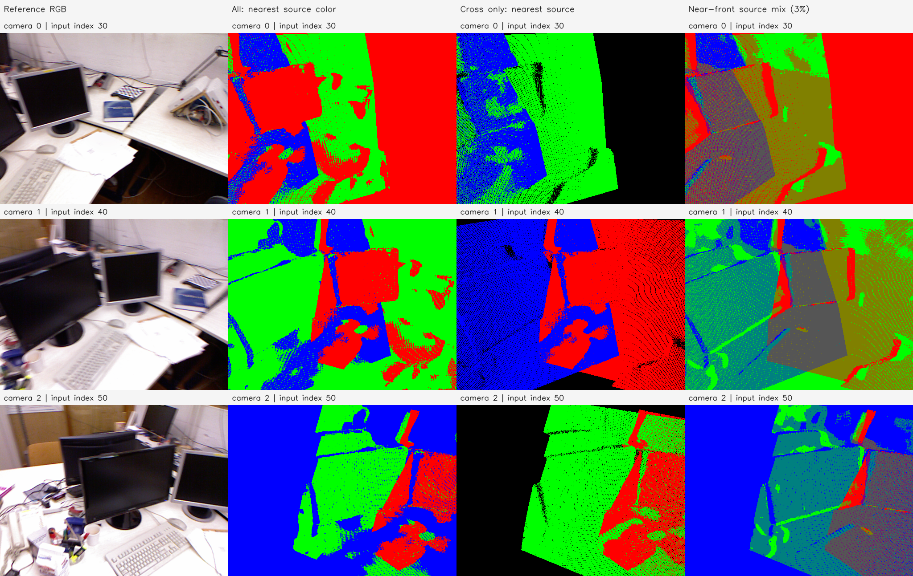
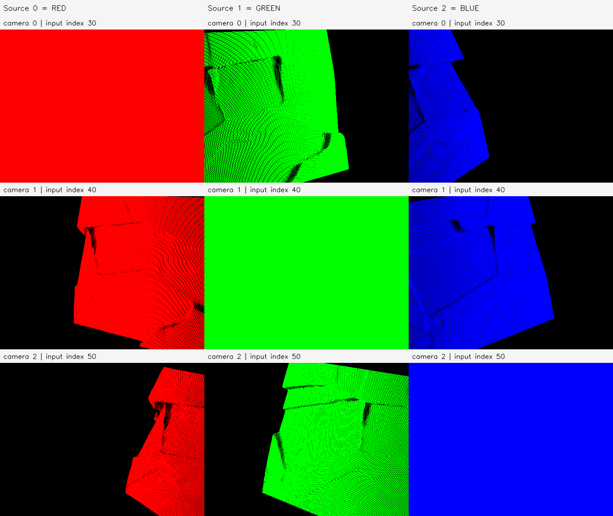

# E0a 결과 보고서 — tum-freiburg1_desk-E0a-20261112-001

**판정: 프레임 출처 색상 PLY와 예측 카메라별 2D 투영 진단 완료.** E0 원본 점 589,824개의 좌표·출처는 그대로 유지했다. 색상만 Frame 0=빨강, Frame 1=초록, Frame 2=파랑으로 바꿨다. 융합·위치 최적화·GT 정확도 개선 실험은 아니다.

## 목적과 비교 기준

사용자가 E0와 E2 PLY를 비교해 초기 기준선부터 벽이 여러 층으로 보인다고 관찰했다. 이번 실험은 E0 원본 점군을 각 예측 카메라에서 봤을 때 어느 프레임의 점이 앞면을 차지하는지 확인한다. E2/E3의 좌표·그룹·색은 사용하지 않았다. 벽 ROI를 지정하거나 같은 물리점의 대응을 확정하지 않았으므로 벽 두께와 오류 원인을 정량 확정하지 않는다.

부모는 `tum-freiburg1_desk-E0-20261112-001/stages/E0`이며 원본 예측·관측·프레임 목록·PLY·부모 Manifest를 SHA-256으로 연결했다. 예측 파일 해시는 `d820f18f5bb683efb89d331f82262b68e5cec55a7bbadf379d8091721a26afa4`, 관측 파일은 `61ba80c7635bf00223b5011e6e0b59e27734ba386d1d2762064bd153084543bc`다. 원본 세 영상이 같은 추론 호출에 들어간 결과를 재사용하며 새 모델 추론은 없다.

| 출처/카메라 ID | 원본 입력 인덱스 | RGB timestamp | 지정 RGB |
| --- | ---: | --- | --- |
| Frame 0 | 30 | 1305031453.791716 | 빨강 `(255, 0, 0)` |
| Frame 1 | 40 | 1305031454.127701 | 초록 `(0, 255, 0)` |
| Frame 2 | 50 | 1305031454.459913 | 파랑 `(0, 0, 255)` |

## 투영 방법과 그림 읽기

원본 512×384 격자와 예측 Intrinsics/Extrinsics를 사용했다. OpenCV camera-from-world로 변환해 양수 camera-Z의 점만 최근접 픽셀 하나에 투영했다. 같은 픽셀에서는 최소 Z의 점 하나를 남긴다. 정확한 동률은 낮은 source frame_id, 같은 프레임 안에서는 낮은 원본 관측 인덱스가 우선한다. 이번 실제 영상에서 출처 간 정확한 앞면 깊이 동률은 모두 0픽셀이었다.

검정은 투영점이 없는 픽셀이다. 점 확대·Gaussian·Alpha 혼합·Confidence 필터·GT 카메라 교체를 적용하지 않았다. 다른 시점 점군의 검은 줄무늬와 구멍은 한 픽셀 footprint의 표본화 및 가림도 포함하며, 곧바로 실제 장면의 구멍이나 깊이 오류를 뜻하지 않는다. 자기 시점은 원래 격자에 다시 투영되므로 단독 출처 영상 전체가 해당 출처 색으로 채워진다.



각 행은 Camera 0/1/2다. 열은 왼쪽부터 다음과 같다.

1. **Reference RGB:** 위치를 알아보기 위한 원본 영상. 진단 점의 색상에는 사용하지 않는다.
2. **All:** 세 프레임을 함께 투영한 불투명 앞면 출처 색상.
3. **Cross only:** 카메라 자신의 출처 점을 빼고 나머지 두 프레임만 투영한 앞면 색상. 학습하지 않은 독립 시점 실험은 아니다.
4. **Near-front source mix (3%):** 출처별 front Z 중 전체 최소 Z의 3% 이내에 있는 출처들의 색을 같은 가중치로 평균한다. 두 출처면 어두운 노랑·자홍·청록, 세 출처면 회색이다. 가려져 보이지 않는 근접 깊이 출처도 표시하는 보조 그림으로, 실제 앞면 색이나 공유점 ID가 아니다.



두 번째 패널의 행은 카메라, 열은 Frame 0 빨강/Frame 1 초록/Frame 2 파랑이다. 서로 다른 출처의 가림을 제거해 어떤 영역까지 각 출처의 점이 투영되는지 확인한다. 전체 앞면에서 한 색만 보인다고 해서 뒤쪽 출처의 점이 없다는 뜻은 아니다.

개별 카메라의 원본 해상도 영상은 다음 링크로 확인한다.

| 카메라 | 전체 앞면 | 자기 출처 제외 | 근접 깊이 보조 혼합색 |
| --- | --- | --- | --- |
| 0 | [전체](figures/camera_00_all.png) | [Cross](figures/camera_00_cross.png) | [보조 혼합색](figures/camera_00_near_front_support.png) |
| 1 | [전체](figures/camera_01_all.png) | [Cross](figures/camera_01_cross.png) | [보조 혼합색](figures/camera_01_near_front_support.png) |
| 2 | [전체](figures/camera_02_all.png) | [Cross](figures/camera_02_cross.png) | [보조 혼합색](figures/camera_02_near_front_support.png) |

## 카메라별 앞면 출처

아래 비율의 분모는 각 카메라 영상 전체 196,608픽셀이다. 전체 점군 투영의 coverage는 세 카메라 모두 100%이며, 자신의 원본 격자 점이 포함되므로 정확도 증거로 사용하지 않는다.

| 카메라 | 빨강 앞면 픽셀 | 초록 앞면 픽셀 | 파랑 앞면 픽셀 | 자기 출처 앞면 비율 | 자기 출처 제외 Coverage |
| --- | ---: | ---: | ---: | ---: | ---: |
| 0 | 125,067 | 49,570 | 21,971 | 63.61% | 60.49% |
| 1 | 41,441 | 117,938 | 37,229 | 59.99% | 87.77% |
| 2 | 25,719 | 50,080 | 120,809 | 61.45% | 59.89% |

세 시점 모두 자기 출처뿐 아니라 다른 출처가 앞면을 차지하는 영역이 존재한다. Camera 0의 상단 벽으로 보이는 영역에는 초록색이 넓게 보이고, Camera 1/2에서도 영역에 따라 다른 출처가 앞면을 차지한다. 이는 그림에 대한 정성 관찰이며 벽 마스크로 수치화한 결과는 아니다. 색 분할 자체는 가림·표본화·깊이 순서의 결과일 수 있으므로 올바른 융합이나 오류를 단독 입증하지 않는다.

| 카메라 | 2개 이상 출처가 투영된 픽셀 | 해당 픽셀의 상대 front-Z 퍼짐 중앙값 | P95 |
| --- | ---: | ---: | ---: |
| 0 | 118,922 | 1.217% | 7.455% |
| 1 | 172,567 | 1.575% | 9.154% |
| 2 | 117,752 | 1.703% | 8.494% |

퍼짐은 출처별 front Z의 `(최대−최소)/해당 카메라 원본 예측 Depth`다. 가림·서로 다른 표면·픽셀 반올림을 포함하고 경계 마스크를 쓰지 않으므로 E1의 경계 제외 지표와 같은 표본이 아니다. 실제 벽 두께·GT 오차로 해석하지 않는다.

## 실행과 검증

2026-11-12, Asia/Seoul. 호스트 CPU에서 실행했으며 GPU/VRAM을 사용하지 않았다. 실행 시간·환경·시작/종료 시각은 [metrics.json](metrics.json), [environment.json](environment.json), [manifest.json](manifest.json)에 기록했다. 측정된 CPU 실행 wall time은 약 1.782초다.

```bash
OPENBLAS_NUM_THREADS=2 .venvs/p0-py311/bin/python \
  experiments/pointmap_refinement/E0a/run.py \
  --run-id tum-freiburg1_desk-E0a-20261112-001
```

다시 실행할 때는 새 Run ID를 지정한다. [실행 코드](../../../../../experiments/pointmap_refinement/E0a/run.py), [설정](config.json), [재현 안내](../../../../../experiments/pointmap_refinement/E0a/README.md)를 함께 보존했다.

- 전체/프레임별 PLY를 다시 읽어 E0의 XYZ·frame_id/u/v가 정확히 유지되는지 확인했다.
- 프레임별 지정 RGB와 점 수 196,608개씩, 총 589,824개를 확인했다.
- 세 카메라에서 자기 투영 픽셀 인덱스가 정확히 일치하고 coverage가 100%임을 확인했다.
- 저장한 앞면 점의 실제 camera-Z와 출처 ID를 버퍼와 대조했다.
- 가까운 점이 먼 점을 가리는 제어 예제와 카메라 뒤 음수 Z 제외를 확인했다.
- PNG를 무손실 재로딩하고 NPZ 깊이·출처 버퍼를 대조했다. 입력 해시는 실행 후에도 같았다.
- 패널 2종을 직접 열어 색상·카메라 행·출처 열·가림 표시를 확인했다.

모든 검증은 [verification.json](verification.json)에 기록했으며 실행은 종료 코드 0이다. 이번 결과는 출처·가림을 구분해 후속 벽 ROI 진단에 사용할 자료다. 깊이·Pose 오류의 원인 분리나 기하 개선을 완료한 것으로 해석하지 않는다.

## 로컬 산출물

루트: `results/pointmap_refinement/tum-freiburg1_desk-E0a-20261112-001/stages/E0a/`.

- `artifacts/maps/frame_colored_all.ply`: E0 전체 좌표, 프레임별 출처 색상.
- `artifacts/maps/frame_00_colored.ply`~`frame_02_colored.ply`: 출처별 PLY.
- `artifacts/projections/camera_00_all.png`~`camera_02_all.png`: 각 카메라의 전체 앞면 투영.
- 같은 폴더의 `camera_XX_cross.png`, `camera_XX_source_YY.png`, `camera_XX_near_front_support.png`: 타 출처·단독 출처·보조 혼합색.
- `camera_XX_buffers.npz`: 출처별 front Z/관측 ID, 전체·cross 앞면 출처·깊이, near-front 출처 비트맵.
- `artifacts/cameras.json`: 카메라·색상·원본 프레임·내부/외부 파라미터·카메라 중심 연결.
- `artifacts/figures/`, `artifacts/source/`, `evaluation/`, `logs/`, `progress.md`, `manifest.json`: 패널·재현 소스·정량 지표·로그·진행·해시.

PLY/대용량 NPZ는 기존 Git 제외 정책에 따라 로컬에 보존하고, 코드·설정·보고서·소규모 그림·출처/검증 기록은 GitHub에 반영한다.
