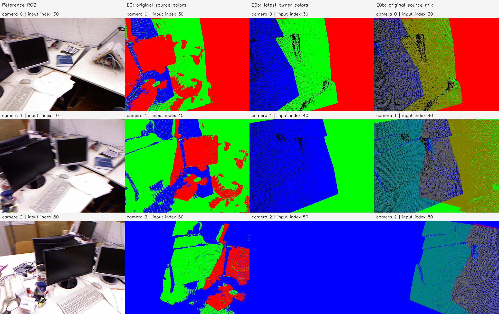

# E0b 결과 보고서 — tum-freiburg1_desk-E0b-20261112-001

**판정: 요청한 순차 픽셀 깊이 평균·이전 점 삭제/치환을 구현·실행하고 출처·저장 검증을 완료했다.** E0의 589,824개 관측을 최종 341,325개 대표점으로 만들었다. 점 수 감소는 42.131%이며, GT 기하 정확도 개선은 평가하지 않았다. 기존 E0/E0a/E2/E3는 변경하지 않았다.

## 목적과 입력

앞 프레임 점을 뒤 프레임 카메라로 투영하고, 같은 픽셀의 깊이를 평균한 점 하나를 뒤 프레임에 남긴 뒤 앞 프레임 대응점을 삭제하는 단순 융합 기준선이다. 여러 층을 남기는 보수적인 E2 gate와 구분해 E0b라는 새 코드로 등록했다.

입력은 `tum-freiburg1_desk-E0-20261112-001/stages/E0`의 원본 관측과 예측 Depth/Intrinsics/Extrinsics다. 원본 영상 인덱스 30/40/50을 내부 ID 0/1/2 순서로 처리했다. 새 추론·학습·카메라 보정·GT 사용은 없다. 원본 예측 SHA-256은 `d820f18f5bb683efb89d331f82262b68e5cec55a7bbadf379d8091721a26afa4`, 관측 SHA-256은 `61ba80c7635bf00223b5011e6e0b59e27734ba386d1d2762064bd153084543bc`다. E0a의 동일 카메라·원본 격자 출처 색상 영상을 전후 비교에 사용했다.

## 사전 고정 융합 규칙

1. 현재 지도는 Frame 0의 196,608점으로 시작한다.
2. Frame j=1,2의 예측 카메라에서 현재 지도 점을 투영한다. camera-Z가 양수이고 픽셀 셀 `[-0.5,W-0.5)`/`[-0.5,H-0.5)` 안에 있는 점을 NumPy rint로 최근접 픽셀에 배정한다.
3. 같은 픽셀 p에 현재 지도 점 m개가 들어오면 다음을 계산한다.

   `D_new(p) = (D_j(p) + z_1 + … + z_m) / (1 + m)`

4. 새 프레임 픽셀의 시선 위에 camera-Z가 D_new인 점 하나를 만든다. 그 픽셀에 배정된 이전 지도 점 m개는 제거한다. 평균은 3D XYZ 평균이나 카메라와의 Euclidean 거리 평균이 아니다.
5. 다음 카메라에 투영되지 않는 이전 점은 정확히 유지한다. 이전 점이 들어오지 않은 새 프레임 픽셀도 원본 좌표 그대로 유지한다.
6. 이미 융합된 현재 대표점은 다음 단계에서 가중치 1이다. 과거 원본 관측 수로 재가중하지 않는다. 따라서 누적된 모든 원본 깊이의 전역 평균과 동일하지 않으며, 실행 순서에 의존한다.

깊이 차이·법선·가림·Confidence gate는 추가하지 않았다. 현재 지도에서 여러 깊이 층이 같은 픽셀로 들어오면 앞면만 고르지 않고 모두 평균한다. 따라서 서로 다른 물체나 앞·뒤 표면까지 평균할 수 있다. 이것은 이번 단순 기준선의 명시된 동작이며 동일 물리점 대응을 확정했다는 뜻이 아니다.

## 점 수와 실제 좌표 변경

| 처리 | 이전 지도 점 | 삭제/치환한 이전 대표점 | 유지한 이전 점 | 평균을 적용한 새 픽셀 | 새 프레임 점 | 처리 후 전체 점 |
| --- | ---: | ---: | ---: | ---: | ---: | ---: |
| Frame 0 → Frame 1 | 196,608 | 126,056 | 70,552 | 106,801 | 196,608 | 267,160 |
| 누적 지도 → Frame 2 | 267,160 | 122,443 | 144,717 | 108,796 | 196,608 | 341,325 |

원본 589,824점에서 총 248,499개 대표점이 감소했다. 여기서 삭제 수는 각 단계의 **현재 대표점** 수이며 과거 원본 관측을 지웠다는 뜻이 아니다. 원본 관측 전체는 `source_to_fused`와 CSR `obs_offsets/obs_indices`로 최종 점 하나에 정확히 연결된다. 한 최종 점에 포함된 원본 관측은 최대 17개다. 픽셀 양자화와 시점 변화 때문에 같은 원본 프레임의 여러 관측이 한 그룹에 들어갈 수도 있다.

최종 점 중 서로 다른 원본 프레임을 1/2/3개 포함한 그룹은 각각 169,859 / 128,239 / 43,227개다. 최종 owner Frame 0/1/2의 점 수는 69,899 / 74,818 / 196,608개다.

최종 owner의 원본 점과 비교해 1e-8 모델 단위 이상 이동한 점은 171,466개다. 변위 평균은 0.009065507, 최대는 0.828376829 모델 단위다. 각 단계의 새 점 최대 변위는 0.805832057 / 0.828376829다. 특히 큰 변위는 깊이 gate 없이 서로 다른 표면을 평균할 수 있음을 주의해서 해석해야 한다. 이 변위는 오차 감소량이나 미터 단위가 아니다.

## 프레임 색상과 카메라별 전후 투영



각 행은 Camera 0/1/2다. 열은 원본 RGB 참고 영상, E0의 원본 출처 색, E0b의 최신 owner 색, E0b의 원본 출처 혼합색이다. 점에는 원본 영상 색을 사용하지 않았다.

- **최신 owner 색:** 마지막으로 해당 점을 보유하게 된 Frame 0/1/2를 빨강/초록/파랑으로 표시한다. 융합 후 frame_id는 원본 단일 출처가 아니라 이 owner를 뜻한다.
- **원본 출처 혼합색:** 같은 최종 점에 들어간 서로 다른 원본 프레임의 palette RGB를 같은 가중치로 평균한다. 예를 들어 Frame 0+1은 어두운 노랑, 0+2는 자홍, 1+2는 청록, 0+1+2는 회색이다. E0a의 3% near-front 혼합색과 달리, 여기서는 실제 저장된 융합 그룹의 출처를 표시한다. 단, 그룹이 실제 같은 물리점을 뜻하는지는 검증하지 않았다.
- 최종 Camera 2에서 이전 대응점은 삭제되고 Frame 2의 전체 픽셀 점으로 치환된다. 그 영상이 파랑으로 채워지는 것은 **정의상 결과**이며 단독으로 정합성·정확도 향상을 입증하지 않는다.

같은 E0a native 512×384 최근접 한 픽셀 z-buffer로 전후를 비교했다. 점 확대나 Gaussian·Alpha는 없다. 검정은 해당 투영에서 점이 없는 픽셀이다.

| 카메라 | E0 Coverage | E0b Coverage | E0b 빨강/초록/파랑 앞면 픽셀 |
| --- | ---: | ---: | --- |
| 0 | 100% | 91.247% | 69,895 / 62,096 / 47,408 |
| 1 | 100% | 93.042% | 0 / 74,817 / 108,111 |
| 2 | 100% | 100% | 0 / 0 / 196,608 |

이전 시점의 coverage 감소를 숨기지 않는다. 삭제한 이전 샘플을 다음 카메라의 격자 시선으로 치환하므로 이전 시점에서 픽셀 구멍이 생길 수 있다. 이는 한 픽셀 footprint 진단이며 실제 표면의 구멍 또는 GT 오차와 같지는 않다.

| 카메라 | 최신 owner 투영 | 원본 출처 혼합색 투영 |
| --- | --- | --- |
| 0 | [owner](figures/camera_00_owner.png) | [출처 혼합색](figures/camera_00_source_mix.png) |
| 1 | [owner](figures/camera_01_owner.png) | [출처 혼합색](figures/camera_01_source_mix.png) |
| 2 | [owner](figures/camera_02_owner.png) | [출처 혼합색](figures/camera_02_source_mix.png) |

## 실행·검증·한계

2026-11-12, Asia/Seoul. 호스트 CPU에서 실행했다. Python 3.11.18 / NumPy 1.26.4 / OpenCV 4.11.0이며 GPU/VRAM은 사용하지 않았다. 기록된 CPU 실행 wall time은 약 2.895초다. [환경](environment.json), [설정](config.json), [정량 결과](metrics.json), [실행 Manifest](manifest.json), [검증](verification.json)을 보존했다.

```bash
OPENBLAS_NUM_THREADS=2 .venvs/p0-py311/bin/python \
  experiments/pointmap_refinement/E0b/run.py \
  --run-id tum-freiburg1_desk-E0b-20261112-001
```

재실행에는 새 Run ID를 지정한다. [실행 코드](../../../../../experiments/pointmap_refinement/E0b/run.py), [재현 안내](../../../../../experiments/pointmap_refinement/E0b/README.md) 참조.

다음 검증을 통과했고 실행 종료 코드는 0이다.

- 알려진 깊이 2·4·6의 평균 4와 다음 단계 대표점 4·새 관측 8의 평균 6을 확인했다. camera-Z 평균, 삭제/치환 인덱스, 비중첩 점 보존과 과거 관측 수 비가중 동작을 검증했다.
- 실제 새 점이 평균 Z 및 지정한 다음 카메라 픽셀 시선과 일치함을 확인했다.
- 비중첩 이전 점과 비중첩 새 관측이 정확히 보존되고, 각 단계의 점 수가 삭제/추가 수식과 일치함을 확인했다.
- 원본 589,824개 관측이 모두 최종 CSR 그룹 하나에만 포함되고 source_to_fused와 CSR이 같은 분할인지 확인했다.
- 중간/최종 PLY와 최종 NPZ를 재로딩하고 PNG도 무손실 재로딩했다. 부모 입력 해시는 실행 전후 같았다.
- 전후 패널을 열어 owner 색과 출처 혼합색의 의미·행/열·coverage 감소를 확인했다.

이번 판정은 **요청한 단순 융합의 구현·실행 완료**다. 벽 ROI·물리 대응·GT 깊이/3D 정확도를 평가하지 않았으므로 겹침이 줄거나 최신 시점의 색이 하나가 됐다는 사실을 정확도 개선으로 보고하지 않는다. 앞·뒤 물체 혼합, 순서 의존성, 이전 시점 coverage 저하와 큰 변위가 남는다.

## 로컬 산출물

루트: `results/pointmap_refinement/tum-freiburg1_desk-E0b-20261112-001/stages/E0b/`.

- `artifacts/maps/fused_owner_colors.ply`: 최신 owner 빨강/초록/파랑의 최종 점군. frame_id는 owner이며 n_observed/source_mask를 함께 저장한다.
- `artifacts/maps/fused_source_mix.ply`: 같은 최종 좌표에 원본 프레임 출처 혼합색을 적용한 점군.
- `artifacts/maps/fused_map.npz`: 최종 XYZ, owner 카메라/픽셀, 원본 출처 비트맵·개수, 원본 관측→최종 점 및 CSR, 두 색상 배열.
- `artifacts/steps/after_frame_01/02.npz`: 단계별 지도·기존 점 삭제 마스크·old_to_new 치환 인덱스·픽셀별 기존 점 수·평균 깊이·출처.
- 같은 폴더의 `after_frame_01/02_owner.ply`: 0→1과 누적→2 직후의 점군.
- `artifacts/projections/`, `artifacts/figures/`: 카메라별 투영·앞면 버퍼와 전후 패널.
- `artifacts/source/`, `evaluation/`, `environment.json`, `logs/`, `progress.md`, `manifest.json`: 코드·설정·환경·정량 결과·진행·해시.

코드·설정·보고서·소규모 그림·출처 기록은 GitHub에 반영하며 대용량 PLY/NPZ와 중간 지도는 로컬에 보존한다.
