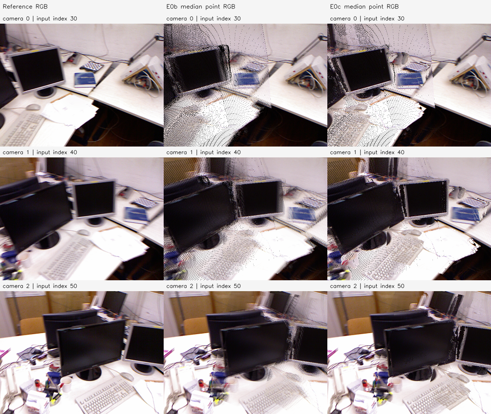
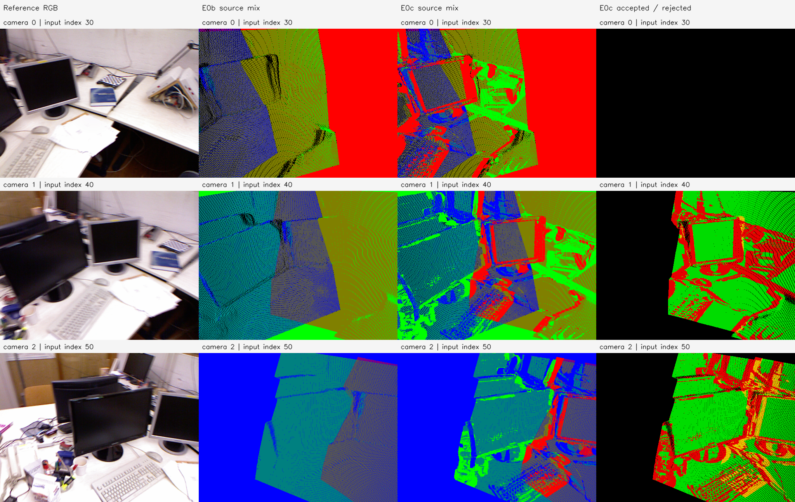

# E0c 결과 보고서 — tum-freiburg1_desk-E0c-20261112-001

**판정: 원본 RGB가 비슷한 관측만 융합하고 색 조건을 통과하지 못한 이전 점을 보존하는 동작을 구현·실행했다.** 최종 419,864점이며, 모든 그룹에서 원본 RGB의 채널별 범위가 30 이하다. E0b보다 이전 카메라의 투영 coverage가 높아졌지만, 같은 공통 영역의 GT 깊이 RMSE는 0.142887→0.154110m로 높아졌다. 색 혼합 제한은 검증됐으며 기하 정확도 개선은 확인되지 않았다.

## 입력과 사전 조건

기존 E0b 결과를 사후 분리하지 않고 **원본 E0에서 다시 융합**했다. 이미 평균한 E0b 좌표에 색 조건을 적용하면 잘못 섞인 깊이를 되돌릴 수 없기 때문이다. E0b/E3b/P2c 결과와 기존 코드는 보존했다.

- 입력: E0의 원본 관측 589,824개, 카메라 3개, 512×384 격자. 영상 인덱스 30/40/50을 내부 Frame 0/1/2 순서로 처리했다.
- 원본 예측 SHA-256: `d820f18f5bb683efb89d331f82262b68e5cec55a7bbadf379d8091721a26afa4`.
- 원본 관측 SHA-256: `61ba80c7635bf00223b5011e6e0b59e27734ba386d1d2762064bd153084543bc`.
- 변경 변수: 원본 RGB 기반 수용 조건과 그 조건을 적용하는 후보 순서. 깊이·법선·confidence 조건, 카메라 변경, 미분 최적화는 추가하지 않았다.
- 임계값: **8비트 RGB 각 채널의 그룹 내 최댓값−최솟값 ≤30**. 융합 전 고정했으며 GT로 선택하거나 조정하지 않았다. 전처리된 원본 영상의 RGB를 사용하며 조명·노출 보정은 없다.

## 색 조건과 깊이 평균

E0b와 같이 현재 지도 점을 다음 카메라에 투영해 최근접 픽셀에 배정한다. camera-Z가 양수이고 픽셀 셀 `[-0.5,W-0.5)` / `[-0.5,H-0.5)` 안에 있는 후보를 처리한다.

각 새 픽셀에서 원본 RGB 하나로 그룹을 시작한다. 이전 후보 그룹은 새 RGB와의 최악 채널 차이가 작은 순서, 동률이면 현재 점 인덱스 순서로 검사한다. **이미 수용한 관측과 새 후보 그룹의 모든 원본 RGB를 합쳐도 각 채널 범위가 30 이하여야 수용한다.** 평균색만 비교하면 서로 다른 색이 연쇄적으로 섞일 수 있으므로 원본 관측의 채널별 min/max를 추적했다. 같은 픽셀에 들어온 후보끼리도 이 제한을 만족해야 한다.

수용한 이전 대표점의 camera-Z를 z₁…zₘ, 새 관측의 깊이를 D라고 하면 `(D + z₁ + … + zₘ)/(1+m)`을 새 픽셀 시선의 깊이로 사용한다. 수용한 이전 점만 삭제하고 이 점으로 치환한다. 이전 대표점은 관측 수에 관계없이 가중치 1이며, 이는 E0b와 같다. 색 조건으로 거절된 점과 투영되지 않은 점은 원래 XYZ 그대로 유지한다. 거절된 점은 다음 단계에서도 다시 후보가 될 수 있다.

색 판단에는 프레임 구분용 빨강·초록·파랑을 사용하지 않는다. PLY의 표시 색은 기존처럼 프레임 출처를 나타낸다. 향후 사용할 그룹별 원본 RGB 중앙값은 NPZ의 `rgb_fixed_median`에 별도로 저장했다.

## 점 수·색 조건 결과

| 처리 | 이전 지도 | 투영 후보 | 수용·삭제한 이전 점 | 색 조건 거절·보존 | 평균한 새 픽셀 | 처리 후 점 |
| --- | ---: | ---: | ---: | ---: | ---: | ---: |
| Frame 0 → 1 | 196,608 | 126,056 | 82,982 | 43,074 (34.171%) | 72,318 | 310,234 |
| 누적 지도 → 2 | 310,234 | 144,351 | 86,978 | 57,373 (39.745%) | 77,827 | 419,864 |

첫 단계의 거절 중 43,002개는 새 관측과 후보 그룹 자체의 색 차이, 72개는 먼저 수용한 다른 후보까지 합쳤을 때의 색 범위 초과였다. 두 번째 단계는 각각 56,824 / 549개다. 거절 수는 각 단계의 현재 대표점에 대한 건수이며 서로 다른 원본 관측 수의 합계가 아니다.

| 항목 | E0b | E0c |
| --- | ---: | ---: |
| 최종 점 수 | 341,325 | 419,864 |
| 원본 589,824점 대비 감소 | 42.131% | 28.815% |
| 원본 색 범위가 30을 초과한 최종 그룹 | 61,671 | 0 |
| 1/2/3개 출처 프레임을 포함한 그룹 | 169,859 / 128,239 / 43,227 | 290,682 / 108,296 / 20,886 |

원본 관측 589,824개는 모두 최종 CSR 그룹 하나에만 연결된다. 그룹별 관측 수는 최대 12개다. 모든 원본 관측에서 다시 계산한 색 범위와 실행 중 추적한 min/max가 정확히 같았고, 최종 최대 범위는 30이었다. 이 수치는 색 조건 충족의 증거이며 동일 물리점 대응의 정확도는 아니다.

최종 owner의 원본 좌표 대비 변위 평균은 0.004385698, 최대는 0.789540275 모델 단위다. 색이 비슷해도 서로 다른 깊이의 표면이 평균될 수 있어 큰 변위는 여전히 남는다.

## 카메라 투영

각 행은 Camera 0/1/2이며 열은 원본 RGB, E0b, E0c다. 두 점군에는 같은 규칙으로 각 그룹의 원본 RGB 채널별 중앙값을 적용했다. RGB 평균에 alpha를 곱하는 방식이 아닌 **최근접 한 픽셀 z-buffer** 진단이다. 검정 점·띠에는 빈 픽셀과 실제 어두운 표면이 함께 포함된다. 이 그림은 P2c 미분 렌더러나 E3b 학습 결과가 아니다. E0c에서 모니터 테두리·책 주변의 색 경계가 E0b보다 덜 섞여 보이지만, 겹침·비틀림·빈 픽셀은 남는다.

| 카메라 | E0 coverage | E0b coverage | E0c coverage |
| --- | ---: | ---: | ---: |
| 0 | 100% | 91.247% | 95.895% |
| 1 | 100% | 93.042% | 95.752% |
| 2 | 100% | 100% | 100% |

열은 원본 RGB, E0b 출처 혼합색, E0c 출처 혼합색, E0c 처리 당시 픽셀별 판단이다. 출처 혼합색은 그룹에 포함된 서로 다른 원본 프레임의 빨강/초록/파랑을 같은 비중으로 섞었다. 마지막 열의 **초록=수용 후보 있음, 빨강=거절 후보 있음, 노랑=둘 다 있음, 검정=후보 없음**이다. Camera 0 행은 초기 seed이므로 판단 열 전체가 검정이다. 판단 열은 단계 당시의 후보 기록이고, 나머지 열은 최종 점군의 투영이므로 같은 시점의 앞면 분류로 해석하지 않는다.

## 사후 GT 깊이 비교

융합 완료 후 P1의 같은 카메라 GT 깊이를 불러왔다. 기존 E3b -002 초기 E0b에서 구한 **scale=1.3171403295592672m/model-unit**을 세 방법에 동일 적용했으며 E0c에 맞춰 재추정하지 않았다. 원본 E0 투영과 GT가 유효한 448,216픽셀을 고정 영역으로 사용했고, 세 방법 모두 깊이가 있는 공통 424,642픽셀에서 오차를 계산했다.

| 방법 | 공통 영역 RMSE (m) | 공통 영역 AbsRel | 고정 영역 coverage |
| --- | ---: | ---: | ---: |
| E0 원본 | 0.158863362 | 3.565686% | 100% (448,216) |
| E0b | 0.142887191 | 3.272471% | 94.888848% (425,307) |
| E0c | 0.154110069 | 3.405639% | 97.328966% (436,244) |

이 평가에서는 E0c가 E0보다 오차가 작지만 E0b보다 크다. 반면 E0b보다 고정 영역에서 10,937픽셀을 더 유지했다. 위 영상의 coverage는 E0a의 반 픽셀 경계 기준이고, GT 표는 기존 E1의 엄격한 영상 중심 경계와 GT 유효 영역을 사용하므로 분모가 다르다.

이는 **같은 입력 시점의 깊이 평가**다. 스케일 기준이 기존 E0b이며, 교집합 평가에서는 누락 영역을 오차에 넣지 않으므로 coverage를 함께 보고한다. E3b 기존 보고서의 초기/last 공통 영역과도 다르므로 그 수치와 직접 대조하지 않는다. 독립 카메라·벽 ROI·전체 3D 표면 정확도를 검증한 결과가 아니다.

## 실행·검증·산출물

2026-11-12 20:58:25~20:58:31 KST, CPU에서 실행했다. Python 3.11.18 / NumPy 1.26.4 / OpenCV 4.11.0이며 GPU는 사용하지 않았다. 측정 구간은 약 5.337초다. 실행 전 프로젝트 커밋은 `e0f42d68ce0be39159f399f0113c67c924abb2a0`이며 실제 코드·설정·의존 helper를 산출물에 복사하고 해시를 저장했다.

다음 검증을 통과했고 종료 코드는 0이다.

- 알려진 색·깊이 평균, 빨강/파랑 거절·좌표 보존, 채널 차이 30 수용 / 31 거절, 서로 다른 후보의 동시 융합 차단, 누적 색 범위의 연쇄 혼합 차단.
- 임계값 255에서 E0b의 **전체 XYZ·owner·픽셀·원본 관측→최종 점 매핑을 정확히 재현**. 새 색 조건이 없을 때 기존 깊이 평균과 동일함을 확인했다.
- 실제 수용점의 평균 camera-Z·새 카메라 픽셀 시선, 거절/비투영 점의 좌표 불변, 원본 RGB로 재계산한 최종 그룹 min/max와 제한.
- 원본 589,824개 관측의 CSR 분할·매핑 일치, PLY/NPZ/PNG 재로딩, 부모 입력 불변. 종료 후 Manifest의 산출물 43개와 입력 14개의 해시를 재검사했다.
- 두 패널을 열어 행·열·표시 색의 의미와 빈 픽셀·남은 겹침을 확인했다.

[설정](config.json), [정량 결과](metrics.json), [GT 평가](gt_depth.json), [검증](verification.json), [환경](environment.json), [Manifest](manifest.json), [실행 로그](run.log), [중간 기록](progress.md)을 보존했다. [코드](../../../../../experiments/pointmap_refinement/E0c/run.py), [재현 안내](../../../../../experiments/pointmap_refinement/E0c/README.md).

로컬 산출물 루트는 `results/pointmap_refinement/tum-freiburg1_desk-E0c-20261112-001/stages/E0c/`다.

- `artifacts/maps/fused_owner.ply`: 최종 점군, 최신 owner Frame 0/1/2의 빨강/초록/파랑.
- `artifacts/maps/fused_source_mix.ply`: 같은 XYZ, 원본 프레임 출처 혼합색.
- `artifacts/maps/fused_map.npz`: XYZ·owner·픽셀·원본 관측 CSR·색 범위·그룹 중앙값 RGB·표시 색.
- `artifacts/steps/after_frame_01/02.npz`: 각 단계 지도·수용/거절 후보와 사유·깊이 평균·이전 점 치환 매핑.
- `artifacts/projections/`, `artifacts/figures/`, `artifacts/source/`: 카메라 투영·GT 버퍼·비교 그림·실행 코드 스냅샷.

최종 NPZ SHA-256은 `bdaa577990a84f4e89183310172cbcbcbdc940c4539d8b7cf448eb56f2772eda`다. 코드·설정·보고서·소규모 그림·출처 기록은 Git에 포함하고 대용량 점군과 버퍼는 로컬에 보존한다.

## 해석의 범위

요청한 색 기반 융합 제한은 적용됐다. 같은 표면도 조명·노출·반사·기존 정합 오차 때문에 색이 달라 거절될 수 있고, 다른 표면도 색이 비슷하면 융합될 수 있다. 따라서 색 조건만으로 벽의 여러 층을 한 표면으로 정렬했다고 판단하지 않는다. 이번에는 융합 초기값만 변경했으며 E0c를 이용한 RGB 역전파 최적화는 실행하지 않았다.
