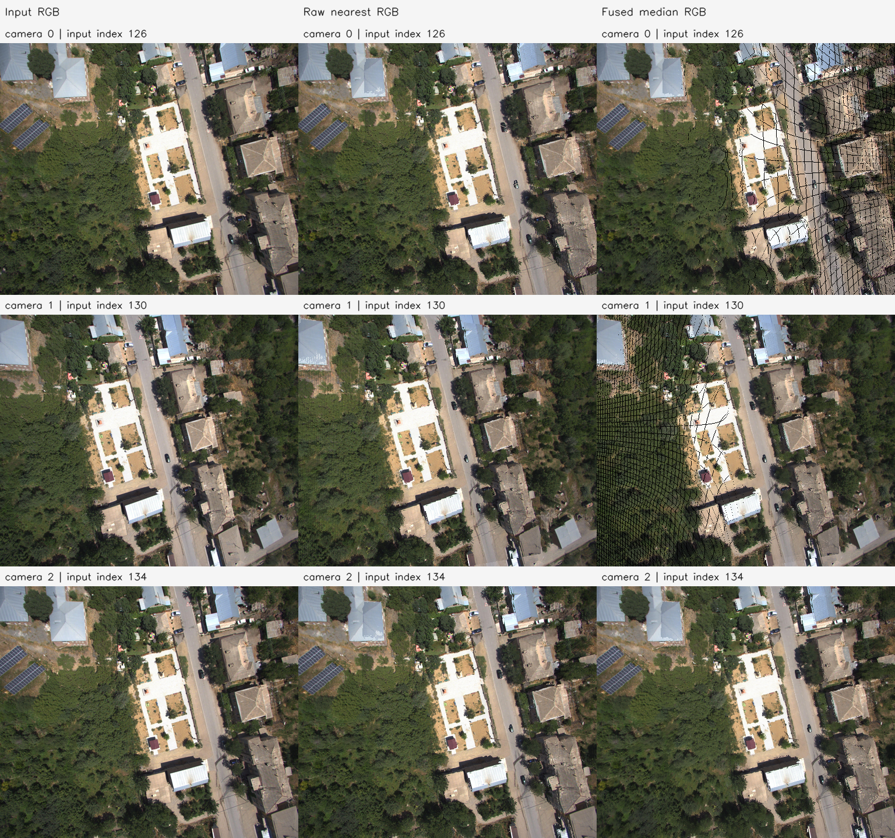
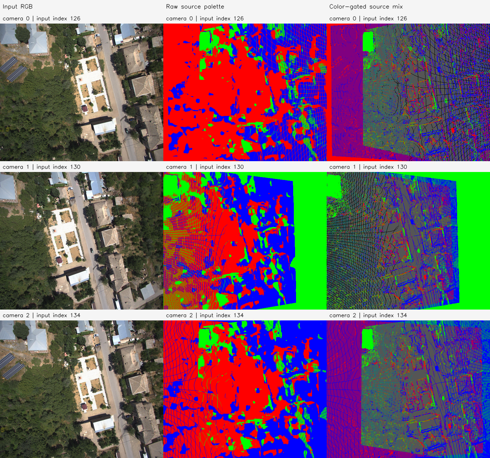

# E0d 결과 보고서 — amtown01-E0d-20261112-001

**판정: AMtown01의 원본 세 장 공동 Omega 추론과 E0c 규칙 색 조건 융합을 실행·검증했다.** 원본 663,552개 관측을 보존하면서 최종 340,732점(48.650294% 감소)을 만들었다. 후속 고정 RGB 정점 이동 후보는 168,315개다. GT 기하 정확도는 평가하지 않았다.

## 데이터와 실행 전 선택

입력은 사용자가 제공한 [UAVScenes HF](https://huggingface.co/datasets/sijieaaa/UAVScenes)의 revision `04a224fd14b0b8fdfd2633e68f20471b85c611a5`, `interval5_CAM_LIDAR.zip`이다. ZIP 전체 크기는 28,682,115,865bytes이며 HTTP Range로 목차·선택 항목만 읽었다. 이번 입력 준비 프로세스의 통신량은 12,300,420bytes였다. 사전 목차/메타데이터 조사 통신량은 별도이며 이 수치에 포함하지 않는다. 추출 파일의 ZIP CRC·크기·SHA-256을 검증했고 **전체 ZIP의 LFS SHA를 로컬에서 검증한 것은 아니다.** [다운로드 출처](download.json).

Cache-only 최초 후보 120/124/128에서 메타데이터 translation 변화가 작았다. 이미지 확인·모델 추론·최적화 전에 `i≥120`의 첫 `norm(T[i+8].translation−T[i].translation)≥5` 구간을 고르는 규칙으로 수정했고, 두 장면 모두 126/130/134를 사용했다. 이전 cache 자료와 변경 사실은 남겼다. 이 값은 T4x4 방향이 독립 검증되지 않은 **메타데이터 이동 proxy**이며 검증된 camera baseline으로 부르지 않는다. 0→1 / 1→2 / 0→2의 시간 차이는 1.999052s / 2.000229s / 3.999281s, translation 차이는 1.117576 / 5.291184 / 6.408167다.

| 내부 카메라 | interval5 정렬 인덱스 | 제공 SortedImageID | timestamp | 원본 JPEG SHA-256 |
| --- | ---: | ---: | --- | --- |
| 0 | 126 | 630 | 1658137120.639091421 | `4036b18728606d231217abe5f61d407dda72d43dcedef4aee381fe4d125d627c` |
| 1 | 130 | 650 | 1658137122.638143493 | `463f4e221afacbe64e0b776eb79eec2b3678b8101734464b47cb45ac4bdf6892` |
| 2 | 134 | 670 | 1658137124.638372823 | `b330d93445db7a470b1d2ddcce807e8dd508315297becd931a1efe7b59e596cd` |

정렬 인덱스와 제공 메타데이터의 원본 인덱스를 구분한다. 원본 영상은 2448×2048, 공식 max_size 전처리 결과는 512×432다. 원본 세 장을 **동시에** Omega에 입력했다. 과거 일반 VGGT/MASt3R PLY를 초기값으로 재사용하지 않았다.

## 모델·융합·고정 후속 입력

Omega 소스 `48b23c8ce72c9a8fcf987f0d7f43d8e4870759f6`, 공식 `facebook/VGGT-Omega` 체크포인트 `vggt_omega_1b_512.pt`, seed=0을 사용했다. 실행 전에 실제 파일 전체 SHA-256 `c02da418b18bb01d0392598d3f6147366bcde1bb70fd08a5e3bf7925b0667934`와 소스 커밋을 확인했다. [공통 모델 검증](../model_and_source_verification.json). Raw 추론 NPZ SHA는 `b3c2a8982d34082ac8a3c32fe5d2a604e6a1813cc32e8682bc664eb7a46b79b5`다.

프레임별 221,184점을 예측 깊이·카메라에서 역투영해 총 663,552개 raw 관측을 저장했다. E0c 코드를 그대로 사용해 0→1→2 순서로 융합했다. 같은 다음 카메라 픽셀의 이전 점 중 **그룹 전체 원본 RGB의 각 채널 범위≤30**인 후보만 수용한다. 수용한 현재 대표점과 새 관측의 camera-Z를 가중치 1로 평균해 다음 픽셀 시선의 점으로 치환하고 이전 대표점을 삭제한다. 거절/비투영 점의 XYZ는 유지한다. 추가 깊이/법선 gate는 없다.

| 처리할 카메라 | 투영 후보 | 수용·치환 | 색 거절·보존 | 처리 후 점 수 |
| --- | ---: | ---: | ---: | ---: |
| 1 | 165,524 | 131,435 | 34,089 | 310,933 |
| 2 | 254,193 | 191,385 | 62,808 | 340,732 |

최종 그룹의 원본 RGB 최대 채널 범위는 30이다. 1/2/3개 원본 출처 그룹 수는 147,474 / 104,369 / 88,889다. 원본 관측 663,552개 모두 CSR에서 최종 점 하나에 정확히 연결된다. 점 색은 채널별 원본 RGB 중앙값으로 별도 저장하며, PLY 표시 색은 프레임 팔레트다.

기존 E3c와 같은 다중 출처·비영 시차·모든 원본 출처의 초기 추정 가시성 정책으로 active=168,315, inactive=172,417를 고정했다. 다음 E3e 렌더 해상도는 128×108이며 초기 raw 깊이 경계·confidence 하위 10% 제외·초기 융합 투영 coverage·3픽셀 테두리 제외의 고정 마스크를 만들었다. Camera 0/1/2의 학습 픽셀은 11364 / 11423 / 11381개다. 기하/GT 정답으로 후보를 선택하지 않았다.

## 원본 해상도 투영

행은 Camera 0/1/2, 열은 전처리 원본 RGB·raw 최근접 RGB·융합 그룹 중앙값 RGB다. 모두 512×432에서 처리한 최근접 한 픽셀 z-buffer 진단이며 Gaussian/alpha는 없다. 검정은 빈 픽셀과 실제 어두운 표면을 포함한다. 융합 후 다른 시점으로 재투영할 때 빈 픽셀이 생길 수 있다.

| 카메라 | 융합 native coverage (raw는 모두 100%) |
| --- | ---: |
| 0 | 94.780364% |
| 1 | 92.940719% |
| 2 | 100.000000% |

색은 원본 Frame 0/1/2 빨강/초록/파랑과 실제 그룹에 속한 서로 다른 출처의 혼합색이다. 이 출처 정보와 점 수 감소는 물리적 대응 또는 정확도 개선을 뜻하지 않는다.

## GT·출처 검증 범위

원본 대응 LiDAR TXT, `sampleinfos_interpolated.json`, 저자 [보정 코드](https://github.com/sijieaaa/UAVScenes/blob/909250d14a4460b2a62ea25f08f12ce6367427ac/calibration_results.py)를 보존했다. 공식 매핑은 HKairport01→`HK_GNSS_calibration`, AMtown01→`AMtown_calibration`이다. 그러나 LiDAR XYZ 좌표계·interval5 이미지의 왜곡/보정 규약·T4x4 방향에 대한 독립 검증이 없어 이번에 깊이 GT나 미터 스케일로 사용하지 않았다. 데이터셋에 GT가 없다고 단정하지 않는다. 관련 [저자 저장소의 규약 질의](https://github.com/sijieaaa/UAVScenes/issues/18)도 확인했으며 확정 답변을 얻지 못했다. [GT 참조 점검](gt_reference_audit.json).

실행은 2026-11-12T22:30:58.706567+09:00~2026-11-12T22:33:31.696091+09:00, 종료 코드 0·Manifest completed다. 추론은 샌드박스 밖 RTX 5060에서 수행했고 GPU peak allocated=5,022,880,256bytes, reserved=5,318,377,472bytes, 순수 forward/camera=0.493451s였다. 준비/융합은 CPU다. 원본 카메라 역투영·색 조건 제어·CSR·NPZ/PLY/PNG 재로딩·입력/스냅샷 불변을 통과했다. 봉인 산출물 41개·입력 9개 해시도 재확인했다.

[설정](config.json), [정량 결과](metrics.json), [추론](inference.json), [검증](verification.json), [환경](environment.json), [Manifest](manifest.json), [프레임](frames.json), [준비 로그](fetch.log), [융합 로그](finalize.log), [진행](progress.md), [재현 코드](../../../../../experiments/pointmap_refinement/E0d/README.md).

로컬 루트는 `results/pointmap_refinement/amtown01-E0d-20261112-001/stages/E0d/`다. `artifacts/maps/raw_source.ply`, `fused_owner.ply`, `fused_source_mix.ply`, `fused_map.npz`와 중간 지도·원본 관측·카메라/target·고정 후보/마스크를 저장했다. 대용량 데이터/점군은 로컬 보존하고 보고서·그림·메타데이터·해시는 Git에 포함한다.
