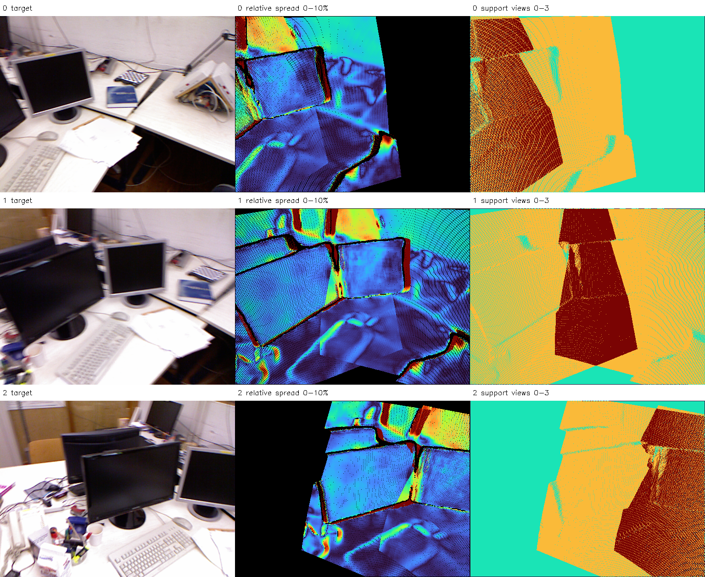
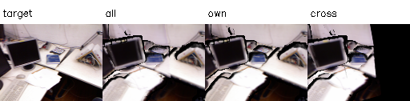
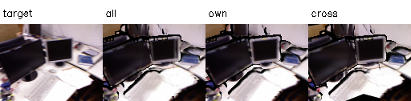
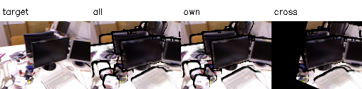

# E1 결과 보고서 — tum-freiburg1_desk-E1-20261112-001

**판정: F0 단순 연결 상태 평가 완료.** 원본 589,824점을 바꾸지 않고 예측 간 기하 불일치, 잠재 중복과 관측 출처별 RGB 재현을 측정했다. 융합·최적화·GT 정확도 평가는 수행하지 않았다.

## 입력·실행 계약

2026-11-12, Asia/Seoul. E0 `tum-freiburg1_desk-E0-20261112-001`의 완료 Manifest와 모든 산출물 해시를 검증했다. 부모의 원본 관측 NPZ와 전체 PLY를 바이트 단위로 복사했으며 SHA-256이 일치했다. 세 프레임의 점을 같은 모델 월드 좌표계에 유지했으며 재등록·색상 학습·confidence 필터·downsample은 없다. 좌표와 깊이는 임의 모델 스케일이며 미터가 아니다.

실행 전에 [설정](config.json)의 3% edge/disagreement, 5% compatibility, 세 voxel 크기와 두 origin을 고정했다. 기하와 재로딩 검사는 호스트 CPU, 전체 점군 렌더링은 샌드박스 밖 호스트 RTX 5060에서 실행했다. Python 3.11.18, NumPy 1.26.4, PyTorch 2.15.0+cu132 환경을 사용했다. [geometry.py](../../../../../experiments/pointmap_refinement/E1/geometry.py), [render.py](../../../../../experiments/pointmap_refinement/E1/render.py), [verify.py](../../../../../experiments/pointmap_refinement/E1/verify.py)가 모두 종료 코드 0으로 완료됐다. GPU 추론은 재실행하지 않았다.

## 타 시점의 예측 깊이 불일치

각 source의 모든 점을 target 카메라에 투영했다. 양수 Z와 화면 범위를 검사하고 가장 가까운 정수 픽셀로 옮긴 뒤, 같은 픽셀에서는 최소 Z를 고정 front 후보로 선택했다. Target 초기 깊이의 4-neighbor 변화가 작은 쪽 깊이의 3%를 넘는 경우 양쪽 픽셀과 이미지 테두리를 제외했다. Source edge는 별도로 제외하지 않았다.

평가 마스크는 이 초기 source coverage와 target edge-safe 영역의 교집합이다. 상대 잔차는 `(source Z − target D)/target D`이며 절대값 3% 초과를 불일치로 집계했다. In-front는 −3% 미만, behind는 +3% 초과다.

| Source→Target | 고정 평가 픽셀 | 절대 상대 잔차 중앙값 | 3% 초과 | In-front | Behind |
| --- | ---: | ---: | ---: | ---: | ---: |
| 1→0 | 103,734 | 1.014% | 16.08% | 12.26% | 3.82% |
| 2→0 | 47,916 | 1.072% | 25.99% | 16.55% | 9.45% |
| 0→1 | 103,395 | 1.014% | 14.06% | 5.06% | 9.00% |
| 2→1 | 104,520 | 1.347% | 16.00% | 10.59% | 5.42% |
| 0→2 | 47,558 | 1.087% | 26.51% | 9.73% | 16.78% |
| 1→2 | 104,967 | 1.387% | 16.25% | 5.82% | 10.43% |

한 source는 196,608점이며 target 격자는 512×384다. 이는 P1의 모든 source point 비교와 달리 target 픽셀당 source 최소 깊이를 선택하고 edge-safe 마스크를 적용한 새 진단이다. 두 수치를 같은 분모의 개선으로 비교하지 않는다.

**3% 초과는 실제 오류 점 비율이 아니다.** 가림, 서로 다른 표면, rounding, 고정 예측 Pose·Depth 오차가 섞여 있다. GT 대응점 없이 원인을 분리하지 못한다. 3%는 확정된 기하 정확도 임계값이 아니라 E1의 사전 고정 진단 조건이다.

## 화면상 깊이 층 퍼짐

각 target 픽셀에서 프레임별 front Z를 하나씩 모았다. 2개 이상 프레임이 들어오고 target이 edge-safe인 영역에서 `(max Z − min Z)/target D`를 측정했다. Source별 내부 중복 층은 최소 Z 선택으로 보이지 않으므로 이것을 전체 3D 표면의 실제 두께로 해석하지 않는다.

| Target | 2개 이상 시점 픽셀 | 3개 시점 픽셀 | 상대 퍼짐 중앙값 | 상대 퍼짐 P95 | 모두 target D의 5% 이내인 픽셀 |
| --- | ---: | ---: | ---: | ---: | ---: |
| 0 | 115,179 | 36,471 | 1.165% | 6.639% | 103,405 |
| 1 | 166,181 | 41,734 | 1.522% | 6.535% | 157,364 |
| 2 | 113,872 | 38,653 | 1.668% | 7.014% | 100,519 |

호환 하위집합의 지표도 `geometry.json`에 별도로 기록했다. 5% 이내로 선택한 집합은 임계값으로 검열된 표본이며 전체보다 작은 퍼짐이 나오는 것을 성공 근거로 삼지 않는다. 알려진 동일 층은 퍼짐 0, 별도 source의 Z=2와 2.04는 차이 0.04·상대 차이 0.02로 검증했다.

중앙은 0~10% 공통 TURBO 범위이며 낮은 값은 파랑, 높은 값은 빨강이다. 10% 이상은 표시만 포화시키며 통계에서 자르지 않는다. 검정은 두 시점 미만·경계 제외 등의 평가 밖 영역이며 오차 0이 아니다. 오른쪽은 0~3개 프레임의 투영 support이며 실제 동일 표면 대응 확정 수가 아니다. 물체 경계·배경과 겹침이 적은 영역에서 주의할 패턴이 보이지만 GT 정확도 판단으로 확대하지 않는다.

## Voxel 기반 잠재 중복과 민감도

전체 초기 Depth 중앙값은 **0.925497264**다. 이를 기준으로 voxel 크기를 정했다. Origin은 전체 XYZ 최소값에서 voxel 크기의 0 또는 0.5만큼 이동했다. 서로 다른 프레임이 같은 voxel을 점유하는 경우를 잠재 중복으로 기록했다.

| Depth 중앙값 대비 크기 | Voxel 크기(모델 단위) | Origin offset(voxel) | 점유 voxel | 다중 프레임 voxel | 그 voxel에 속한 전체 점의 비율 |
| --- | ---: | ---: | ---: | ---: | ---: |
| 0.25% | 0.00231374 | 0.0 | 476,874 | 20,533 | 9.50% |
| 0.25% | 0.00231374 | 0.5 | 476,668 | 20,545 | 9.50% |
| 0.5% | 0.00462749 | 0.0 | 240,513 | 17,458 | 21.26% |
| 0.5% | 0.00462749 | 0.5 | 240,522 | 17,293 | 21.19% |
| 1% | 0.00925497 | 0.0 | 87,912 | 9,688 | 34.20% |
| 1% | 0.00925497 | 0.5 | 87,789 | 9,663 | 34.28% |

범위는 약 9.5~34.3%이며 크기에 크게 의존한다. 이는 제거 가능한 중복점 비율이나 융합률이 아니다. 같은 voxel에 물리적으로 다른 표면이 들어갈 수 있으며, 같은 표면도 voxel 경계로 나뉠 수 있다. Voxel 자체로 점을 삭제하거나 위치를 이동하지 않았다. E2에서는 재투영·깊이·관측 출처 등의 추가 gate가 필요하다.

## 전체 점군과 출처별 RGB 비교

P2a에서 새 렌더러를 기본선으로 채택하지 않았으므로, 기존 P2 Gaussian(σ=.65px, 5×5, front gate 3%, 검은 배경)을 그대로 사용했다. P2/P2a와 달리 **전체 관측**으로 평가한다.

- all: 전체 589,824점.
- own: 평가 카메라 자신의 196,608점.
- cross: 다른 두 카메라의 393,216점. 원본 VGGT-Ω 추론에는 세 이미지가 모두 들어갔으므로 held-out 평가가 아니다.

해상도 128×96, target은 RGB INTER_AREA 축소, K는 centre-based affine으로 변환했다. alpha≥.5를 coverage로 사용한다. 고정 all 마스크와 세 조건 모두 보이는 공통 마스크를 각각 적용했다. 누락 부분을 임의로 제외해 지표를 높이지 않도록 전체 픽셀 PSNR도 JSON에 보존했다.

| Frame | 조건 | 점 수 | Coverage | 고정 all 마스크 PSNR(dB) | 공통 마스크 PSNR(dB) |
| --- | --- | ---: | ---: | ---: | ---: |
| 0 | all | 589,824 | 89.06% | 18.721 | 17.986 |
| 0 | own | 196,608 | 87.81% | 17.659 | 22.681 |
| 0 | cross | 393,216 | 57.70% | 7.284 | 14.870 |
| 1 | all | 589,824 | 87.73% | 17.495 | 19.030 |
| 1 | own | 196,608 | 86.25% | 16.937 | 23.453 |
| 1 | cross | 393,216 | 85.20% | 12.844 | 16.296 |
| 2 | all | 589,824 | 83.44% | 16.684 | 16.886 |
| 2 | own | 196,608 | 84.33% | 17.700 | 22.743 |
| 2 | cross | 393,216 | 53.69% | 6.835 | 15.440 |

공통 영역에서는 own이 all/cross보다 높은 점수를 보였다. 이는 자기 원본 픽셀의 색상을 그대로 재사용하는 설정에서 자기 영상 재현이 유리함을 보여주는 진단이다. Cross의 고정 all 마스크 점수에는 원래 다른 프레임에서 관측하지 못한 부분의 구멍도 포함된다. 공통 영역 점수와 coverage를 함께 읽어야 한다. 이 결과만으로 depth 오류나 전체 점군의 열세를 확정하지 않으며, RGB를 낮추는 것이 기하 정확도 개선이라는 주장도 하지 않는다.

렌더는 모두 no_grad이며 실제 좌표를 갱신하지 않았다. PyTorch peak allocated **739.736MiB**, reserved **1054.000MiB**다. GPU 프로세스 종료 후 nvidia-smi는 14MiB로 복귀했다. 단회 forward 시간은 GPU 선택 indexing을 포함해 JSON에 저장했으며 성능 벤치마크로 일반화하지 않는다.

## 저장·검증 및 E2 인계

루트: `results/pointmap_refinement/tum-freiburg1_desk-E1-20261112-001/stages/E1/`.

- `artifacts/f0/`: 변경 없는 원본 관측 NPZ·전체 PLY·원본 예측·프레임 출처.
- `artifacts/diagnostics/pair_*.npz`: source front Z·frame 내부 winner index·target 깊이·초기 고정 평가 마스크.
- `artifacts/diagnostics/layers_target_*.npz`: 프레임별 Z와 support·층 퍼짐·호환 하위 마스크. 평가 밖 값은 NaN/Inf일 수 있으며 제공 mask로 구분한다.
- `artifacts/renders/`: 조건별 RGB·Depth·alpha·coverage·target, 초기 고정/공통 마스크, 비교 PNG.
- `evaluation/geometry.json`, `render.json`, `verification.json`, `handoff.json`: 전체 수치·검증·E2 입력 계약.
- `config_resolved.json`, `environment_cpu.json`, `logs/`, `artifacts/source/`, `manifest.json`: 실행 환경·코드·해시·부모 출처.

저장된 pair mask에서 지표를 재계산해 일치를 확인했고, RGB/Depth 유한값·Coverage와 alpha의 일치·PSNR 재계산을 통과했다. F0의 NPZ/PLY는 E0와 바이트 단위로 동일하다. E0의 PLY 저장·재로딩 검증도 부모 해시를 통해 유지했다.

E2에서는 원본과 **초기 고정 픽셀 집합**을 재사용하고, 융합 결과의 누락 coverage를 별도로 보고해야 한다. 평가가 불가능해진 픽셀을 조용히 버리지 않는다. E1의 층 퍼짐과 voxel 수치는 후보 선택·일관성 진단이며, GT 기반 실제 정확도·표면 두께 또는 성공적인 대응점 수가 아니다. 다음은 **E2 공유점 융합·가시성 검증**이다.
