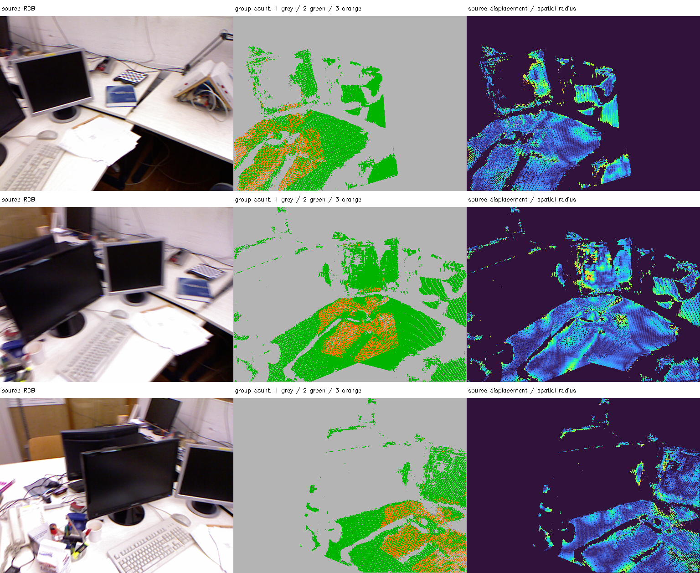
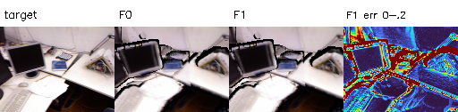
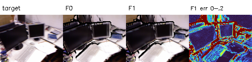
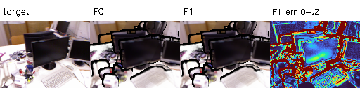

# E2 결과 보고서 — tum-freiburg1_desk-E2-20261112-001

**판정: 공유점 융합과 가시성의 구현·저장·계약 검증 완료. 품질 향상은 미확인.** 원본 관측 589,824개를 보존하면서 대표점 510,427개를 생성했다. 고정 E1 마스크 RGB PSNR은 세 시점 모두 소폭 낮아졌으며, GT 기하 정확도는 평가하지 않았다. 불리한 결과를 포함해 기록한다.

## 목적·입력·실행

2026-11-12, Asia/Seoul. 부모 E1 `tum-freiburg1_desk-E1-20261112-001`의 완료 상태와 모든 산출물 해시를 검증했다. 원본 F0 NPZ/PLY는 수정하지 않았고 모든 관측이 새 CSR의 그룹 하나에 정확히 한 번 포함되도록 했다.

호스트 CPU에서 융합·가시성·검증을 수행하고, RTX 5060의 샌드박스 밖 GPU에서 기존 P2 렌더러로 F0/F1을 비교했다. Python 3.11.18, NumPy 1.26.4, PyTorch 2.15.0+cu132 환경이다. [fuse.py](../../../../../experiments/pointmap_refinement/E2/fuse.py), [evaluate.py](../../../../../experiments/pointmap_refinement/E2/evaluate.py), [verify.py](../../../../../experiments/pointmap_refinement/E2/verify.py), [handoff.py](../../../../../experiments/pointmap_refinement/E2/handoff.py) 모두 종료 코드 0이다. 코드·설정·부모 출처·환경·로그를 Manifest로 연결했다.

**실제 공유 Pointmap의 점 집합과 대표 좌표는 이번 E2부터 달라졌다.** 다만 이는 관측 집계에 의한 융합 초기화이며 원본 RGB 손실로 점 위치를 학습한 것은 아니다. RGB 최적화는 E3 이후 범위다.

## 사전 고정 융합 조건

초기 Depth 중앙값 0.925497264를 단위 기준으로 사용했다. 수치는 미터가 아니라 모델 스케일이다.

- 후보: 프레임 i<j에서 i의 점을 j에 투영한 최근접 픽셀 관측. 역방향 투영도 원래 i 픽셀의 1px 이내여야 한다. 알려진 카메라를 이용한 projective 탐색이며 voxel 27-neighbor 전수 탐색이나 전체 대응의 완전성을 주장하지 않는다.
- 공간 거리: median depth의 1%, 즉 **0.009254973** 이하.
- 깊이: 양 방향에서 `abs(Z−D) ≤ 0.001850995 + 0.02D`.
- 법선: 원본 세계 점군 격자의 중심차분 du×dv를 사용한다. 3% Depth 경계·불안정 법선은 융합 후보에서 제외하고, 법선 방향 차이는 30도 이내로 제한한다.
- 그룹: 가까운 edge부터 처리하되 한 프레임의 관측을 두 개 넣지 않는다. 그룹의 **모든 쌍**이 후보 gate를 통과해야 하므로 단순 연결 성분의 연쇄 팽창을 허용하지 않는다.
- XYZ: 프레임별 Confidence 10/90분위로 정규화해 [0.1,1]로 clipping한 상대 가중 평균. Confidence는 보정된 확률이 아니다.
- RGB: 그룹 원본 색상의 채널별 median으로 고정한다. 관측 2개의 median은 평균과 같으며 색상 차이 자체는 추가 gate로 사용하지 않았다.

매칭되지 않은 관측과 경계·낮은 신뢰도 관측은 삭제하지 않고 단독점으로 남긴다. 이 gate들은 보수적인 구현 조건이며 실제 동일 물리 표면이라는 GT 증명은 아니다. 얇고 가까운 다른 면, 반사·잘못된 초기 Depth/Pose를 완전히 배제하지 못한다. Fusion threshold의 광범위한 최적값 탐색은 이번 범위에 포함하지 않았다.

## 공유점 생성 결과

| 구분 | 개수 |
| --- | ---: |
| 원본 관측 | 589,824 |
| F1 대표점 전체 | 510,427 |
| 단독 관측 그룹 | 439,425 |
| 2개 프레임 그룹 | 62,607 |
| 3개 프레임 그룹 | 8,395 |
| 2~3개 관측 그룹에 속하는 원본 관측 | 150,399 |
| 2~3개 프레임의 공유점 | 71,002 |

대표점 수는 **13.46% 감소**했다. 처리한 후보 edge는 112,678개이며 수락된 union은 79,397개다. 프레임 중복 때문에 9,959개, 그룹 모든 쌍 조건 때문에 14,927개의 union을 거절했다. 그룹 내부에서 같은 root가 된 edge는 재집계하지 않는다.

원본 관측에서 해당 대표점까지 거리의 평균은 **0.000441564**, P95는 **0.002783584**, 최대는 **0.007662193**다. 이것은 융합 집계 변위이며 실제 오차 감소량이 아니다. 다중 관측 그룹의 최대 시차각 중앙값은 **4.080°**, P95는 **9.447°**였다.

중앙은 단독점 회색·2관측 녹색·3관측 주황색이다. 오른쪽은 원본점에서 대표점까지의 거리를 공간 반경으로 나눈 0~1 TURBO 표시다. 이 그림은 source 픽셀별 집계 상태이며 GT 정확도 지도가 아니다. 원본 관측 전체와 대표점의 연결을 CSR로 추적할 수 있다.

## 관측 출처 O와 추정 가시성 V

O는 이번 데이터 연관으로 묶인 원본 camera/pixel 목록이다. V는 현재 공유점을 각 카메라에 투영했을 때 보일 가능성의 추정이며 O에 관측을 추가하지 않는다.

V는 native 512×384의 양수 Z·frustum, 현재 shared point nearest-pixel z-buffer의 3% front 범위, 초기 Depth prior, 초기 Depth 경계·target Confidence 하위 10분위 제외로 계산했다. RGB 렌더러의 5×5 splat visibility와 정확히 같은 구현은 아니며, 기하 진단용 hard estimate다. Prior gate의 절대 항은 median depth×0.002, 상대 항의 민감도는 다음과 같다.

| Camera | 상대 1% | 상대 3%(기본) | 상대 5% |
| --- | ---: | ---: | ---: |
| 0 | 181,973 | 216,418 | 223,615 |
| 1 | 199,959 | 264,246 | 273,459 |
| 2 | 190,140 | 241,681 | 245,910 |

기본 V에서 2개 이상 카메라에 보일 것으로 추정된 점은 **243,163개**다. 이는 O가 2개 이상인 71,002개보다 많으며, 보인다는 추정이 실제 다른 원본 관측을 갖는다는 뜻이 아님을 보여준다. 다중 관측 그룹 중 모든 출처 카메라의 V 조건을 통과한 점은 **67,906개**다.

## E1 고정 픽셀의 깊이 진단

각 source의 원본 관측이 가리키는 F1 대표점 집합을 투영해 source별 front Z를 만들었다. 같은 대표점이 여러 source에 포함될 수 있다. E1의 초기 pair mask를 그대로 읽어 사용하고, F1이 예측하지 못한 픽셀은 삭제하지 않고 누락 수로 보고했다.

| Source→Target | E1 고정 픽셀 | F1 누락 픽셀 | 고정 영역 Coverage | F0 상대 잔차 중앙값 | F1 잔차 중앙값(covered only) |
| --- | ---: | ---: | ---: | ---: | ---: |
| 1→0 | 103,734 | 6,622 | 93.62% | 1.014% | 1.080% |
| 2→0 | 47,916 | 3,473 | 92.75% | 1.072% | 1.149% |
| 0→1 | 103,395 | 188 | 99.82% | 1.014% | 1.006% |
| 2→1 | 104,520 | 1,615 | 98.45% | 1.347% | 1.394% |
| 0→2 | 47,558 | 775 | 98.37% | 1.087% | 1.075% |
| 1→2 | 104,967 | 1,633 | 98.44% | 1.387% | 1.433% |

F1의 coverage는 약 92.75~99.82%다. 관측된 픽셀만의 잔차는 방향에 따라 혼합된 변화가 나타났다. **Covered-only 중앙값을 같은 고정 분모의 정확도 점수로 간주하지 않는다.** 가림·픽셀 재배치·prior 오차를 포함하며 GT 정확도가 아니다. 일부 픽셀의 소실을 숨긴 유리한 마스크로 교체하지 않았다.

## 층 퍼짐과 구조적 일치의 분리

| Target | 초기 고정 픽셀 | F1 2시점 이상 픽셀 | 동일 공유점으로만 구성된 픽셀 | F0 상대 퍼짐 중앙값 | F1 퍼짐(covered only) | 서로 다른 대표점 부분집합 |
| --- | ---: | ---: | ---: | ---: | ---: | ---: |
| 0 | 115,179 | 111,123 | 33,363 | 1.165% | 1.135% | 2.024% |
| 1 | 166,181 | 165,021 | 42,249 | 1.522% | 1.493% | 1.963% |
| 2 | 113,872 | 112,969 | 25,527 | 1.668% | 1.638% | 1.994% |

F1의 전체 covered 퍼짐 중앙값은 소폭 작아졌으나, 동일 대표점이 두 source에서 다시 투영된 픽셀은 **정의상 퍼짐 0**이다. 이 구조적 일치를 독립적으로 확인된 표면 두께 개선으로 주장하지 않는다. 서로 다른 대표점 부분집합은 선택된 표본이 달라져 F0 전체와 같은 분포가 아니며, 남은 어려운 관측이 집중될 수 있다. 위 값은 GT-backed 표면 두께가 아니다.

## 같은 렌더러의 F0/F1 RGB 비교

128×96, P2 Gaussian σ=.65px, 5×5, front gate=3%, 검은 배경과 같은 반경을 유지했다. Target은 기존 E1 INTER_AREA RGB, K는 같은 centre-based affine이다. F0는 같은 실행 환경에서 재렌더해 보관된 E1 RGB와의 최대 차이도 JSON에 기록했다. F1은 고정 median RGB를 사용했다. **점당 기여도는 동일하며 관측 수만큼 opacity를 보상하지 않았다.** 점 밀도·색상 집계·가림·좌표 집계가 동시에 달라져 RGB 변화의 원인을 하나로 확정하지 않는다.

| Frame | 표현 | 점 수 | 전체 Coverage | E1 고정 영역 누락 | E1 고정 마스크 PSNR(dB) | 공통 마스크 PSNR(dB) |
| --- | --- | ---: | ---: | ---: | ---: | ---: |
| 0 | f0 | 589,824 | 89.06% | 0 | 18.721 | 18.857 |
| 0 | f1 | 510,427 | 88.73% | 46 | 18.480 | 18.758 |
| 1 | f0 | 589,824 | 87.73% | 0 | 17.495 | 17.639 |
| 1 | f1 | 510,427 | 87.35% | 53 | 17.316 | 17.609 |
| 2 | f0 | 589,824 | 83.44% | 0 | 16.684 | 16.751 |
| 2 | f1 | 510,427 | 83.27% | 27 | 16.580 | 16.736 |

열은 target, F0, F1, F1의 평균 절대 RGB 오차를 0~0.2 공통 범위로 표시한 그림이다. 표시값만 포화시키며 PSNR 통계는 자르지 않았다. 고정 마스크 PSNR은 **약 0.10~0.24dB 저하**했다. Coverage도 소폭 낮아졌다. 공통 마스크에서는 두 방식의 차이가 더 작지만 개선으로 판정하지 않는다. 자기 영상·원본 색상 재사용 조건이며 독립 시점 일반화나 GT 정확도 평가가 아니다.

GPU PyTorch peak allocated는 **725.674MiB**이며 전체 GPU 필요량이나 학습 메모리 상한을 뜻하지 않는다. 프로세스 종료 후 사용량은 14MiB로 돌아왔다. 실제 공유점 좌표 최적화나 모델 재추론은 수행하지 않았다.

## 검증·산출물·E3 인계

동일 점의 cross-frame 병합, 같은 프레임 충돌 거절, clique가 아닌 chain 거절을 통제 검사했다. 실제 결과에서는 모든 원본 index가 한 번씩 배정됨, 그룹마다 프레임 유일·관측 수 최대 3, 모든 쌍의 후보·공간 반경 조건, Confidence 가중 XYZ·median RGB, PLY/NPZ 저장·재로딩, E1 마스크의 정확한 일치를 확인했다. 이 검사는 구현 불변식이며 의미적으로 올바른 대응점이라는 GT 검증은 아니다.

루트: `results/pointmap_refinement/tum-freiburg1_desk-E2-20261112-001/stages/E2/`.

- `artifacts/shared/shared_map_initial.npz`: xyz0/xyz, 고정 RGB·normal, source_to_shared, CSR obs_offsets/indices/camera/pixel, 원본 depth/confidence/sample 좌표, owner, 관측 수, 시차각, O와 V 마스크.
- `artifacts/shared/shared_map_initial.ply`: 원본과 분리한 F1 점군, n_observed·owner 포함. 단위는 모델 스케일.
- `artifacts/diagnostics/association.npz`: 후보 edge·거리·source 법선·상대 Confidence 가중치.
- `artifacts/diagnostics/`, `artifacts/renders/`: E1 초기 고정 마스크·누락·후보/공유점별 진단과 F0/F1 렌더. 평가 밖 NaN/Inf는 제공 mask로 구분한다.
- `evaluation/`, `logs/`, `config_resolved.json`, `environment_cpu.json`, `artifacts/source/`, `manifest.json`: 수치·판정·검증·코드·환경·해시·부모 연결.

원본별 RGB·XYZ는 부모 F0의 index와 해시로 복구할 수 있다. E3 후보로 다중 관측·비영 시차·모든 출처 V를 통과한 **67,906점**을 별도 저장했지만, 사진 오차로 깊이를 결정할 수 있다는 보장은 아니다.

`ray_initialization.npz`는 owner 카메라에서 **융합 xyz0를 통과하는 단위 월드 Ray와 Euclidean 거리**를 저장한다. 융합점은 원래 owner 픽셀의 Ray 위에 정확히 있지 않을 수 있으므로 원본 owner 픽셀 Ray로 초기화해 점이 다시 이동하지 않도록 한다. Ray 거리는 camera Z-depth와 다르며, 초기점 재구성 일치를 검증했다.

**E2는 F1 생성·계약 검증 완료, 품질 향상은 미확인으로 종료한다.** 다음 E3에서는 이 초기 상태를 고정한 뒤 원본 RGB 손실의 Ray-depth 보정을 별도 회차로 검증해야 한다. 가림 경계·실패한 P2/P2a 사례와 GT 한계를 함께 유지한다.
