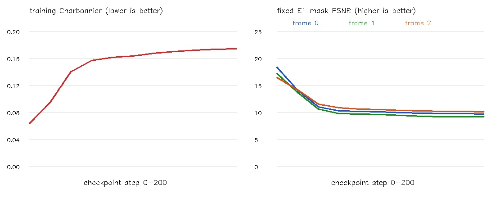
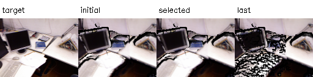
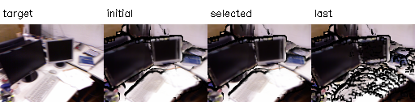
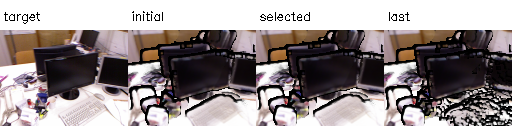

# E3 결과 보고서 — tum-freiburg1_desk-E3-20261112-001

**판정: 최적화 실행·평가는 완료했으나, 현재 설정에서 효과는 실패.** 200회 학습 후 RGB 손실·PSNR·Coverage가 악화했고, 평가한 11개 체크포인트 중 최선은 초기 0회였다. selected는 초기 점군이며 개선된 결과로 포장하지 않는다. 실제 점 위치가 바뀐 200회 last도 별도로 보존했다.

## 실행 조건과 입력 보존

2026-11-12, Asia/Seoul. E2 `tum-freiburg1_desk-E2-20261112-001` 초기 공유점과 부모 Manifest의 전체 해시를 검증했다. 호스트 RTX 5060에서 샌드박스 밖 GPU 실행, Python 3.11.18 / PyTorch 2.15.0+cu132다. E2 초기 510,427점 중 다중 관측·비영 시차·모든 출처의 추정 V 조건을 통과한 **67,906점**만 학습했다. 나머지 442,521점은 고정했다.

카메라·RGB·반경·관측 그룹·owner는 고정했다. E3는 Photo Charbonnier(ε=.001)만 사용하며 Anchor/Surface/CrossDepth 손실은 없다. 매 카메라의 고정 픽셀 평균 손실을 1/3씩 합산하고 GPU 그래프는 순차 backward했다. Adam lr=.001, 200회, delta gradient clip norm=1, log-Ray delta∈[-.05,.05], Seed=0을 실행 전에 고정했다. 이 제약은 Ray 거리의 약 −4.877~+5.127% 이동에 해당하며 GT 기반 제한은 아니다.

`xyz = xyz0 + unit_owner_ray * d0 * expm1(delta)`로 초기 XYZ를 정확히 유지하며 시작했다. d0는 Ray 거리로 camera Z-depth와 다르다. 같은 P2 Gaussian(σ=.65px, 5×5, hard front gate 3%)을 사용했다. Hard stencil/front 결정은 매 Forward에 다시 계산하지만 그 결정 변화는 미분하지 않는다. E2 active set은 고정했다.

128×96 target RGB는 E2와 같고, train mask는 초기 F1 alpha≥.5와 E1 고정 마스크의 교집합이다. 이후 Coverage가 줄어도 그 픽셀을 손실에서 빼지 않았다. E1 고정 마스크 PSNR도 별도로 보고했다. **학습 프로세스는 GT를 읽지 않았으며 체크포인트 선택도 GT를 사용하지 않았다.**

## 학습 결과와 체크포인트 선택

0/20/…/200회의 11개 상태를 평가·보존했다. selected는 그중 학습 Charbonnier가 가장 낮은 상태다. 독립 validation이나 GT 최적 모델이 아니다.

| Step | 학습 Charbonnier | Frame 0 PSNR | Frame 1 PSNR | Frame 2 PSNR | log 이동 bound 도달 점 |
| --- | ---: | ---: | ---: | ---: | ---: |
| 0 | 0.064585 | 18.480 | 17.316 | 16.580 | 0 |
| 20 | 0.095344 | 14.189 | 13.797 | 14.304 | 0 |
| 40 | 0.141004 | 11.108 | 10.723 | 11.624 | 0 |
| 60 | 0.157936 | 10.370 | 9.904 | 10.968 | 2934 |
| 80 | 0.162332 | 10.309 | 9.755 | 10.722 | 3333 |
| 100 | 0.164397 | 10.250 | 9.728 | 10.607 | 3069 |
| 120 | 0.168490 | 10.072 | 9.534 | 10.460 | 2868 |
| 140 | 0.171220 | 9.971 | 9.412 | 10.395 | 2700 |
| 160 | 0.173193 | 9.880 | 9.329 | 10.301 | 2586 |
| 180 | 0.174204 | 9.879 | 9.304 | 10.262 | 2497 |
| 200 | 0.175130 | 9.806 | 9.254 | 10.248 | 2456 |

최선 체크포인트는 **step 0**, 손실 **0.064584576**다. 마지막 손실은 **0.175130183**로 증가했다. 초기 렌더는 E2와 최대 약 1.3e-6 RGB 차이로 일치했다. 선택 상태의 좌표와 PLY 필드는 초기 상태와 정확히 같았다. 200회 last의 실제 이동 결과를 삭제하거나 selected로 대체하지 않았다.

| Frame | 초기 전체 Coverage | last 전체 Coverage | 초기 E1 고정 영역 누락 | last E1 고정 영역 누락 |
| --- | ---: | ---: | ---: | ---: |
| 0 | 88.73% | 72.11% | 46 | 2161 |
| 1 | 87.35% | 68.68% | 53 | 2442 |
| 2 | 83.27% | 71.05% | 27 | 1618 |

마지막 영상에 구멍·색상 불일치가 증가했다. 동일 마스크를 유지했으므로 어려운 픽셀을 제거해 점수를 높인 결과는 아니다. 이번 조건은 자기 입력 시점·고정 원본 색상이며 독립 시점 일반화 실험이 아니다.

## 실제 좌표 변화와 데이터 계약

last에서 1e-8 모델 단위보다 크게 이동한 active 점은 **65,010개**였다. Active 변위의 평균 **0.013314993**, 중앙값 **0.011540672**, P95 **0.036629333**, 최대 **0.096327049**다. 이 단위는 모델 스케일이며 실제 오차 감소량이 아니다. Log bound에 도달한 점은 2,456개다.

비활성 XYZ, 고정 RGB, 원본 obs CSR·source_to_shared·owner·n_observed는 정확히 유지됐다. 모든 이동은 초기 owner Ray에 평행하며 거리 양수·log bound를 검증했다. shared NPZ는 초기 xyz0와 현재 xyz를 함께 보존한다. visibility_initial과 현재 좌표로 재계산한 visibility_estimated를 분리했다. Normal0·parallax 등 inherited metadata는 초기 상태의 값이며, 현재 기하로 다시 추정한 값으로 해석하지 않는다.

## 사후 GT Depth 평가

GT는 학습 및 선택을 끝낸 뒤 P1의 `aligned_0/1/2.npz`를 읽고 부모 Manifest 해시와 대조했다. 이미 RGB 격자에 맞춘 TUM Depth를 추가 scale 보정 없이 미터 값으로 사용했다. 예측은 native 512×384에서 현재 전체 점군의 nearest-pixel front Z를 사용했다. 저해상도 RGB 렌더의 Gaussian 평균 Depth와는 다른 평가다.

초기 E2 front Z와 GT의 유효 격자에서 전 카메라 공통 `median(GT/initial Z)` 한 개를 계산했다. **scale=1.322891202201 m/model-unit**이며 selected/last에 재추정하지 않았다. XYZ·PLY에 이 scale을 적용한 것은 아니며 출력은 기존 모델 좌표계다.

초기 GT 평가 영역은 448,144픽셀이고, 초기·selected·last가 모두 값을 제공하는 공통 영역은 **439,400픽셀**이다. last의 초기 고정 영역 coverage는 Frame별 약 98.14%, 98.03%, 97.96%다. 공통 mask의 before/after를 동일 분모로 계산하고 누락 coverage를 따로 보존했다.

| 상태 | 공통 픽셀 | GT Depth RMSE (m) | AbsRel |
| --- | ---: | ---: | ---: |
| initial | 439,400 | 0.164116643 | 3.672696% |
| selected | 439,400 | 0.164116643 | 3.672696% |
| last | 439,400 | 0.164567258 | 3.839305% |

last의 수치는 소폭 악화했으며 개선을 확인하지 못했다. GT는 scale alignment에 사용된 같은 입력 시점이고, 카메라는 예측값이며 센서 시간 차이·등록 오차가 남는다. 공통 mask는 모든 출력 coverage의 교집합이므로 누락 영역의 정확도까지 대표하지 않는다. 이는 **동일 입력 시점의 scale-aligned image-depth 지표**이며 전체 3D 점군 정확도나 held-out 성능의 증거로 확대하지 않는다. 반복 실험을 통한 통계적 유의성도 평가하지 않았다.

## 손실 방향 진단

실제 초기 장면에서 계산한 delta Gradient norm은 **0.000338068**로 유한하고 0이 아니었다. 초기 Adam 방향 `−g/(|g|+1e−8)`에 대한 Autograd 방향 미분은 **-0.029886641**로 감소를 예측했다. 같은 초기점에서 전체 렌더링을 다시 계산한 유한차분은 다음과 달랐다.

| ε | +Adam 방향 실제 손실 | 1차 예측 손실 | 중심 유한차분 방향 미분 |
| --- | ---: | ---: | ---: |
| 1e-06 | 0.064585591 | 0.064584546 | -0.512227 |
| 1e-05 | 0.064590845 | 0.064584277 | 0.302494 |
| 0.0001 | 0.064595025 | 0.064581587 | 0.062929 |
| 0.001 | 0.064782316 | 0.064554689 | 0.076681 |

ε=1e-5~1e-3에서는 전체 함수의 방향 미분 부호가 Autograd와 달랐고, 아주 작은 ε에서도 변화가 안정적이지 않았다. 새 stencil·hard depth front가 선택되는 효과와 float32 수치 정밀도가 포함된다. P2/P2a의 안정 영역 미분 통과를 실제 밀집 점군의 모든 상태에 일반화할 수 없다는 증거다.

이 진단으로 hard visibility가 유일한 실패 원인이라고 증명한 것은 아니다. 학습률·파라미터화·점 밀도·픽셀 cutoff·가림 규칙의 영향을 더 분리해야 한다. 이번 결과를 VGGT-Ω나 RGB 기반 기하 보정 방법 전체의 불가능성으로 해석하지 않는다. 실패를 숨기기 위해 설정을 바꾸거나 양호한 결과만 선택하지 않았다.

## 파일·재현·완료 판단

루트: `results/pointmap_refinement/tum-freiburg1_desk-E3-20261112-001/stages/E3/`.

- `artifacts/maps/shared_map_initial.ply`: E2 초기 PLY의 그대로인 사본.
- `artifacts/maps/shared_map_selected.ply` 및 NPZ: 선택된 0회 상태, **좌표 개선 없음**.
- `artifacts/maps/shared_map_last.ply` 및 NPZ: **200회 실제 이동이 적용된 악화 결과**.
- `artifacts/checkpoints/step_XXXX.pt/npz`: delta·active ID·optimizer state·RNG와 중간 상태.
- `artifacts/renders/`: selected/last RGB·Depth·alpha·고정 마스크, native Depth/GT mask, PNG.
- `evaluation/`: 학습 이력·step log·변위·GT scale/지표·예측 일관성·방향 진단·검증·판정.
- `logs/`, `config_resolved.json`, `artifacts/source/`, `manifest.json`: 명령·코드·설정·부모·해시.

[학습](../../../../../experiments/pointmap_refinement/E3/train.py), [방향 진단](../../../../../experiments/pointmap_refinement/E3/diagnose.py), [사후 평가](../../../../../experiments/pointmap_refinement/E3/evaluate.py)를 모두 종료 코드 0으로 수행했다. NPZ/PLY를 다시 읽어 저장 전 값과 대조했고, 초기 선택점의 PLY XYZ·RGB·관측 메타데이터가 E2 초기와 일치함을 확인했다.

200회 wall time은 체크포인트 평가·저장을 포함해 **10.556초**였다. PyTorch peak allocated **625.386MiB**, reserved **852.000MiB**이며 모델 동시 추론의 자원 수치가 아니다. 종료 후 GPU 사용량은 로그에 보존했다.

**E3 실행·평가 완료, 현재 설정에서 최적화 효과 실패로 종료한다.** 더 자유로운 XYZ 이동(E4)으로 바로 확대하기보다, 별도 E3a에서 가림/stencil 선택 고정 또는 연속화와 작은 이동의 실제 손실 방향을 우선 분리 검증하는 것이 다음 판단에 필요하다. 이번 회차에서는 E3a/E4를 실행하지 않았다.
