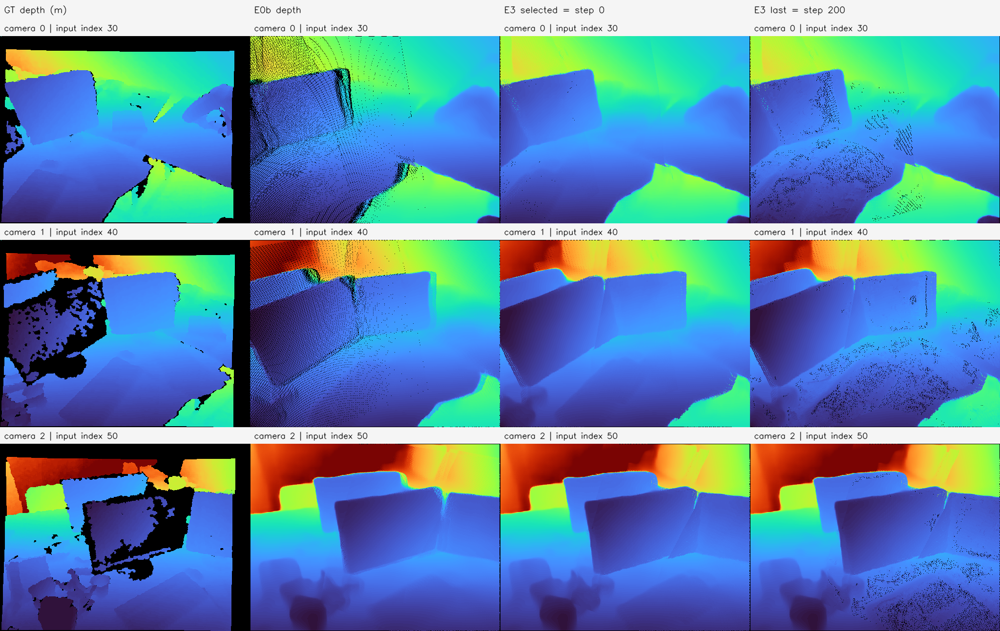
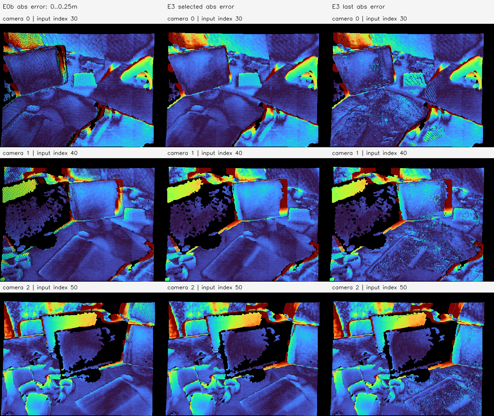
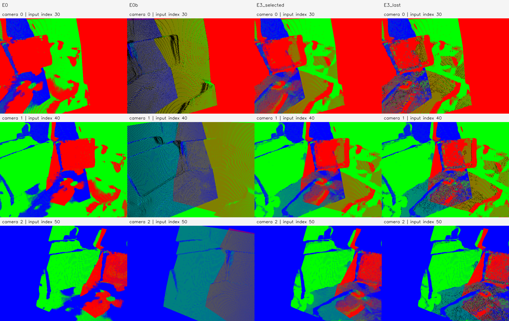

# E3b 비교 보고서 — tum-freiburg1_desk-E3b-20261112-001

**판정: 비교 실행·검증 완료. 이 샘플의 공통 유효 영역에서는 E0b가 기존 E3 selected/last보다 GT 깊이 오차가 낮지만, 초기 고정 영역의 coverage도 낮았다.** 새 학습은 수행하지 않았다. 동일 입력 시점의 scale-aligned 깊이 평가이며 독립 시점·전체 3D·벽 ROI 정확도 개선으로 일반화하지 않는다.

## 비교 대상과 질문

E0b의 단순 순차 깊이 평균·이전 점 치환 결과를 기존 E3의 Photo-only 최적화 결과와 비교한다. E0 원본도 기준선으로 포함한다. E0b에 E3 최적화를 새로 적용하는 실험은 아니다.

| 방법 | 기존 Run ID | 점 수 | 의미 |
| --- | --- | ---: | --- |
| E0 | tum-freiburg1_desk-E0-20261112-001 | 589,824 | 3장 공동 추론의 원본 역투영 점군 |
| E0b | tum-freiburg1_desk-E0b-20261112-001 | 341,325 | 0→1→2 순차 픽셀 깊이 평균 및 이전 점 치환 |
| E3_selected | tum-freiburg1_desk-E3-20261112-001 | 510,427 | 학습 손실로 선택된 step 0, E2 초기와 좌표 동일 |
| E3_last | 위와 동일 | 510,427 | 실제 200회 이동 후 결과, selected 대비 65,010점 이동 |

E3가 초기 상태를 최선으로 선택했으므로 selected를 개선된 최적화 결과라고 해석하지 않는다. last를 별도로 비교해 실제 좌표 변경의 결과를 포함했다. 부모의 완료 상태·산출물 해시를 검증하고 원본 관측 589,824개의 대응 인덱스를 각 지도에 연결했다.

## 사전 고정 평가 계약

- **카메라/해상도:** 동일한 원본 예측 Intrinsics/Extrinsics, 512×384. GT 자세로 교체하지 않는다.
- **깊이 투영:** 기존 E3 GT 평가와 같은 E1 `front_map`, 최소 양수 camera-Z, 최근접 픽셀. 투영 중심이 `[0,W−1]×[0,H−1]` 안에 있어야 한다.
- **스케일:** 기존 E3에서 E2 초기로 맞춘 값 **1.3228912022012644m/model-unit**을 그대로 재사용한다. E0b나 last에 다시 맞추지 않는다. 점군 PLY 좌표는 원래 모델 스케일을 유지한다.
- **고정 영역:** E3의 초기 유효 front Z와 GT가 있던 **448,144픽셀**을 재사용한다. 각 방법의 누락/coverage를 이 분모로 보고한다.
- **주 비교 영역:** 고정 영역 안에서 네 방법 모두 유효한 깊이를 제공하는 **416,835픽셀**. Camera 0/1/2는 각각 143,919 / 132,058 / 140,858픽셀이다. 모든 방법의 RMSE/AbsRel 분모가 같다.
- **누락:** 값을 제공하지 않은 픽셀은 오차 0으로 처리하지 않는다. 공통 영역에서 제외하되 방법별 누락 수·coverage를 별도로 보고한다. 공통 영역은 출력 coverage에 의존하므로 전체 영역 성능을 대표하지 않을 수 있다.
- **GT:** 기존 P1의 RGB 격자에 등록된 TUM 깊이와 그 해시를 재사용한다. 사후 평가에만 읽으며 새 학습·모델 선택·파라미터 조정에 사용하지 않는다.

RMSE는 픽셀별 제곱오차를 전 카메라에서 합산한 뒤 전체 공통 픽셀 수로 나누어 제곱근을 취했다. AbsRel도 픽셀 수로 가중해 합쳤다. 카메라별 RMSE의 단순 평균이 아니다. 결과별 covered-only 지표는 [gt_depth.json](gt_depth.json)에 보존하지만 표본이 달라 주 비교로 사용하지 않는다.

## 주 결과: 같은 픽셀의 GT 깊이와 coverage

| 방법 | 공통 픽셀 RMSE (m) ↓ | 공통 픽셀 AbsRel ↓ | 고정 영역 Coverage ↑ | 고정 영역 누락 픽셀 ↓ |
| --- | ---: | ---: | ---: | ---: |
| E0 | 0.159959030 | 3.589403% | 100.000000% | 0 |
| E0b | **0.144257106** | **3.368203%** | 94.896953% | 22,869 |
| E3_selected | 0.159963431 | 3.591228% | **100.000000%** | 0 |
| E3_last | 0.160427350 | 3.759016% | 98.048841% | 8,744 |

E0b는 E3 selected 대비 공통 영역 RMSE가 약 **9.82%**, AbsRel이 약 **6.21%** 낮았다. E3 last 대비는 각각 약 **10.08%**, **10.40%** 낮았다. 반면 E0b의 coverage는 selected보다 약 **5.10%p** 낮고, last보다 약 **3.15%p** 낮았다. 누락된 영역의 정확도를 평가한 수치가 아니므로 한 방법의 전반적 우월성으로 결론 내리지 않는다. E0와 E3 selected의 공통 RMSE는 거의 같았고 last는 소폭 악화했다.

| 카메라 | 방법 | 공통 픽셀 | RMSE (m) | AbsRel | 고정 영역 Coverage |
| --- | --- | ---: | ---: | ---: | ---: |
| 0 | E0b | 143,919 | 0.105376 | 2.912390% | 91.522769% |
| 0 | E3_selected | 143,919 | 0.108731 | 2.945641% | 100.000000% |
| 0 | E3_last | 143,919 | 0.109832 | 3.175495% | 98.142797% |
| 1 | E0b | 132,058 | 0.136582 | 3.002691% | 93.565019% |
| 1 | E3_selected | 132,058 | 0.165815 | 3.511629% | 100.000000% |
| 1 | E3_last | 132,058 | 0.166225 | 3.698255% | 98.033351% |
| 2 | E0b | 140,858 | 0.180964 | 4.176598% | 99.991655% |
| 2 | E3_selected | 140,858 | 0.194592 | 4.325469% | 100.000000% |
| 2 | E3_last | 140,858 | 0.194763 | 4.412184% | 97.959666% |

세 카메라의 공통 영역에서 모두 E0b의 RMSE/AbsRel이 더 낮았다. Camera 1의 감소 폭이 가장 컸다. E0b의 Camera 2 coverage가 과거 E0b 색상 투영의 100%와 조금 다른 것은 이번 GT 평가는 기존 E3의 엄격한 투영 중심 경계를 그대로 사용하기 때문이다. 원래 색상 투영은 반 픽셀 넓은 픽셀 셀 경계를 사용했다. 이번 비교 내에서는 방법별로 같은 구현을 사용했다.

## 기존 E3 평가 재현

이번 비교에 앞서 E3 selected/last의 native 깊이 배열이 기존 저장 배열과 NaN 위치까지 정확히 같은지 확인했다. 기존 E3 공통 영역 **439,400픽셀**의 pooled 지표도 1e-12 이내로 재현했다.

| 기존 E3 영역의 상태 | 재현 RMSE (m) | 재현 AbsRel |
| --- | ---: | ---: |
| selected | 0.164116643 | 3.672696% |
| last | 0.164567258 | 3.839305% |

이 수치와 위 주 결과가 다른 이유는 **E0b를 포함하면서 공통 평가 픽셀이 416,835개로 바뀌었기 때문**이다. E3 좌표나 스케일을 바꿔 점수를 개선한 것이 아니다. 두 표를 같은 분모의 개선 전후로 비교하지 않는다.

## 깊이·오차·출처 그림



행은 Camera 0/1/2, 열은 GT/E0b/E3 selected/E3 last다. 같은 TURBO 표시 범위 **0.8162~3.3586m**를 사용했다. 이는 GT 유효 깊이의 1/99분위에서 정한 그림 범위이며 수치 평가에서는 깊이를 자르지 않았다. 검정은 깊이 미제공 영역이다. GT는 센서의 무효 픽셀도 검정으로 남는다. 그림의 구멍은 최근접 한 픽셀 footprint와 점 삭제·이동을 포함하므로 실제 표면의 구멍과 같지는 않다.



열은 E0b/E3 selected/E3 last이며 절대 깊이 오차의 같은 표시 범위 **0~0.25m**를 사용했다. 낮은 오차는 어두운 파랑 계열, 큰 오차는 노랑·빨강 계열이다. 0.25m 이상의 오차는 그림에서만 최댓값으로 표시하고 수치 계산은 자르지 않았다. 검정은 GT 또는 예측 깊이가 없는 영역이다. 이 그림은 GT/예측이 있는 전체 영역의 정성 진단이며 주 표의 공통 마스크와 동일한 표시 영역은 아니다.



열은 E0/E0b/E3 selected/E3 last다. E0a와 같은 RGB 팔레트와 native 최근접 픽셀 z-buffer를 사용했다. 최종 점이 포함한 서로 다른 원본 프레임 색을 같은 가중치로 평균했다. E0b는 최신 카메라 owner, E3는 E2에서 선택한 owner라 의미가 달라, owner 색 대신 원본 출처 혼합색을 주 그림으로 사용했다. owner 영상/PLY도 별도로 저장했다.

E0b의 혼합색 영역이 넓은 것은 원본 출처가 더 많이 같은 대표점에 묶였기 때문이다. 두 개 이상 프레임이 포함된 점은 E0b 171,466개, E3 selected/last 71,002개다. 이것은 그룹 구성의 차이이며 올바른 대응이나 정확도 증거로 쓰지 않는다. 실제 출처 수·그룹별 관측 수는 [structure.json](structure.json)에 기록했다.

## 검증·재현·판정의 범위

2026-11-12, Asia/Seoul. 호스트 CPU에서만 실행했고 GPU/VRAM을 사용하지 않았다. Python 3.11.18 / NumPy 1.26.4 / OpenCV 4.11.0이며 새 비교 실행 wall time은 약 **4.399초**다. [환경](environment.json), [설정](config.json), [Manifest](manifest.json), [검증](verification.json)을 보존했다.

```bash
OPENBLAS_NUM_THREADS=2 .venvs/p0-py311/bin/python \
  experiments/pointmap_refinement/E3b/run.py \
  --run-id tum-freiburg1_desk-E3b-20261112-001
```

재실행에는 새 Run ID를 지정한다. [실행 코드](../../../../../experiments/pointmap_refinement/E3b/run.py), [재현 안내](../../../../../experiments/pointmap_refinement/E3b/README.md) 참조.

부모 산출물 해시, 원본 관측→지도 인덱스·개수·출처 비트맵, selected=초기 좌표, 기존 E3 깊이·GT 점수 재현, 알려진 깊이 오차 예제, 단일 스케일·동일 공통 마스크, 결과별 누락 보고, PLY/PNG/native 깊이 NPZ 재로딩을 검증했다. 그림 3종을 열어 표시 범위·카메라 행·방법 열과 누락 영역을 확인했다. 실행 종료 코드는 0이다.

결과는 **현재 한 샘플에서 단순 깊이 평균이 기존 E3 selected/last보다 낮은 공통 영상 깊이 오차를 보였지만 coverage는 희생했다**는 데 한정한다. RGB 학습 손실·새 최적화·독립 시점·전체 3D/벽 두께는 평가하지 않았다. E0b는 다른 표면을 잘못 합칠 수 있으며 E3는 기존 구현·설정에서 실패한 결과다. 이 비교를 RGB 최적화 일반과 모든 융합 방식의 우열로 확대하지 않는다. 반복·통계적 유의성도 검증하지 않았다.

## 로컬 산출물

루트: `results/pointmap_refinement/tum-freiburg1_desk-E3b-20261112-001/stages/E3b/`.

- `artifacts/maps/E0b_source_mix.ply`, `E3_selected_source_mix.ply`, `E3_last_source_mix.ply`: 같은 원본 출처 팔레트로 재출력한 비교 점군. 각 부모의 XYZ는 변경하지 않았다.
- 같은 폴더의 `*_owner.ply`: 각 방법의 owner 정책에 따른 색상 PLY. 서로 같은 의미의 출처 색으로 해석하지 않는다.
- `artifacts/native_depth/METHOD_camera_XX.npz`: 모델/미터 깊이, GT 깊이, 고정/공통 마스크.
- `artifacts/projections/`: 네 방법의 원본 출처 혼합색·owner PNG 및 앞면 점 ID·출처 버퍼.
- `artifacts/figures/`: 깊이·절대 오차·원본 출처 패널 3종.
- `evaluation/gt_depth.json`, `structure.json`, `verification.json`: 같은 분모의 GT 점수·coverage·기존 평가 재현·구조·검증.
- `artifacts/source/`, `logs/`, `environment.json`, `progress.md`, `manifest.json`: 코드·설정·도우미·환경·진행·입출력 해시.

코드·설정·보고서·소규모 그림·출처 기록은 GitHub에 반영하고 PLY/대용량 NPZ는 로컬에 보존한다.
