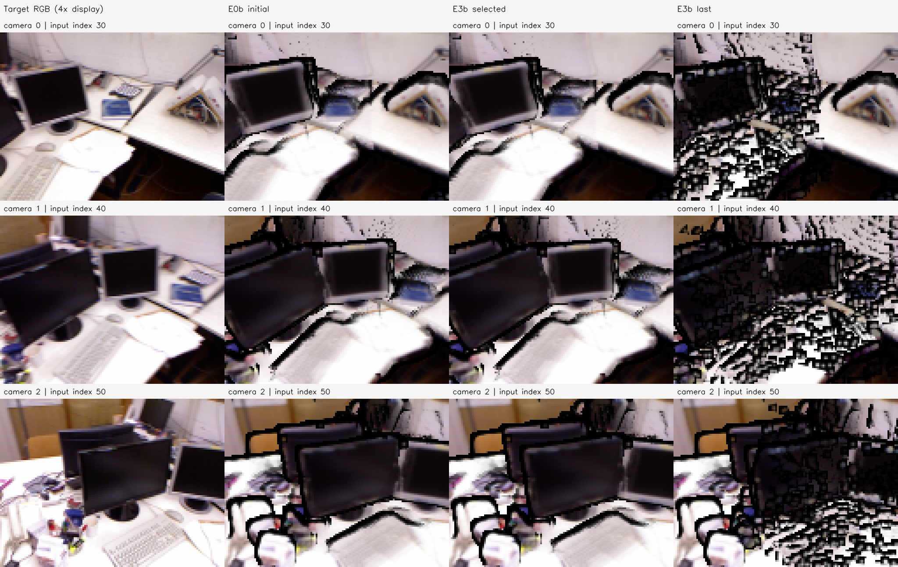
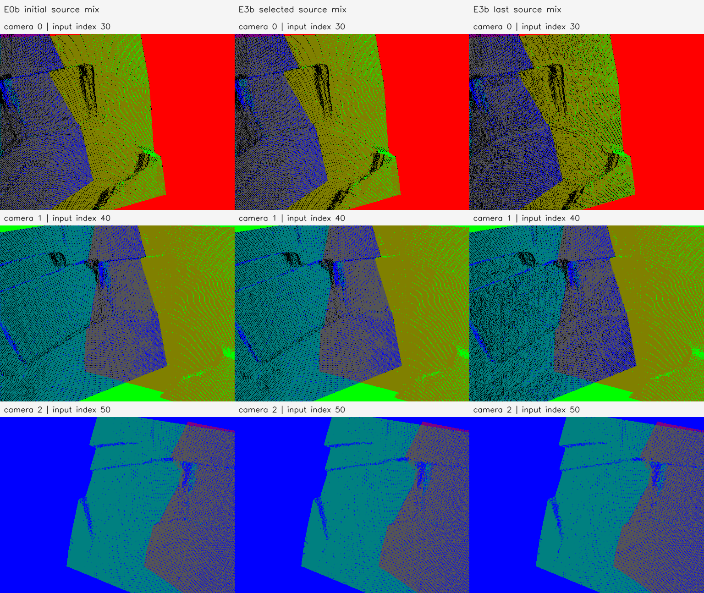

# E3b 결과 보고서 — tum-freiburg1_desk-E3b-20261112-002

**판정: E0b 융합 점군에서 시작한 실제 RGB 미분 위치 최적화의 실행·검증은 완료했으나, 현재 설정의 개선 효과는 실패했다.** 200회 후 실제 126,222개 점이 이동했지만 RGB 손실·PSNR·Coverage가 악화했다. 평가한 체크포인트 중 최선인 selected는 초기 step 0이며, 실제 이동된 last도 별도로 보존한다.

## 실험코드 정정과 초기값

사용자의 명시 요청으로 비교만 수행했던 E3b의 코드·보고서·로컬 Run `tum-freiburg1_desk-E3b-20261112-001`을 삭제했다. 이전 기록은 Git 커밋 `6de932f167f577ddcb7b7b500412da53eb69444e`에 남기고, 현재 E3b는 **E0b를 초기값으로 사용하는 원본 RGB 역전파 정점 이동 실험**으로 재지정했다. 기존 삭제 범위·해시는 [삭제 기록](../replacement.json)에 보존했다. 이번 새 Run은 `...-002`이며 E0b/E3 등 다른 실험은 변경하지 않았다.

부모는 `tum-freiburg1_desk-E0b-20261112-001/stages/E0b`다. E0b의 341,325개 XYZ·최신 owner·원본 관측 CSR를 정확히 재사용했다. E0b를 다시 융합하거나 E2의 초기점을 대신 사용하지 않았다. 입력 `fused_map.npz` SHA-256은 `3be5021fd1a89516e65d058b35f17a81941020bb7c64c0962f28c3ad9e19a67e`다. 원본 RGB 관측은 E0에서 읽었으며 모든 부모 해시를 실행 전후 대조했다.

## 미분 이동·색상·가시성 계약

- **학습 변수:** 기존 E3와 같은 owner 시선 방향의 log 거리 변수 delta. `xyz = xyz0 + unit_owner_ray × distance0 × expm1(delta)`이므로 delta=0은 E0b 초기 좌표와 정확히 같다. 자유로운 XYZ 3축 최적화는 아니다.
- **고정:** 카메라·341,325개 점의 수·관측 그룹·owner·RGB·반경·opacity 규칙. RGB는 원본 관측 색의 E0b 그룹별 채널 median으로 한 번 집계했다. 프레임 팔레트 색으로 원본 사진 손실을 계산하지 않는다.
- **학습 후보:** 서로 다른 2개 이상 출처 카메라, 비영 시차, 모든 출처의 초기 추정 가시성. E2/E3와 같은 front 3%, 원본 Depth prior 3%+median Depth×.002, Depth 경계 3%, Confidence 하위 10% 제외 정책을 적용했다. 후보 집합은 학습 중 고정했다.
- **후보 수:** 다중 출처 171,466개 중 135,193개가 통과했다. 나머지 206,132점은 고정했다. 다중 관측은 실제 물리 대응/정확한 기하의 GT 증명이 아니다.
- **Renderer:** 기존 P2 Gaussian, sigma=.65px, radius=2px, 5×5 stencil, hard front gate=3%, 검은 배경. Forward마다 stencil/front 선택은 갱신하지만 선택 변화는 미분하지 않는다.
- **손실/학습:** Photo Charbonnier epsilon=.001만 사용. Adam lr=.001, gradient clip norm=1, delta∈[-.05,.05], 200회, Seed=0. 거리 이동 범위는 약 −4.877~+5.127%다. Anchor/Surface/CrossDepth 손실은 없다.
- **목표/마스크:** 원본 전처리 RGB를 128×96으로 INTER_AREA 축소했다. centre-based affine으로 K를 변환했다. 초기 E0b alpha≥.5와 E1 F0 고정 마스크의 교집합을 학습 내내 고정했다. 세 카메라 손실은 각각 1/3 가중치로 합산했다. Coverage가 줄어도 손실 픽셀을 제외하지 않았다.
- **선택:** 0/20/.../200의 11개 체크포인트 중 학습 Charbonnier 최소값. 독립 validation이나 GT 최적 모델 선택이 아니다. 학습 프로세스는 GT 배열을 읽지 않았다.

## 학습과 실제 좌표 변화

| Step | Photo Charbonnier | Camera 0 PSNR | Camera 1 PSNR | Camera 2 PSNR | 이동 bound 도달 점 |
| --- | ---: | ---: | ---: | ---: | ---: |
| 0 | 0.059157 | 16.434 | 15.902 | 16.107 | 0 |
| 20 | 0.101630 | 12.460 | 12.252 | 13.432 | 0 |
| 40 | 0.158180 | 9.883 | 9.434 | 10.953 | 0 |
| 60 | 0.186000 | 9.112 | 8.640 | 10.145 | 5,638 |
| 80 | 0.196164 | 8.928 | 8.298 | 9.834 | 6,644 |
| 100 | 0.201584 | 8.851 | 8.158 | 9.628 | 6,073 |
| 120 | 0.202618 | 8.900 | 8.123 | 9.632 | 5,648 |
| 140 | 0.205136 | 8.829 | 8.055 | 9.583 | 5,322 |
| 160 | 0.208575 | 8.733 | 8.007 | 9.475 | 5,036 |
| 180 | 0.208665 | 8.760 | 7.979 | 9.509 | 4,846 |
| 200 | 0.209852 | 8.727 | 7.936 | 9.520 | 4,799 |

PSNR는 같은 E1 고정 마스크에서 계산했다. 최선 체크포인트는 **step 0**, 손실 **0.059157044937**이며 last는 **0.209851930539**다. selected의 XYZ는 E0b 초기 XYZ와 정확히 같다. 초기 base 직접 렌더와 delta=0 파라미터화 렌더는 float32 계산 순서에 따른 최대 약 1.26e-6 RGB 차이 이내였다.

last에서 1e-8 모델 단위 이상 이동한 active 점은 **126,222개**다. Active 변위 평균 0.017272897, 중앙값 0.015704852, P95 0.040217755, 최대 0.136612550 모델 단위다. 4,799개가 이동 bound에 도달했다. 고정점 좌표와 점의 색·CSR·owner 등 초기 메타데이터는 그대로 유지했다. 변위는 오차 감소량이나 미터 값이 아니다.

| 카메라 | 초기 전체 RGB Coverage | last 전체 RGB Coverage | 초기 E1 영역 누락 | last E1 영역 누락 |
| --- | ---: | ---: | ---: | ---: |
| 0 | 86.987% | 62.817% | 424 | 3,445 |
| 1 | 85.026% | 50.041% | 597 | 4,963 |
| 2 | 82.528% | 59.367% | 388 | 3,237 |

열은 목표 RGB/E0b 초기/selected/last, 행은 Camera 0/1/2다. 학습 해상도 128×96을 최근접으로 4배 확대해 보여 주며 보간으로 구멍을 채우지 않았다. 마지막 영상의 구멍과 색상 불일치 증가를 그대로 보존했다.

각 점의 원본 출처 혼합색은 학습 전후 고정이며, 카메라별 native z-buffer 투영을 비교했다. 이 그림은 원본 사진 재현 손실의 색상과 다르다. 실제 이동된 last에서도 팔레트 그림의 차이가 작아 보일 수 있으므로 좌표 변위·RGB·깊이 지표를 함께 확인한다.

## 사후 GT 깊이 평가

학습과 체크포인트 선택이 끝난 뒤 P1의 GT 깊이를 처음 읽었다. 초기 E0b의 native 512×384 최소 front-Z와 유효 GT에서 한 개의 `median(GT/initial Z)`를 계산했다. 스케일은 **1.3171403295592672m/model-unit**이며 selected/last에 다시 맞추지 않았다. PLY 좌표에 이 스케일을 적용하지 않았다.

초기 GT 고정 영역은 425,327픽셀이고, 초기/selected/last 모두 유효한 공통 영역은 **402,577픽셀**이다. 아래 오차의 분모는 모두 같은 공통 영역이며 고정 영역 coverage와 누락을 따로 계산했다.

| 상태 | 공통 픽셀 | GT Depth RMSE (m) | AbsRel | 초기 GT 영역 Coverage |
| --- | ---: | ---: | ---: | ---: |
| E0b 초기 | 402,577 | 0.146851644 | 3.374634% | 100% |
| E3b selected | 402,577 | 0.146851644 | 3.374634% | 100% |
| E3b last | 402,577 | 0.147653167 | 3.653819% | 94.651174% |

last의 오차는 소폭 악화했다. 고정 영역 coverage는 Camera 0/1/2에서 90.753/93.188/100%다. 이 평가는 같은 입력 시점·예측 카메라의 scale-aligned image depth이며, 전체 3D 정확도·독립 시점 성능·실제 벽 두께의 증거는 아니다. GT 무효 픽셀·등록/시간 차이·공통 영역 선택의 한계가 남는다. 삭제된 비교 전용 E3b와 스케일/마스크가 다른 새 전후 평가다.

## 초기 손실 방향 진단

실제 초기 장면의 delta Gradient norm은 **0.000656585**로 유한하고 0이 아니었다. 초기 Adam 방향에 대한 Autograd 미분은 **−0.072692648**로 감소를 예측했다. 같은 방향으로 전체 렌더를 다시 계산한 중심 유한차분은 다음과 같았다.

| epsilon | +Adam 방향 실제 손실 | 1차 예측 손실 | 중심 유한차분 미분 |
| --- | ---: | ---: | ---: |
| 1e-6 | 0.059157671 | 0.059156971 | +0.502914 |
| 1e-5 | 0.059157180 | 0.059156317 | +0.061560 |
| 1e-4 | 0.059172545 | 0.059149774 | +0.020303 |
| 1e-3 | 0.059439644 | 0.059084351 | +0.008450 |

초기 gradient가 예측한 감소 방향과 전체 렌더의 실제 변화가 일치하지 않았다. 기존 hard front/stencil 선택과 float32 정밀도의 영향을 포함한 진단이다. 이것만으로 유일한 원인을 특정하지는 않지만, E0b로 공유점 수를 늘려도 현재 렌더/미분 설정의 문제가 해결되지 않았음을 보여 준다. 개선된 결과를 얻기 위해 이번 Run의 학습률·gate·파라미터화를 사후 변경하지 않았다.

## 실행·저장 검증

**후속 렌더 진단:** 사용자가 초기 E0b 영상의 검은 테두리를 지적해 별도 [P2b](../../P2b/tum-freiburg1_desk-P2b-20261112-001/report.md)에서 저장 RGB/alpha만으로 색 합성의 영향을 분리했다. 좌표 변화 없이 alpha 곱 제거 시 검은 띠가 크게 줄었으므로 초기 검은 테두리를 E0b 기하 오류만으로 해석하지 않는다. 다만 초기 밝기 프로브의 어두운 픽셀 3,366개 중 학습 마스크 안은 207개여서 그 테두리만으로 본 Run의 실패 전체를 설명할 수 없다. 현재 hard 가림/stencil의 미분 불일치는 별도 문제이며, 원본 E3b 결과나 수치를 변경하지 않았다.

2026-11-12, Asia/Seoul. 준비·GT 평가·출력 검증은 호스트 CPU, 역전파는 **샌드박스 밖 RTX 5060**에서 실행했다. Python 3.11.18 / PyTorch 2.15.0+cu132 / NumPy 1.26.4 / OpenCV 4.11.0이다. 200회 wall time은 체크포인트 평가/저장을 포함해 **6.821896초**, PyTorch peak allocated **381.622MiB**, reserved **610MiB**다. 모델 동시 추론 자원이나 GPU 전체 메모리 사용량은 아니다.

[재현 안내](../../../../../experiments/pointmap_refinement/E3b/README.md)의 prepare→train→evaluate 순서로 실행했고 모두 종료 코드 0이다. [설정](config.json), [준비](preparation.json), [학습](training.json), [체크포인트 이력](checkpoint_history.json), [변위](displacement.json), [GT 평가](gt_depth.json), [방향 진단](direction_diagnostic.json), [검증](verification.json), [환경](environment.json), [Manifest](manifest.json)을 보존했다.

초기 XYZ/CSR가 E0b와 정확히 같은지, inactive 좌표가 고정됐는지, active 좌표가 저장한 delta의 시선 이동과 일치하는지, 이동 bound·비영 실제 변위·점 수·RGB/출처 메타데이터·학습 마스크가 유지됐는지 검증했다. PLY/NPZ/PNG 재로딩과 부모/실행 소스 해시 검사도 통과했다. initial visibility/parallax 메타데이터는 초기값이며 최적화 후 새로 추정한 값이 아니다.

## 산출물과 완료 판단

루트: `results/pointmap_refinement/tum-freiburg1_desk-E3b-20261112-002/stages/E3b/`.

- `artifacts/maps/initial_owner.ply`, `initial_source_mix.ply`: E0b 초기 좌표.
- `artifacts/maps/selected_owner.ply`, `selected_source_mix.ply`: 선택된 step 0, **이동 없음**.
- `artifacts/maps/last_owner.ply`, `last_source_mix.ply`: **200회 실제 미분 이동이 적용된 결과**.
- `artifacts/maps/shared_map_initial/selected/last.npz`: 초기/현재 좌표·고정 RGB·CSR·팔레트·ray·delta·active 인덱스.
- `artifacts/checkpoints/step_0000`~`step_0200.pt/npz`: 20회 간격의 delta·optimizer state·RNG·active 인덱스.
- `artifacts/renders/`, `artifacts/figures/`: RGB·alpha·고정 마스크·native 깊이/GT 마스크·출처 투영·패널.
- `artifacts/source/`, `evaluation/`, `logs/`, `progress.json`, `manifest.json`: 실행 소스·설정·진행·입출력 해시.

**요청한 E0b 초기값의 RGB 역전파 정점 이동은 완료했지만 최적화 효과는 실패했다.** selected=초기를 개선 결과로 내보내지 않으며, 실제 이동된 last도 삭제하지 않는다. 코드·보고서·소규모 그림은 GitHub에 반영하고 대용량 PLY/NPZ·체크포인트는 로컬에 보존한다.
