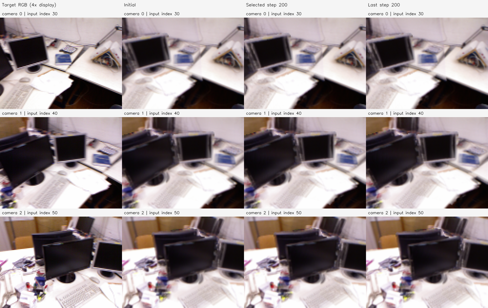
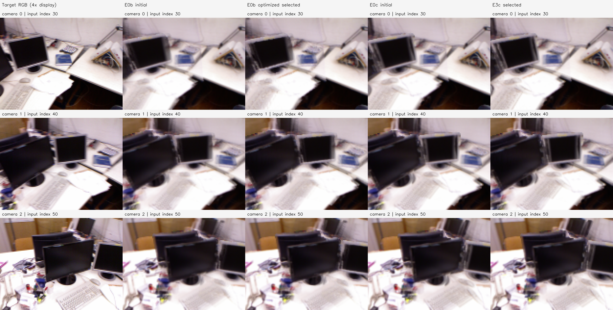
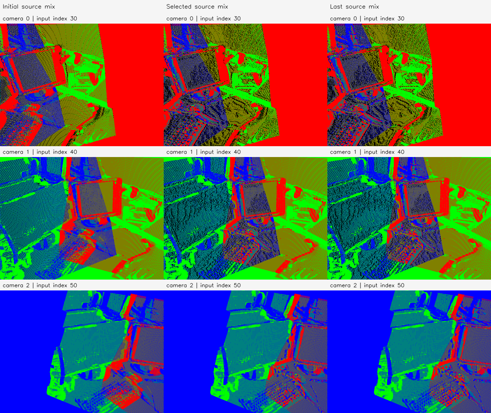

# E3c 결과 보고서 — tum-freiburg1_desk-E3c-20261112-001

**판정: E0c 색 조건 융합 점군에서 원본 RGB 역전파에 의한 정점 이동을 완료했다. 미분 검사와 RGB 감소는 통과했지만, 깊이 정확도 개선은 실패했다.** 419,864점 중 106,687점을 이동 후보로 정해 200회 최적화했고 실제 106,464점이 이동했다. RGB 손실은 2.333% 감소했지만 공통 영역의 GT 깊이 RMSE는 0.161851→0.165296m, AbsRel은 3.597179→4.505438%로 증가했다. 같은 렌더러의 E0b 대조군도 RGB 감소·깊이 악화를 보였다. 색 조건의 준비 효과가 이 설정에서 기하 개선으로 이어졌다는 증거는 없다.

## 목적과 비교 조건

E0c의 색 조건은 이후 미분 정점 이동을 위해 서로 다른 색의 관측이 하나의 정점에 묶이는 것을 줄이는 준비다. 이번에는 그 초기값에 실제 최적화를 적용했다. E0c 자체의 깊이 평균 효과와 이후 RGB 최적화 효과를 구분하고, 렌더러 변경이 섞이지 않도록 **같은 E3c 실행 안에 E0b 대조군과 E0c 처치군**을 두었다. E0b/E0c/E3b/P2c의 기존 결과·코드는 보존했다.

| 조건 | control_E0b | treatment_E0c: E3c 본 실험 |
| --- | ---: | ---: |
| 초기값 | E0b 순차 깊이 평균 | E0c 원본 RGB 채널별 범위 ≤30 융합 |
| 전체 점 수 | 341,325 | 419,864 |
| 다중 출처 그룹 | 171,466 | 129,182 |
| 이동 후보 | 135,193 | 106,687 |
| 이동하지 않는 점 | 206,132 | 313,177 |

카메라 3개와 원본 관측 589,824개는 E0와 같다. 영상 인덱스 30/40/50을 사용한다. E0c 초기 좌표·관측 CSR·점당 원본 RGB 중앙값을 정확히 재사용했다. E0b 준비 결과는 이전 E3b -002의 **초기 좌표·RGB·시선·가시성·active set·모든 공유 메타데이터와 정확히 일치**했다.

이 비교에서 처치에는 색 조건에 따른 그룹 구성·점 수·고정 RGB·이동 후보 수 변화가 함께 포함된다. 동일한 정점 집합에서 색 조건 하나의 계수만 바꾼 비교로 해석하지 않는다.

## 사전 고정 렌더·손실·이동 규칙

- P2c에서 검증한 `compact_soft` 렌더러를 수정 없이 사용했다. Compact C1 공간 kernel, σ=.65px, 반경=2px, 정규화 RGB 및 연속 깊이 가중치를 적용했다. RGB에 alpha를 곱하지 않는다.
- 카메라별 온도는 초기 E0b 양의 camera-Z 중앙값×.1인 `0.09041110278030895 / 0.09357169677591856 / 0.08572922916200763` 모델 단위다. 두 arm에 동일 적용하고 학습 중 변경하지 않았다.
- 렌더 해상도 128×96. 원본 RGB를 area 축소하고 반 픽셀 Intrinsics 변환을 적용했다. 학습 픽셀은 E1 고정 마스크와 **두 초기 점군에서 모두 compact support alpha≥.5인 영역**의 교집합이다. Camera 0/1/2의 10,944 / 10,780 / 10,253픽셀을 동일하게 고정했다.
- 점 색은 원본 관측 CSR 그룹의 채널별 RGB 중앙값으로 고정했다. 카메라·점 수·융합 그룹·관측 출처·active set·학습 마스크를 학습 중 바꾸지 않았다.
- 이동 후보 정책은 기존 E3b와 같다. 서로 다른 출처 카메라 ≥2, 비영 시차, 모든 출처의 초기 추정 가시성을 통과한 정점이다. Front/prior 깊이 3%, prior 절대 항 median Depth×.002, 경계 3%, confidence 하위 10% 제외를 초기 선정에 사용했다. 이는 학습 중 기하 유지 손실이 아니다.
- Owner 카메라의 시선 방향 거리만 `distance × exp(delta)`로 바꾼다. 이동에 따라 타 카메라에서 투영 픽셀 위치가 달라진다. 직접 2D 픽셀 변수나 자유 XYZ 이동은 사용하지 않았다.
- 세 카메라의 고정 마스크 Photo Charbonnier(ε=.001)를 같은 비중으로 평균했다. **손실은 RGB만 사용하며 anchor·surface·GT 손실은 없다.** Adam lr=.001, gradient clip norm=1, log delta±.05, seed=0, 정식 200회다.
- 체크포인트 0/10/20/40/.../200의 학습 손실 최소로 selected를 골랐다. GT는 이 선택에 사용하지 않았다. 두 arm 모두 selected=200이며 last와 좌표가 정확히 같다.

Alpha는 가림 전 compact spatial mass의 지원도 진단이다. 실제 불투명 표면 coverage나 GT 정합성을 뜻하지 않는다. 기존 E3b -002/P2c의 학습 마스크와 이번 공통 마스크는 정의가 다르므로 기존 손실 수치와 직접 비교하지 않는다.

## 실제 미분과 독립 10회 사전 검사

200회에 앞서 각 전체 점군에서 방향 미분과 짧은 최적화를 수행했다. 두 arm 모두 통과한 뒤 **delta=0·새 Adam으로 정식 200회**를 시작했다. 사전 검사의 마지막 좌표를 정식 초기값으로 사용하지 않았다.

| 검사 | E0b 대조군 | E0c 처치군 |
| --- | ---: | ---: |
| FP64 방향 미분 상대 오차, ε=1e-5 | 3.31673e-9 | 2.28772e-8 |
| FP64 방향 미분 상대 오차, ε=1e-4 | 3.62252e-7 | 2.28533e-6 |
| FP32 ε=1e-4 / 1e-3 실제 감소 | 모두 통과 | 모두 통과 |
| 10회 RGB 손실 | 0.044564713→0.044029847 | 0.047569258→0.047330388 |
| 고정 학습 픽셀 support 감소 | 0%p | 0%p |

[사전 검사 전체 기록](preflight.json). 기존 hard renderer의 미분 불일치와 구분해 이번에는 실제 전체 점군에서 감소 방향을 확인했다. 이는 손실의 미분 검증이며 물리 표면 정확도 검증은 아니다.

## 200회 결과와 실제 정점 이동

| 항목 | E0b 대조군 | E0c 처치군 |
| --- | ---: | ---: |
| 초기 RGB 손실 | 0.044564713 | 0.047569260 |
| selected=last RGB 손실 | 0.042271039 | 0.046459407 |
| 자기 초기값 대비 손실 감소 | 5.146840% | 2.333131% |
| 실제 이동 >1e-8 모델 단위 | 134,851점 | 106,464점 |
| 이동 후보 변위 평균 / 중앙값 | 0.044304463 / 0.042949041 | 0.042973180 / 0.041693276 |
| 이동 후보 변위 P95 / 최대 | 0.080532189 / 0.144685810 | 0.083340345 / 0.144685810 |
| log 이동 한계 도달 | 94,585점 (69.963%) | 70,574점 (66.151%) |
| 정식 GPU 최적화 시간 | 12.037초 | 15.507초 |

변위는 모델 단위다. 이동하지 않는 점의 XYZ는 정확히 유지됐다. 원본 관측 589,824개의 CSR 분할도 그대로다. 한계에 도달한 점이 많아 현재 손실이 허용된 이동 구간의 경계까지 정점을 밀고 있음을 알 수 있다. 이를 근거로 이동 한계를 더 키우지는 않았다.

독립 사후 투영 검사에서 E0c 후보의 **관측된 타 카메라 픽셀 이동은 평균 1.476374px, 중앙값 1.386531px, 최대 5.788976px**였다. 전후 모두 영상 안에 있는 타 출처 카메라-정점 쌍 121,783개를 원본 512×384 격자에서 측정했다. 같은 정점이 여러 카메라에 관측되면 여러 쌍으로 계산된다. Owner 카메라 투영 변화의 최대는 2.12e-7px로 시선 방향 유지가 확인됐다. [사후 검사](postrun_audit.json), [검사 코드](audit.py).

행은 Camera 0/1/2, 열은 target·E0c initial·E3c selected·E3c last다. 128×96 렌더를 최근접 4배 확대했으며 원본 고해상도 정합 결과로 해석하지 않는다. Selected와 last가 모두 200회여서 뒤의 두 열은 같다. 영상 변화는 작고 겹침·흐림은 남는다.

| 카메라 | E0c 초기 PSNR | E3c selected PSNR |
| --- | ---: | ---: |
| 0 | 21.255318dB | 21.239698dB |
| 1 | 19.874873dB | 19.939265dB |
| 2 | 20.503569dB | 20.629038dB |

PSNR은 기존 E1 고정 마스크의 MSE 기준이고 학습은 Charbonnier이므로 RGB 학습 손실 감소가 모든 카메라 PSNR 증가를 뜻하지 않는다. Camera 0 PSNR은 소폭 낮아졌다.

위 패널은 target·E0b initial·E0b optimized selected·E0c initial·E3c selected 순서다. [E0b 대조군 전후](arms/control_E0b/figures/rgb_comparison.png), [E0b 전체 이력](arms/control_E0b/checkpoint_history.json), [E0c 전체 이력](arms/treatment_E0c/checkpoint_history.json).

## 사후 GT 깊이·빈 픽셀 평가

두 arm의 학습·selected 결정이 끝난 뒤 P1 GT 깊이를 불러왔다. 기존 E3b -002 초기 E0b의 **단일 scale=1.3171403295592672m/model-unit**을 그대로 사용했다. 이번 좌표에 맞춘 재추정은 없다. GT 유효·원본 E0 native 깊이 유효 영역 448,216픽셀을 고정했고, 두 arm의 initial/selected/last 여섯 상태 모두 유효한 **공통 380,948픽셀**에서 오차를 계산했다.

| 초기값 / 상태 | 공통 GT RMSE (m) | 공통 AbsRel | 고정 영역 coverage |
| --- | ---: | ---: | ---: |
| E0b initial | 0.149987624 | 3.451935% | 94.888848% (425,307) |
| E0b optimized selected=last | 0.154667446 | 4.746364% | 88.590323% (397,076) |
| E0c initial | 0.161850584 | 3.597179% | 97.328966% (436,244) |
| E3c selected=last | 0.165296362 | 4.505438% | 92.775135% (415,833) |

E3c는 자기 초기값 대비 RMSE +0.003445777m, AbsRel +0.908259%p, coverage −4.553831%p다. E0b 대조군도 RMSE +0.004679822m, AbsRel +1.294429%p, coverage −6.298526%p로 악화했다. 처치군의 최종 RMSE는 대조군보다 높지만 AbsRel과 coverage는 더 낫다. 효과가 지표마다 달라 색 조건의 전반적인 우월성을 주장하지 않는다.

공통 영역은 여섯 상태의 교집합이므로 이전 E0c/E3b 보고서와 평가 픽셀이 다르다. 이전 RMSE와 직접 대조하지 않는다. 누락 영역을 교집합 오차에 넣지 않는 한계가 있어 coverage·픽셀 수를 함께 제시한다. 이 평가는 같은 입력 카메라의 고정 스케일 깊이이며 독립 시점·벽 ROI·전체 3D 표면 정확도를 검증하지 않았다. [GT 상세](gt_depth.json), [변화량](comparison.json).

출처 혼합색은 융합 그룹의 원본 프레임 빨강/초록/파랑을 섞은 표시 색이다. 실제 손실의 RGB와 다르다. 이 그림은 원본 격자의 최근접 한 픽셀 z-buffer이며 검정은 빈 픽셀이다. 학습 렌더러의 넓은 footprint에서는 support가 100%로 유지됐지만, 원본 격자에서는 정점 이동 뒤 빈 픽셀이 늘었다. 따라서 **학습 support 유지와 원본 점군 투영 coverage 유지는 서로 다른 조건**이다.

## 실행·출처·검증

2026-11-12 21:14:41~21:16:02 KST에 준비·학습·평가를 완료했다. 준비/GT 평가는 CPU, 미분/최적화는 샌드박스 밖 호스트 RTX 5060에서 실행했다. Python 3.11.18, NumPy 1.26.4, OpenCV 4.11.0, PyTorch 2.15.0+cu132, CUDA 13.2, driver 595.99.02다. GPU 단계 전체 약 33.976초, peak allocated 1,101,027,840bytes, reserved 1,539,309,568bytes였다. 실행 전 프로젝트 커밋은 `d9ee1de938524b52b825aa88c5fe88f386c05d8a`다.

CPU 준비 시 코드를 복사했고 GPU 학습과 사후 평가를 **해당 실행 폴더의 코드 스냅샷**으로 실행했다. 실행 종료 코드 모두 0, Manifest status=completed다. 미분·짧은 최적화·정식 200회·실제 이동·inactive 보존·초기 부모 일치·CSR·고정 색/카메라/학습 계약·이동 범위·PLY/NPZ/PNG 재로딩을 검증했다. 종료 후 봉인된 산출물 167개·입력 19개·GT 출처 5개의 크기와 SHA-256을 재검사했다. 비교 영상도 열어 행/열·selected=last·남은 흐림/빈 픽셀을 확인했다.

[설정](config.json), [준비](preparation.json), [학습](training.json), [변위](displacement.json), [검증](verification.json), [환경](environment.json), [Manifest](manifest.json), [실행 진행](progress.json), [중간 기록](progress.md), [준비 로그](prepare.log), [학습 로그](train.log), [평가 로그](evaluate.log). [코드·재현 안내](../../../../../experiments/pointmap_refinement/E3c/README.md).

로컬 루트는 `results/pointmap_refinement/tum-freiburg1_desk-E3c-20261112-001/stages/E3c/`다.

- `arms/treatment_E0c/maps/selected_source_mix.ply`: E3c 실제 이동 점군, 원본 프레임 출처 혼합색.
- 같은 폴더의 `initial_source_mix.ply`, `last_source_mix.ply`, `initial/selected/last_owner.ply`: 초기·선택·마지막과 owner 색 점군. 각 419,864점.
- `arms/treatment_E0c/maps/shared_map_selected.npz`: 실제 XYZ·원본 XYZ·고정 RGB·CSR·이동 변수·출처. `selected_positions.npz`에는 XYZ·delta·이동 후보 인덱스를 별도 저장했다.
- `arms/control_E0b/`: 같은 형식의 대조군 초기/체크포인트/지도/렌더/평가. 각 341,325점.
- `artifacts/common/`: 같은 카메라·target·학습 마스크·온도. `artifacts/source/`는 실행 코드, 각 arm의 `checkpoints/`에는 사전 검사와 정식 체크포인트의 delta·Adam 상태·RNG를 보존했다.

E3c `selected_positions.npz` SHA-256은 `b63e547d01bcd3cb7e2ca7d6894d226af1eadba67720ac497e98f65ba67599ae`, `selected_source_mix.ply`는 `2bb07df773a2daac1c8ad8a15a9cd582ceaff5153acc802c6b2479b62c7bc446`다. 코드·설정·보고서·소규모 그림·출처는 Git에 포함하며 대용량 PLY/NPZ/체크포인트는 로컬에 보존한다.

## 해석과 후속 후보

색 조건을 거친 초기값에서도 미분이 정상 작동하고 원본 RGB 손실로 실제 정점이 이동함을 확인했다. 다만 현재의 RGB-only·owner ray·soft visibility·고정 마스크 설정에서는 깊이와 native coverage가 악화했다. 초기 가시성 검사는 정점이 학습 중 깊이를 잘못 바꾸는 것을 막지 않았고, 이동 한계에 도달한 후보도 많다. 원인을 색 조건 하나로 단정하거나 전체 광도 보정 방법의 불가능성으로 일반화하지 않는다.

다음 후보는 동일 초기값/렌더러를 유지한 채 초기 기하 보존 항을 추가하는 별도 비교다. 이동 범위를 넓히거나 GT가 좋은 체크포인트를 고르는 방식으로 이번 결과를 바꾸지 않는다. 이번 요청에서는 추가 실험을 실행하지 않았다.
