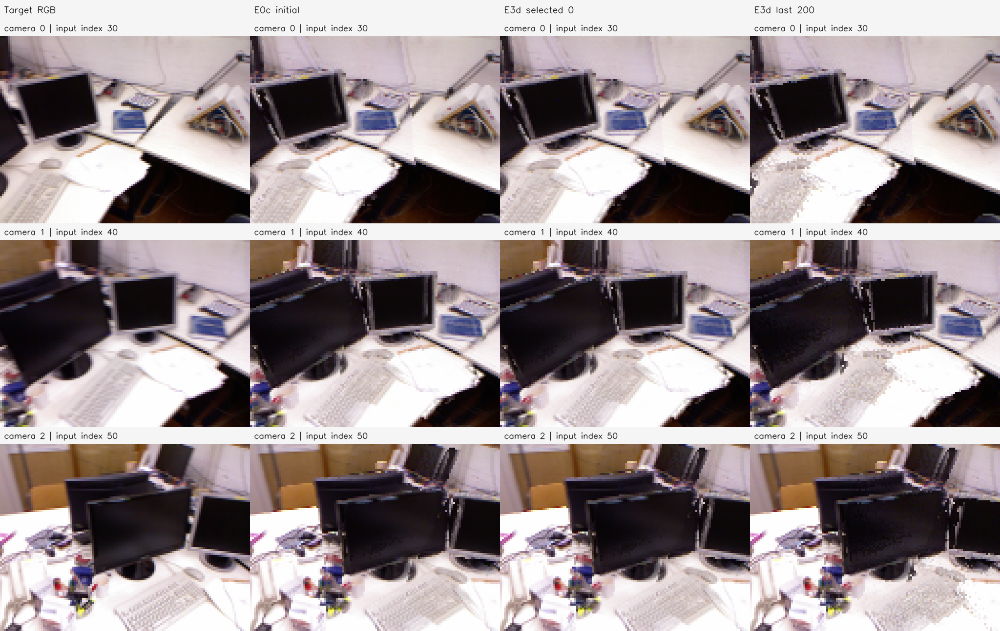
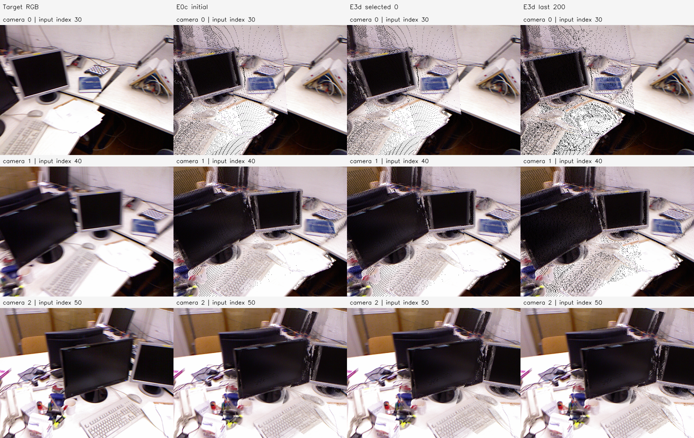

# E3d 결과 보고서 — tum-freiburg1_desk-E3d-20261112-001

**판정: ADOP 방식의 최소 1픽셀·깊이 제한·근사 위치 기울기 시험을 완료했으며, 이 실내 샘플에서 개선은 없었다.** 고정 RGB와 카메라로 200회 실행해 마지막 78,434점이 실제 이동했지만, RGB 손실은 0.047734269→0.048161422로 높아졌다. 사전 체크포인트 중 selected는 초기 0회다. 마지막 native GT 깊이 RMSE도 0.161113365→0.161583488m로 증가했다. 사용자 요청과 사전 기준에 따라 **이 실내 샘플의 추가 튜닝을 중단하고 드론 샘플 전환**으로 결정했다. 드론 시험은 현재 원본 입력 위치가 없어 미실행이다.

## 목적·입력과 ADOP 적용 범위

E3c에서 확인한 공간/깊이 색 혼합을 줄이는 다른 정방향과, 1픽셀 이동을 이용하는 근사 역방향을 검증했다. 원본 E0c 초기점 419,864개와 E3c 처치군의 원본 RGB 중앙값·카메라·관측 CSR·학습 마스크·이동 후보 106,687개를 정확히 재사용했다. 단일 출처·초기 가시성 탈락 점 313,177개는 렌더에 포함하지만 이동하지 않았다. 영상은 같은 TUM freiburg1_desk 인덱스 30/40/50이다.

[ADOP 논문 §3.1](https://arxiv.org/html/2110.06635v3#S3.SS1) 및 [논문 당시 공식 코드 mode 4](https://github.com/darglein/ADOP/blob/ad8801583ad30e2e9e205947cb3602406d3aac0f/src/lib/rendering/PointRenderer.cu#L487-L624)를 참고했다. 적용한 부분은 다음과 같다.

1. 각 정점을 최근접 **한 픽셀**에 투영한다. `floor(uv+.5)`로 픽셀을 정하고 범위 밖·카메라 뒤 점은 제외한다.
2. 픽셀별 최소 camera-Z를 구하고 `Z≤1.01×Zmin`인 앞면 근처 점만 수용한다. 수용한 고정 RGB를 산술 평균하며 이웃 픽셀로 색을 퍼뜨리지 않는다. 빈 픽셀은 검정이다.
3. 역방향에서는 가시 점을 좌/우/상/하 한 픽셀로 가상 삽입한다. 이웃이 비었거나 후보가 충분히 앞이면 덮어쓰기, 뒤이면 영향 0, 깊이가 비슷하면 기존 개수+1로 평균하는 색 변화량을 계산한다.
4. 좌우/상하 변화량과 해당 픽셀의 손실 기울기를 대칭 평균하고, 투영 Jacobian을 통해 3D 시선 방향 거리 변수로 전달한다. 별도의 부드러운 깊이 합성 미분은 없다.

**이것은 ADOP 전체 재현이 아닌 로컬 최소 구현이다.** 신경망·학습 특징·톤매퍼·카메라 최적화·환경맵·법선 culling·다중 해상도·확률적 point/ghost dropout은 생략했다. 공식 코드의 비-ghost 가시점 근사식에 해당하며 원본의 `ghost_gradients=true` 학습 구성과 같지 않다. 원본의 point SGD 대신 기존 E3c의 Adam을 유지해 변경 범위를 제한했다. ADOP 전체 방법의 실패나 논문 재현 실패로 일반화하지 않는다.

## 사전 고정 조건과 검증

렌더·학습은 128×96이다. E3c에서 고정한 Camera 0/1/2의 10,944 / 10,780 / 10,253픽셀을 그대로 사용하고, 점이 사라진 픽셀도 손실에서 제외하지 않았다. RGB·카메라·점 수·관측 그룹·active set은 고정했다. 기존 owner 시선의 거리×exp(delta), log delta±.05, Adam lr=.001, clip norm=1, Photo Charbonnier ε=.001, seed=0, 200회를 유지했다. 체크포인트 0/10/20/40/.../200에서 학습 손실 최소만으로 selected를 골랐다. GT는 학습·선택 후 평가에만 사용했다.

개선 판정은 실행 전에 다음의 동시 충족으로 고정했다.

- selected>0 및 자기 초기값 대비 RGB 손실 ≥1% 감소.
- 고정 스케일·같은 공통 영역의 GT RMSE ≥1% 감소, AbsRel 비증가.
- 원본 E0+GT 고정 영역 coverage 감소 ≤0.5%p.

미충족 시 실내 추가 튜닝 없이 드론으로 전환한다. 이 기준은 이번 실행 결과를 본 뒤 바꾸지 않았다.

제어 검사는 CPU와 실제 호스트 GPU에서 통과했다. 한 점이 한 픽셀만 차지함, 같은 픽셀의 Z=1/1.005는 평균하고 Z=2는 거절함, 이웃 덮어쓰기/가림/평균의 역방향 값 `1/6 / 0 / 1/12`, perspective chain rule의 `dL/dx=1/12`, `dL/dz=−1/3`을 독립 수식과 대조했다. 점 색은 gradient 반환 대상에서 제외했다. [검사 기록](controlled_checks.json).

이산 정방향은 작은 연속 이동에서 값이 그대로이거나 픽셀/가림 경계에서 불연속이다. 따라서 **이 surrogate가 정방향의 정확한 미분이라고 주장하지 않으며**, E3c의 미소 유한차분 일치 기준을 그대로 적용하지 않았다. 중심 픽셀에서 원래 점을 제거하는 효과도 이 근사식에는 포함되지 않는다.

실제 전체 장면에서 초기 surrogate gradient norm은 0.000116750431, 비영 변수는 79,207개였다. 초기 감소 추정 방향으로 log 이동 .001/.01/.05를 적용했을 때 손실은 각각 0.047739490 / 0.048339007 / 0.048225083으로 **모두 초기보다 높았다**. 방향 기울기 내적은 음수였지만 실제 이산 정방향의 감소를 보장하지 않았다. 이를 기록하고 사전 고정한 200회 시험을 수행했으며 조건을 조정하지 않았다. [실제 방향 진단](real_direction_diagnostic.json).

## RGB·실제 정점 이동

| 상태 | RGB Charbonnier | 실제 이동점 (>1e-8 모델 단위) | 이동 후보 변위 평균 | 이동 한계 도달 |
| --- | ---: | ---: | ---: | ---: |
| 초기 0회 | 0.047734269 | 0 | 0 | 0 |
| selected 0회 | 0.047734269 | 0 | 0 | 0 |
| last 200회 | 0.048161422 | 78,434 | 0.009990259 | 4,864 |

마지막 후보 변위 중앙값/P95/최대는 0.005894057 / 0.038823551 / 0.137629400 모델 단위다. 선택 결과는 원래 XYZ와 정확히 같고 실제 이동 last도 별도 보존했다. 고정 RGB·카메라·점 수·CSR은 바뀌지 않았다. [학습 결과](training.json), [체크포인트 전체](checkpoint_history.json), [매 step 기록](step_log.json), [변위](displacement.json).

각 행은 Camera 0/1/2이며 열은 목표 RGB·E0c 초기·selected 0회·실제 last 200회다. **맨 왼쪽도 128×96으로 축소한 뒤 512×384로 최근접 4배 확대한 목표 영상**이다. 패널 픽셀과 저장 target의 일치를 사후 재검사했다. 모든 열의 해상도 조건은 같다. Initial과 selected는 같은 상태다.

이 패널은 모든 열을 **512×384에서 직접** 생성했다. 왼쪽은 전처리된 원본 RGB이며 나머지는 해당 해상도에서 같은 1픽셀·1% 깊이 조건으로 재투영한 결과다. 학습을 고해상도에서 다시 한 것이 아니다. E3c의 넓은 footprint와 달리 공간 색 퍼짐을 제거했지만 점 샘플의 빈 픽셀이 보이며, last에서는 빈 픽셀이 늘어난다. 빈 픽셀은 실제 어두운 물체 색과 함께 검정으로 보이므로 혼동하지 않는다.

## 사후 고정 스케일 GT 깊이

선택을 마친 뒤 기존 E3b 초기 E0b의 **scale=1.3171403295592672m/model-unit**을 그대로 적용했다. 재추정은 없다. 원본 E0 native 깊이·GT가 유효한 448,216픽셀을 고정 영역으로 삼고, initial/selected/last 모두 유효한 공통 422,380픽셀에서 RMSE·AbsRel을 계산했다.

| 상태 | 공통 RMSE (m) | 공통 AbsRel | 고정 영역 coverage |
| --- | ---: | ---: | ---: |
| initial | 0.161113365 | 3.559357% | 97.328966% (436,244) |
| selected | 0.161113365 | 3.559357% | 97.328966% (436,244) |
| last | 0.161583488 | 3.735091% | 95.210568% (426,749) |

Last의 coverage는 초기보다 2.118398%p 낮다. selected는 초기이므로 RGB/GT 개선 폭이 모두 0이며, 사전 개선 기준을 충족하지 못했다. [판정](decision.json), [GT 결과](gt_depth.json).

이는 같은 입력 카메라의 깊이 평가다. 공통 영역이 이전 E3c/E0c 보고서와 달라 RMSE 절대값을 직접 대조하지 않는다. 빈 픽셀이 공통 오차에서 빠지는 한계 때문에 coverage를 함께 보고했다. 물리 대응·벽 ROI·독립 카메라·전체 3D 표면 정확도 검증으로 확장하지 않는다.

## 실행·저장 검증

2026-11-12 22:01:11~22:01:23 KST, 샌드박스 밖 호스트 RTX 5060에서 실행했다. 정식 200회 최적화는 약 2.016초, 준비·평가를 포함한 측정 구간은 11.595초였다. Python 3.11.18 / NumPy 1.26.4 / OpenCV 4.11.0 / PyTorch 2.15.0+cu132 / CUDA 13.2 / driver 595.99.02다. GPU peak allocated 68,397,056bytes, reserved 115,343,360bytes였다. 실행 전 커밋은 `b62e431ee57c730310e0575f715363d15b2bdb0e`다.

실행은 종료 코드 0, Manifest completed다. 초기·selected·last의 원본 관측 589,824개 CSR 완전 분할, inactive 좌표 불변, 이동 변수 범위, 고정 색/카메라/출처/점 수, PLY/NPZ/PNG 재로딩, 입력·실행 스냅샷 불변을 검사했다. 종료 후 산출물 78개·입력 7개·GT 출처 5개의 크기·SHA-256을 재확인했다. 두 RGB 패널을 열어 목표 해상도·선택 상태·빈 픽셀을 확인했다. [검증](verification.json), [사후 검증](postrun_verification.json), [환경](environment.json), [설정](config.json), [Manifest](manifest.json), [실행 로그](run.log), [중간 기록](progress.md).

로컬 루트는 `results/pointmap_refinement/tum-freiburg1_desk-E3d-20261112-001/stages/E3d/`다.

- `artifacts/maps/last_source_mix.ply`: 실제 이동한 200회 점군, 원본 프레임 출처 혼합색.
- `artifacts/maps/selected_source_mix.ply`: 선택된 초기 점군. `initial/selected/last_owner.ply`도 저장했다.
- `artifacts/maps/shared_map_initial/selected/last.npz`: XYZ·원래 좌표·고정 RGB·CSR·원본 관측 매핑·이동 변수.
- `artifacts/checkpoints/`: 사전 체크포인트별 delta·Adam 상태·RNG.
- `artifacts/renders/`, `artifacts/figures/`, `artifacts/source/`: 두 해상도의 RGB, 원본 출처 색 투영, native GT 버퍼와 실행 코드.

실제 last PLY SHA-256은 `845d508bf01f2ff845187957fe9ce059a0ca00a137748025928109f418671858`, last NPZ는 `e3f21223579a159aba0edd074ecd201b4389b63bba2adcbfa9b4454fdeb00f10`이다. 코드·설정·보고서·그림·해시 기록은 Git에 포함하며 대용량 점군·버퍼·체크포인트는 로컬에 보존한다. [실행 코드·재현 안내](../../../../../experiments/pointmap_refinement/E3d/README.md).

## 결정과 드론 전환

실내 개선 판정은 false다. **이 샘플에서 추가 lr/이동 범위/손실 튜닝을 진행하지 않는다.** 색이 고정된 최소 구현에서의 결과이며 ADOP 전체·다른 장면·다른 초기 기하의 가능성까지 부정하지 않는다.

후속은 HKairport01 또는 AMtown01 원본 영상의 새 VGGT-Omega 공동 추론·색 조건 융합·같은 최소 ADOP 방식 정점 이동이다. 과거 일반 VGGT/MASt3R PLY를 Omega 초기값처럼 재사용하지 않는다. 현재 작업 환경에서 과거 HKairport 실험 경로와 해당 이름의 입력을 찾지 못해 로컬 경로나 다운로드 주소를 요청했다. **야외 실행은 아직 시작하지 않았다.** [후속 전환 계획](../../drone_transition.md).
