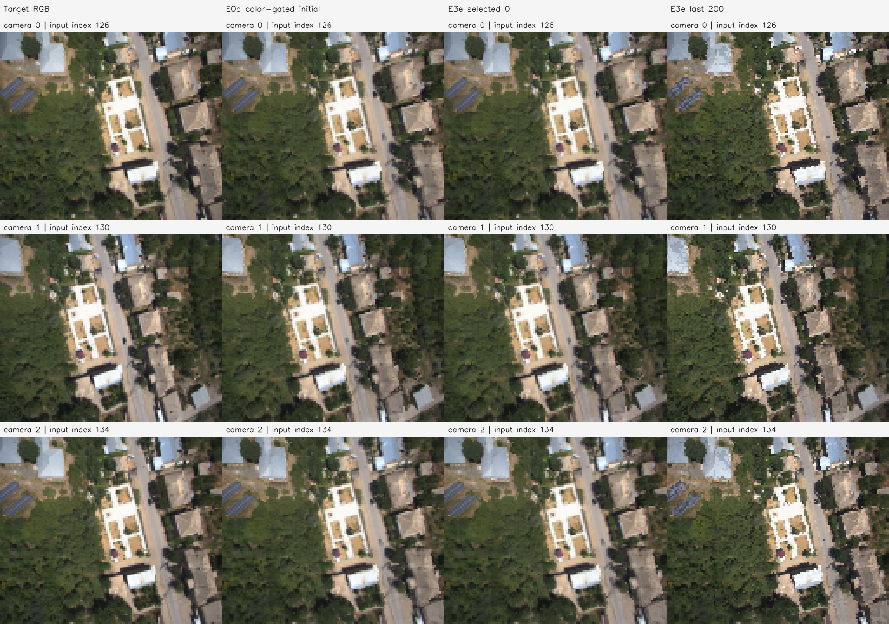
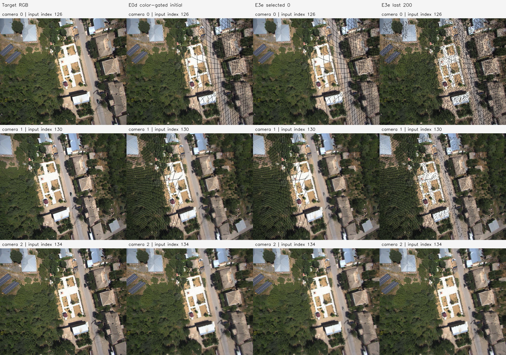

# E3e 결과 보고서 — amtown01-E3e-20261112-001

**판정: AMtown01의 고정 RGB·카메라 최소 ADOP 방식 200회 시험은 실행 완료했지만, 사전 등록한 광도 개선은 확인되지 않았다.** 마지막 159,177점이 실제 이동했으나 RGB 손실은 0.028672801→0.042417280(+47.935602%)로 증가했다. 선택한 체크포인트는 초기 0회다. 초기 native 유효 영역의 last coverage도 94.575310%로 감소했다. **GT 기하 정확도는 미평가**이며 야외 전체·ADOP 전체의 효과를 부정하는 결과로 일반화하지 않는다.

## 입력·고정 조건

부모는 [AMtown01 E0d 보고서](../../E0d/amtown01-E0d-20261112-001/report.md)의 새 Omega 3장 공동 추론·원본 RGB 채널 범위≤30 융합이다. HF revision `04a224fd14b0b8fdfd2633e68f20471b85c611a5`, interval5 정렬 인덱스 126/130/134를 사용했다. 전체 340,732점, 이동 후보 168,315개, 학습 픽셀 11364 / 11423 / 11381개를 부모에서 고정했다.

E3d와 **바이트가 같은 renderer.py**를 사용했다. 최근접 한 픽셀 투영, 가장 앞 camera-Z의 1% 이내 점 RGB 평균, 가시점의 이웃 픽셀 삽입 효과를 이용하는 ADOP mode-4 방식 근사 gradient다. 넓은 공간 kernel·soft depth 합성·alpha 곱은 없다. 근사식과 perspective chain rule의 알려진 제어 검사를 실제 GPU에서 통과했다. 정방향의 정확한 미분으로 주장하지 않는다. 원본 ADOP의 신경망/특징/톤매퍼/카메라 학습과 확률적 ghost dropout은 생략했다. [최소 구현 설명](../../../../../experiments/pointmap_refinement/E3e/README.md), [검사](controlled_checks.json).

RGB는 원본 관측 그룹의 채널 중앙값으로 고정했다. 점 수·CSR·관측 출처·카메라·active set·학습 마스크도 고정했다. Owner 시선 거리×exp(delta)만 Adam lr=.001, log delta±.05, clip norm=1, seed=0으로 200회 이동했다. 손실은 세 카메라 Photo Charbonnier ε=.001의 같은 비중 평균이며 기하 prior·GT는 없다. 학습은 128×108, native 비교는 512×432다. 데이터 비율·유효 마스크는 실내와 다르지만 방법·하이퍼파라미터는 바꾸지 않았다.

Selected는 0/10/20/40/.../200 중 고정 RGB 손실 최소로 선택했다. 광도 개선 표시는 selected>0, RGB≥1% 감소, 초기 native 유효 영역 및 학습 영역 coverage 저하≤0.5%p의 동시 충족으로 실행 전에 고정했다. GT 없는 RGB 개선을 기하 정확도로 해석하지 않는다.

## 손실·실제 이동

| 체크포인트 | RGB Charbonnier |
| --- | ---: |
| 0 | 0.028672801 |
| 10 | 0.033386535 |
| 20 | 0.037576026 |
| 40 | 0.041031970 |
| 60 | 0.041762212 |
| 80 | 0.042016262 |
| 100 | 0.042098622 |
| 120 | 0.042207941 |
| 140 | 0.042348488 |
| 160 | 0.042329621 |
| 180 | 0.042386215 |
| 200 | 0.042417280 |

초기 가상 이동 .001/.01/.05 모두 실제 RGB 손실을 낮추지 못했다. 매 step pre-update 로그의 최솟값도 초기 상태이며, 사전 체크포인트 역시 초기보다 낫지 않았다. [실제 유한 이동 진단](real_direction_diagnostic.json), [매 step 로그](step_log.json).

| 상태 | 실제 이동 >1e-8 모델 단위 | 후보 변위 평균 / 중앙값 | 후보 변위 P95 / 최대 | log 한계 도달 |
| --- | ---: | --- | --- | ---: |
| initial | 0 | 0 / 0 | 0 / 0 | 0 |
| selected 0 | 0 | 0 / 0 | 0 / 0 | 0 |
| last 200 | 159,177 | 0.016727008 / 0.011757836 | 0.053484685 / 0.070223133 | 18,967 |

변위는 모델 단위이며 미터 오차가 아니다. Inactive 좌표는 정확히 유지됐고, 모든 상태에서 원본 관측 663,552개의 CSR 분할과 RGB·그룹·출처가 보존됐다. Selected는 부모 초기 XYZ와 정확히 같다. Last는 되돌리거나 숨기지 않고 별도 NPZ/PLY로 보존했다. [학습](training.json), [변위](displacement.json).

사후 독립 투영 검사에서 last의 관측된 타 카메라 픽셀 이동은 평균 0.326032px, 중앙값 0.210014px였다. 전후 모두 영상 안에 있는 252,483개 관측 카메라-정점 쌍을 native 격자에서 측정했다. Owner 픽셀 변화 최대는 6.4e-08px로 시선 유지가 확인됐다. [사후 검사](postrun_audit.json), [검사 코드](../audit.py).

## 카메라 영상·coverage

행은 Camera 0/1/2, 열은 target·E0d 초기·selected 0회·실제 last 200회다. **왼쪽 target도 128×108로 축소 후 512×432로 최근접 4배 확대**한 영상이며 패널 픽셀을 저장 target와 대조했다. Initial과 selected가 같은 것은 선택 규칙의 결과이며 last에서 실제 이동이 없었다는 뜻이 아니다.

| 카메라 | 초기 PSNR (고정 학습 마스크) | last PSNR |
| --- | ---: | ---: |
| 0 | 26.299948 | 23.089531 |
| 1 | 24.280517 | 21.932598 |
| 2 | 26.443869 | 23.374766 |

이 패널은 target와 점군 투영 모두 512×432에서 생성했다. 학습을 고해상도에서 다시 한 것이 아니다. Last에서는 앞의 두 카메라에서 빈 픽셀·경계 불일치가 더 보인다. 검정에는 빈 픽셀과 실제 어두운 표면이 함께 포함되며 단순 밝기 차이를 정확도로 해석하지 않는다.

| 상태 | 초기 유효 native 영역의 유지 픽셀 | 초기 영역 coverage |
| --- | --- | ---: |
| initial | 635,299 / 635,299 | 100.000000% |
| selected | 635,299 / 635,299 | 100.000000% |
| last | 600,836 / 635,299 | 94.575310% |

분모는 엄격한 영상 중심 경계의 초기 native 최근접 깊이 유효 영역이다. E0d 표의 반 픽셀 셀 기준 전체 영상 coverage와 분모가 다르다. Last의 카메라별 유지 비율은 89.729983% / 93.673391% / 100.000000%다. 학습 128×108의 한 픽셀은 많은 점을 받으므로 학습 coverage가 100%여도 native 빈 픽셀이 늘 수 있다. 이 수치는 투영 sampling 진단이며 물리 표면 구멍 또는 GT 오차가 아니다. [Coverage](native_coverage.json).

## 판정·GT 한계

[사전 판정](decision.json)의 `photometric_improved_with_coverage=false`다. Selected>0과 RGB≥1% 감소 조건을 충족하지 못했다. Selected가 초기여서 해당 상태의 coverage 변화 0이라는 사실을 최적화 성공으로 해석하지 않는다.

대응 LiDAR·pose·저자 보정 파일은 E0d에서 보존했지만 LiDAR 좌표계·영상 왜곡/rectification·T4x4 방향의 독립 검증이 없어 GT 깊이·스케일·RMSE를 계산하지 않았다. 데이터셋에 GT 자체가 없다는 뜻이 아니다. [GT 참조 점검](gt_reference_audit.json). 이 결과는 한 장면의 **3장 공동 추론에 사용한 같은 카메라**에서의 광도/coverage 시험이다. 독립 held-out, 더 긴 비행 구간, 다른 고도/시점/모델 초기값, 전체 ADOP를 평가한 결과가 아니다. 이번 결과를 본 뒤 샘플·lr·이동 범위·선택 규칙을 바꾸지 않았다.

## 실행·저장 검증

2026-11-12T22:34:54.076375+09:00~2026-11-12T22:35:05.833324+09:00, 샌드박스 밖 호스트 RTX 5060에서 실행했다. 정식 200회 최적화 2.483454초, 전체 측정 11.755090초, GPU peak allocated 69,950,976bytes, reserved 119,537,664bytes다. Python 3.11.18, NumPy 1.26.4, OpenCV 4.11.0, torch 2.15.0+cu132, CUDA 13.2, driver 595.99.02를 사용했다. 실행 직전 커밋은 `25d9bb2333b8f07afbee2af9e3228527a48e1b4f`이고 실행 당시 새 코드 전체를 별도 스냅샷과 해시로 보존했다.

실행은 종료 코드 0·Manifest completed다. 실행 후 산출물 80개·입력 7개의 크기·SHA-256, 전 상태 CSR 완전 분할·고정 RGB/메타데이터·inactive 좌표·selected=초기·실제 타 시점 픽셀 이동·고정 target/mask를 재검사했다. 두 장면의 원본 해상도 전후 패널을 직접 열어 행/열·남은 겹침/빈 픽셀을 확인했다. [설정](config.json), [검증](verification.json), [환경](environment.json), [Manifest](manifest.json), [로그](run.log), [진행](progress.md).

로컬 루트는 `results/pointmap_refinement/amtown01-E3e-20261112-001/stages/E3e/`다. `artifacts/maps/initial_source_mix.ply`, `selected_source_mix.ply`, **`last_source_mix.ply`**와 owner 색 점군을 각각 저장했다. `shared_map_initial/selected/last.npz`에는 원본/실제 XYZ·고정 RGB·CSR·이동 변수를 보존했다. 실제 last PLY SHA-256은 `fa4d320ee9d6463952ae6303c6776eae1c7af8f52b87b21276da3fea3aa0ad36`다. 대용량 점군/체크포인트/버퍼는 로컬에 유지하고 코드·설정·보고서·그림·출처/해시는 Git에 반영한다.
