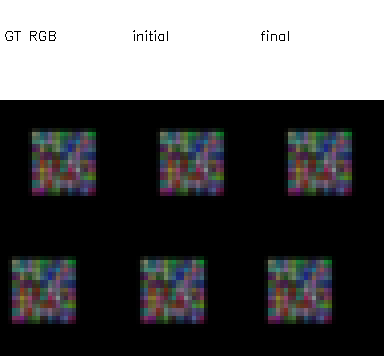
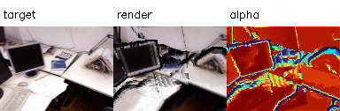
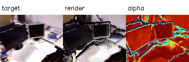
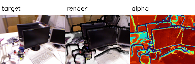

# P2 결과 보고서 — tum-freiburg1_desk-P2-20261112-002

**판정: 최소 Soft Splat Renderer와 안정 영역 위치 Gradient 검증 완료.** Hard visibility 경계는 불연속이며, 실제 점군의 기하 개선은 검증하지 않았다. 실패한 001을 보존하고 조건을 변경한 002의 결과를 별도로 기록한다.

## 구현 및 실행

2026-11-12 (Asia/Seoul), 호스트 GPU에서 샌드박스 밖으로 실행했다. RTX 5060, PyTorch 2.15.0+cu132, Python 3.11.18 환경을 사용했다. PyTorch3D는 설치되지 않았으며 빌드를 시도해 실패한 것은 아니다. 계획서의 대안인 자체 최소 Gaussian Soft Splat을 구현했다. 공식 ADOP/PyTorch3D 재현으로 주장하지 않는다.

고정 σ=0.65px, 5×5 stencil, 최근접 깊이의 3% 범위 hard gate, alpha=1−exp(−Σw), 가중 평균 RGB×alpha, 검은 배경을 사용한다. 출력 Depth는 기여점 Z의 가중 평균이다. Coverage는 alpha≥0.5로 정의했다. Stencil·frustum·front 선택은 detached이며 이산 선택을 통과하는 Gradient는 제공하지 않는다. 반경·색상·카메라는 고정한다.

[실행 코드](../../../../../experiments/pointmap_refinement/P2/run.py)와 [검증 코드](../../../../../experiments/pointmap_refinement/P2/verify.py)를 실행했으며 모두 종료 코드 0이다. 설정·부모 해시·소스 사본·환경·로그는 P2 실행 폴더와 Manifest에 보존했다.

## 단일 점 및 평면의 Gradient 검사

알려진 두 카메라에서 XYZ Autograd와 중심 유한차분을 비교했다. Float64, rtol=0.001, atol=1e-7을 사용했으며 stable stencil/front 영역에서 검사했다.

| ε | 단일 점 최대 절대 Gradient 차이 | 결과 |
| --- | ---: | --- |
| 0.001 | 0.000701402584 | 통과 |
| 0.0001 | 7.01502245e-06 | 통과 |
| 1e-05 | 7.0151386e-08 | 통과 |

합성 평면의 0/40/80번째 점에 대해서도 XYZ 중심 유한차분(ε=1e-5)을 별도 검사했고 모두 통과했다. 상세 벡터는 `verification.json`에 기록했다.

자기 카메라 Ray 방향의 RGB 에너지 미분은 **1.0755e-16**, 이동한 다른 카메라에서는 **0.08663906**이었다. 이는 자기 영상만으로 Ray-depth를 결정할 수 없는 퇴화와, 시차에 따른 민감도를 보여주는 통제 검사다. GT 위치에서의 재구성 Loss Gradient와 RGB 에너지 Gradient를 혼동하지 않는다.

## 합성 평면의 3D 회복 및 실패 기록

81점 컬러 평면, 카메라 2대, 32×32 이미지에서 Source Ray의 Z-depth만 학습했다. GT Z=2.4, 초기 Z=2.6, Adam lr=0.02, 200회, Seed=0. 학습 목적함수는 두 시점 RGB MSE 합이며 GT 좌표는 평가 전용이다. 이미지는 같은 렌더러로 생성한 통제 환경이다.

- [001 실패](../tum-freiburg1_desk-P2-20261112-001/report.md): rtol=0.03 hard visibility에서 평균 3D 오차 **0.2043544930 → 0.2525276896**. 실패 보존.
- 002: 평면에서만 depth gate를 사실상 비활성화(rtol=1000)하여 표면의 RGB 미분을 분리. 평균 3D 오차 **0.2043544930 → 0.0000030335**. 사전 기준인 초기 오차의 20% 미만을 통과했다.

왼쪽은 합성 GT RGB, 중앙은 초기 위치, 오른쪽은 최적화 후 위치다. 두 행은 서로 다른 카메라다. 성공은 고정된 Ray 매개변수·색상·합성 장면 조건에 한정한다. 실제 장면과 hard visibility를 적용한 평면의 안정적 회복을 증명하지 않는다.

별도 hard gate 검사는 뒷면 색상 제외·음수 깊이·화면 밖 제외를 통과했다. 앞점 Z=2일 때 뒷점 Z=2.0599의 파랑 기여 최댓값은 0.40068, Z=2.0601에서는 0이다. 이 임계 전환은 불연속이며 미분 가능한 경계라고 주장하지 않는다. 가림 변경에 따른 최적화 안정성은 후속 단계의 검증 항목이다.

## 실제 E0 점군 렌더링과 원본 RGB 비교

E0 `tum-freiburg1_desk-E0-20261112-001` Manifest의 완료 상태와 모든 산출물 해시를 검증했다. 전체 589,824점 중 각 프레임 u/v가 4로 나눈 나머지 2인 **36,864점**을 선택했다. 이 하나의 점 집합을 3개 카메라가 공동 참조한다. 선택 인덱스는 NPZ로 보존했다. 전체 E0 점군이나 융합 표면이 아니다.

렌더 해상도는 128×96이며 target은 전처리 RGB를 INTER_AREA로 줄였다. K는 scale과 (scale−1)/2 오프셋의 centre-based affine으로 변환했다. 배경은 검정이다. 아래 수치는 초기 alpha≥0.5 마스크를 고정해 산출한 값과 전체 픽셀 값을 나누어 기록했다. RGB 범위는 [0,1]이다.

| Frame | Coverage | 고정 초기 마스크 픽셀 | 마스크 PSNR (dB) | 전체 PSNR (dB) | XYZ Gradient norm |
| --- | ---: | ---: | ---: | ---: | ---: |
| 0 | 82.20% | 10101 | 17.563 | 11.830 | 0.106215 |
| 1 | 80.92% | 9943 | 17.070 | 11.544 | 0.103074 |
| 2 | 75.81% | 9315 | 16.454 | 10.197 | 0.108532 |

**이번 P2에서 원본 RGB와 점군 재렌더링의 초기 비교를 실제 수행했다.** 오른쪽은 alpha이며 RGB 오차 영상이 아니다. 재렌더링에는 구멍·가림 경계 및 타 관측점의 겹침이 남는다. 이 PSNR은 자기 시점·원본 색상 재사용·부분 점군·저해상도 조건의 진단값이며 성능 향상 또는 실제 깊이 정확도의 증거가 아니다. 카메라별 실제 점 XYZ Gradient는 모두 유한하고 0이 아니었지만, 실제 좌표는 한 번도 갱신하지 않았다. Held-out 시점·GT 기하 평가는 수행하지 않았다.

## 산출물과 검증 범위

루트: `results/pointmap_refinement/tum-freiburg1_desk-P2-20261112-002/stages/P2/`.

- `artifacts/renders/frame_XX.npz`: RGB, Depth, alpha, 고정 Coverage, target RGB, K/E. PNG 비교 그림도 저장.
- `artifacts/synthetic/plane.npz`: 합성 GT·초기·최종 XYZ와 고정 RGB.
- `evaluation/synthetic.json`, `plane_history.json`, `verification.json`, `real.json`: 유한차분·3D 오차·가림 경계·초기 RGB 비교·Gradient.
- `artifacts/source/selected_observations.npz`: 부모 관측의 선택 인덱스.
- `artifacts/source/`, `manifest.json`, `config_resolved.json`, `environment.json`, `logs/`: 실행 근거·해시·코드 사본.

RGB·Depth의 유한값, Coverage와 alpha의 일치, 유효 Depth 양수 및 NPZ/PNG 재로딩을 검증했다. 계측된 PyTorch peak allocated는 48.731MiB, reserved는 60.000MiB다. 이는 이번 소규모 렌더/검증 과정의 PyTorch 수치이며 전체 VRAM 필요량이나 모델 동시 실행 상한이 아니다. 프로세스 종료 뒤 nvidia-smi 사용량은 14MiB로 돌아왔다. 조건별 렌더 시간은 초기화 영향을 포함한 단회 측정으로 `real.json`에 보존했다.

P2는 최소 기능과 안정 영역 미분에 한해 완료했다. 다음은 E1 단순 연결 평가와 E2 공유점 융합·가시성 검증이다. Hard visibility가 실패했던 증거를 유지하며, 실제 점 위치 최적화는 이 문제를 검토한 뒤 E3 이후에 수행한다.
