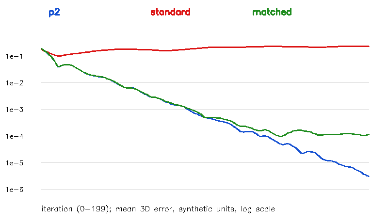
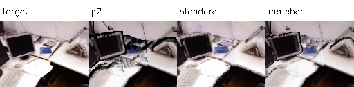
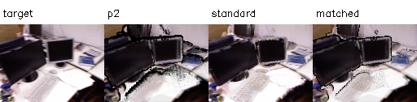
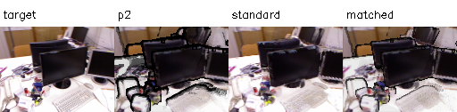

# P2a 결과 보고서 — tum-freiburg1_desk-P2a-20261112-001

**판정: PyTorch3D CUDA 설치와 비교 실험 완료.** 설치는 성공했고 안정 영역의 Gradient 검증을 통과했지만, 표준 Alpha 합성의 합성 기하 회복 및 경계의 Gradient는 실패 사례가 있다. 이 결과를 렌더러 전체의 정확도 향상으로 해석하지 않는다. 기존 P2 구현과 환경은 유지했다.

## 설치 및 환경

2026-11-12, Asia/Seoul. GPU 작업은 호스트에서 샌드박스 밖으로 실행했다. `.venvs/p2a`를 따로 만들고 기존과 같은 Python 3.11.18, PyTorch 2.15.0+cu132, NumPy 1.26.4, RTX 5060을 사용했다. Driver 595.99.02, nvcc Toolkit 13.5이며 PyTorch runtime은 13.2다.

- 공식 소스: [PyTorch3D](https://github.com/facebookresearch/pytorch3d/tree/fdd657494ea5151cd66e19a1594494f1e1d592a1), Commit `fdd657494ea5151cd66e19a1594494f1e1d592a1`, 패키지 버전 0.7.9.
- 첫 소스 빌드 실패: `#error C++20 or later compatible compiler is required to use ATen.` PyTorch3D setup.py의 C++17 설정과 PyTorch 2.15 헤더의 요구가 맞지 않았다.
- 패치: setup.py의 두 `-std=c++17`을 `-std=c++20`으로만 변경했다. CUDA 렌더링 알고리즘은 수정하지 않았다. [패치](../../../../../experiments/pointmap_refinement/P2a/pytorch3d-cxx20.patch)를 보존했다.
- 재빌드: `MAX_JOBS=2 TORCH_CUDA_ARCH_LIST=12.0 FORCE_CUDA=1`, `--no-build-isolation --no-deps`, 종료 코드 0. 67개 C++/CUDA 컴파일 대상 빌드 및 설치 완료.
- `torch` 로드 후 `_C` 확장을 로드하고 GPU rasterization·compositing·backward를 실제 실행했다. 확장 파일 해시와 빌드 시도는 `installation.json`에 기록했다. 직접 `_C`를 먼저 import하면 libc10 로더 오류가 나므로 검증 코드처럼 torch를 먼저 import한다.
- 전체 버전은 [의존성 lock](../../../../../experiments/pointmap_refinement/P2a/requirements.lock.txt), 설치 절차는 [재현 안내](../../../../../experiments/pointmap_refinement/P2a/README.md)에 있다. 56개 패키지의 의존성 검사를 통과했다.

첫 빌드 오류 로그와 원본 setup.py를 보존했다. 기존 P0/P2 환경을 다운그레이드하거나 교체하지 않았다.

## 비교 설계와 좌표계

E0와 P2-002의 완료 Manifest 및 모든 산출물 해시를 대조했다. 실제 입력은 P2에 저장된 **같은 선택 인덱스의 36,864점**, 같은 RGB·K/E, 128×96 해상도, 검은 배경이다. P2의 source colors는 uint8 양자화 값이며 세 방식 모두 이를 동일하게 사용한다.

| 이름 | Rasterization·가중치·합성 |
| --- | --- |
| p2 | 기존 Gaussian σ=0.65px, 5×5 stencil, 3% front-depth gate, weighted RGB×alpha |
| standard | PyTorch3D 원형 반경 2px, 가까운 K=16점, `1−d²/r²` 가중치와 공식 alpha_composite |
| matched | 같은 PyTorch3D rasterization 위 Gaussian σ=0.65px, 3% gate 및 P2와 가까운 정규화·alpha 합성 |

standard는 PointsRenderer/AlphaCompositor의 규칙을 사용하지만 클래스 전체를 그대로 호출한 것은 아니다. **정사각 stencil 대 원형 disk, top-K 제한, 깊이순 선택이 다르므로 matched도 P2와 완전히 동일한 모델이 아니다.** 결과 차이를 라이브러리 이름만의 효과로 단정하지 않는다.

OpenCV 투영을 직접 계산해 `((W−1−2u)/min(H,W), (H−1−2v)/min(H,W), camera_z)`로 rasterizer NDC에 전달했다. 비정사각 48×32 이미지의 비대칭 위치 3개와 회전·이동 카메라로 검사했고, 각 최대 응답 픽셀이 예상 정수 픽셀과 일치했다. P2 재실행과 저장된 P2 RGB의 최대 차이는 3.6e-7~5.4e-7이었다. 이후 비교는 같은 P2a 환경에서 다시 실행한 p2를 기준으로 한다.

## Gradient 및 경계 검사

단일 점 XYZ 중심 유한차분: 세 방식 모두 ε=0.001/0.0003, float32, rtol=0.02, atol=0.002에서 통과했다. P2의 기존 float64 결과와 같은 정밀도 검사라고 해석하지 않는다. 자기 Ray 방향의 RGB 에너지 미분은 모두 절댓값 1e-5 미만이고, 다른 카메라에서 시차를 주면 0이 아니었다.

평면의 0/40/80번째 점을 ε=0.0003, rtol=0.05, atol=1e-5로 추가 검사했다. 입력 상태에 따라 다음 차이가 났다.

| 방식 | 같은 깊이 평면 | 깊이 순서 분리 | 깊이 순서·화면 위치 모두 경계에서 이동 |
| --- | ---: | ---: | ---: |
| p2 | 3/3 | 3/3 | 3/3 |
| standard | 0/3 | 3/3 | 3/3 |
| matched | 1/3 | 1/3 | 3/3 |

standard는 같은 깊이에서 순서가 바뀌는 구간을 통과하지 못했다. matched는 깊이 순서만 분리해도 일부가 실패했으며, XYZ에 (0.013,0.017,0)을 더해 화면 영향 범위 경계에서 벗어난 추가 검사에서는 모두 통과했다. 이 통제는 경계 민감성을 보여주며 모든 점에서 미분이 유효하다는 보증은 아니다. 원형 cutoff, top-K, 깊이 순서의 이산 선택은 여전히 존재한다. 자세한 벡터·오차는 `additional_gradients.json`에 있다. 초기 진단 JSON·로그도 별도로 보존했다.

## 같은 합성 평면의 3D 회복

P2의 같은 81점 GT·초기 XYZ·고정 RGB를 읽어 float32로 변환했다. 초기 Z=2.6, GT Z=2.4, source Ray-depth 81변수, 카메라 2대, Adam lr=0.02, 200회다. 각 방식의 GT RGB는 **해당 방식으로 생성**하여 그 렌더러의 자기 복원 능력을 검사했다. GT 좌표는 평가에만 사용했다. p2/matched의 평면 hard gate는 P2 성공 조건처럼 사실상 해제(rtol=1000)하고, standard는 본래 깊이순 Alpha 합성을 유지했다. 이 차이도 해석에 포함해야 한다.

| 방식 | 초기 평균 3D 오차 | 최종 평균 3D 오차 | 초기 오차의 20% 미만 |
| --- | ---: | ---: | --- |
| p2 | 0.204354301 | 0.000003099 | 통과 |
| standard | 0.204354301 | 0.236622572 | 실패 |
| matched | 0.204354301 | 0.000114206 | 통과 |

standard는 RGB 최적화가 실행됐어도 실제 합성 기하 회복 기준을 충족하지 못했다. 원인을 특정 알고리즘 하나로 완전히 분해한 실험은 아니므로, 설치 성공이나 개별 Gradient 통과를 최적화 성공으로 대신하지 않는다. matched는 회복했지만 p2보다 잔여 오차가 컸다. 같은 색상·반경의 전체 XYZ 자유 최적화나 실제 장면에서의 효과는 아직 검증하지 않았다.

## 실제 E0 RGB·Coverage 비교

RGB PSNR은 초기 P2 고정 마스크와 세 방식 모두 alpha≥0.5인 공통 마스크를 사용했다. 세 방식별 마스크의 PSNR과 전체 픽셀 PSNR도 `real.json`에 별도로 기록했다. 아래의 숫자는 자기 시점·원본 색상 재사용·저해상도 부분 점군에 대한 진단값이다.

| Frame | 방식 | Coverage | P2 고정 마스크 PSNR (dB) | 공통 마스크 PSNR (dB) | 렌더 중앙값 (ms), bin=0 | Peak allocated (MiB) |
| --- | --- | ---: | ---: | ---: | ---: | ---: |
| 0 | p2 | 82.20% | 17.563 | 17.563 | 0.708 | 41.40 |
| 0 | standard | 100.00% | 18.575 | 18.574 | 7.993 | 34.80 |
| 0 | matched | 93.63% | 19.650 | 19.650 | 8.177 | 34.71 |
| 1 | p2 | 80.92% | 17.070 | 17.070 | 0.766 | 47.29 |
| 1 | standard | 100.00% | 16.701 | 16.700 | 8.229 | 34.80 |
| 1 | matched | 93.43% | 18.019 | 18.019 | 7.843 | 34.71 |
| 2 | p2 | 75.81% | 16.454 | 16.454 | 0.707 | 42.32 |
| 2 | standard | 100.00% | 16.641 | 16.640 | 8.382 | 34.80 |
| 2 | matched | 90.10% | 17.707 | 17.707 | 9.017 | 34.71 |

matched의 P2 고정 마스크 PSNR은 세 시점에서 높았지만 standard는 Frame 1에서 낮았다. Coverage 증가, 원형 footprint, top-K·합성 방식이 함께 바뀌었기 때문에 점 위치가 더 정확해졌다는 증거가 아니다. **실제 E0 점 위치는 갱신하지 않았다.** 실제 XYZ Gradient는 세 방식·세 카메라에서 모두 유한했으며 GT 기하 정확도·held-out 재현은 평가하지 않았다.

시간은 CUDA synchronize, warmup 2회 뒤 5회 중앙값이다. 기본 비교는 명시적인 naive bin_size=0을 사용했다. 메모리는 각 backend의 forward+backward PyTorch peak이며 초기 할당량과 reserved도 JSON에 기록했다. 후보와 합성 구조가 달라 순수 rasterizer 벤치마크가 아니며 모든 CUDA 메모리나 일반적인 속도 우열을 뜻하지 않는다.

## 자동 bin 추가 검사

기본 비교의 속도를 일반화하지 않기 위해 자동 bin_size=None도 별도로 확인했다. 다음은 같은 입력의 5회 중앙값이며 이미지 비교 기준은 저장된 bin=0 결과다.

| Frame | 방식 | 자동 bin 중앙값 (ms) | RGB 최대 절대 차이 |
| --- | --- | ---: | ---: |
| 0 | standard | 5.988 | 0.000149488 |
| 0 | matched | 5.994 | 0.000000000 |
| 1 | standard | 5.989 | 0.000000000 |
| 1 | matched | 5.993 | 0.000000119 |
| 2 | standard | 5.979 | 0.000000000 |
| 2 | matched | 5.989 | 0.000000000 |

특히 matched Frame 1에서 bin 설정에 따라 최대 약 0.02969 차이가 관측됐다. 동일 결과라고 가정해 속도 수치만 교체하지 않고, 기본 비교는 bin=0으로 유지했다. 깊이 tie·top-K·부동소수점 또는 후보 선택 영향의 상세 원인은 미확정이며 추가 추적 대상이다. 원형 반경·가림·bin 설정을 고정하는 것이 후속 재현에 필요하다.

## 산출물·완료 범위

루트는 `results/pointmap_refinement/tum-freiburg1_desk-P2a-20261112-001/stages/P2a/`다. `artifacts/renders/`에 세 방식×3시점의 RGB·Depth·alpha·Coverage·target·고정 마스크와 PNG가 있다. `artifacts/synthetic/`에는 방식별 GT/초기/최종 XYZ와 오차 그래프가 있다. `evaluation/`에는 설치·좌표·유한차분·수렴 이력·실제 RGB·bin 검사, `logs/`에는 첫 빌드 실패·재빌드·실행·추가 검증과 의존성 버전이 있다. 저장 RGB·Depth 유한값, Coverage=alpha≥0.5 및 NPZ/PNG 재로딩 검사를 통과했다.

검증 직후 GPU 사용량은 175MiB였고, 종료 정리 후 재확인에서는 **14MiB**로 돌아왔다. 두 상태를 별도 로그로 보존했다. `manifest.json`은 코드·설정·보고서·산출물 해시와 부모 출처를 연결한다.

**P2a 설치·비교 작업은 완료했지만, standard를 검증된 위치 최적화 기본선으로 채택하지 않는다.** 기존 P2는 유지하며 E1/E2의 점군·가시성 검증을 진행할 수 있다. 향후 E3에서 renderer를 선택할 때에는 경계 실패와 실제 기하 지표를 함께 확인해야 한다.
