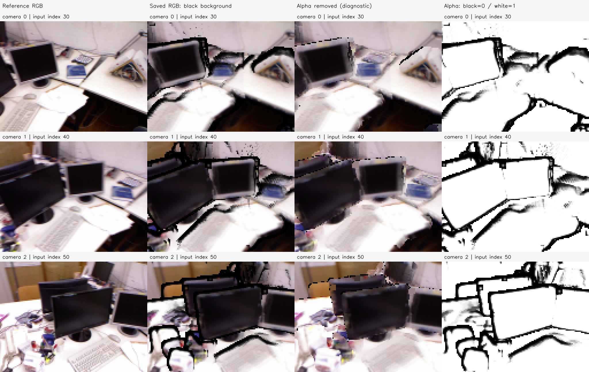

# P2b 결과 보고서 — tum-freiburg1_desk-P2b-20261112-001

**판정: 초기 E0b RGB 영상의 검은 테두리에 현재 renderer의 검은 배경 alpha 합성이 크게 기여함을 확인했다.** 저장 버퍼에서 alpha 곱만 제거해도 검은 띠가 크게 줄었다. 기하·카메라·가림을 바꾸지 않은 색상 진단이며 새 미분 renderer·학습·GT 기하 개선을 검증한 실험은 아니다.

## 문제와 원인 분리 방법

사용자가 E3b의 E0b 초기 렌더에서 물체 주변의 검은 테두리를 관찰했다. 부모는 `tum-freiburg1_desk-E3b-20261112-002/stages/E3b`다. 세 카메라의 `initial_frame_0/1/2.npz`에 저장된 RGB, alpha, target, E1 고정 마스크와 학습 마스크를 그대로 재사용했다. 점 좌표를 읽거나 수정하지 않았고 새 모델 추론·GT 접근·점 이동은 없다.

현재 [P2 renderer](../../../../../experiments/pointmap_refinement/P2/renderer.py)는 픽셀에 기여하는 점의 가중 색상 평균을 계산한 뒤 다음처럼 검은 배경에 합성한다.

`rendered_rgb = weighted_color × alpha`, `alpha = 1 − exp(−sum_weights)`

낮은 alpha에서는 weighted_color가 밝아도 저장 RGB가 검게 보인다. alpha>.000001인 픽셀에서 `saved_rgb / alpha`로 weighted_color를 복원하고, 그보다 작은 alpha는 검정으로 남겼다. 정규화 색에 alpha를 다시 곱하면 원본 RGB와 최대 1e-6 이내로 일치함을 확인했다. 색 범위의 수치 오차만 [0,1]로 clipping했고, 기하·깊이·가림 선택·pixel footprint를 새로 계산하지 않았다.



행은 Camera 0/1/2, 열은 목표 RGB / 저장된 검은 배경 합성 / alpha 곱 제거 진단 / alpha 회색조다. 128×96 버퍼를 최근접으로 4배 표시했으며 구멍을 보간하지 않았다. Alpha 그림에서 검은 테두리 위치의 낮은 alpha를 확인할 수 있고, 세 번째 열에서는 띠가 상당히 줄지만 경계·색 혼합 문제는 남는다.

## 같은 픽셀에서의 정량 진단

탐색적 프로브를 **원본 목표 영상의 평균 RGB>.25이면서 렌더 평균 RGB<.12인 픽셀**로 고정했다. 이는 검은 테두리 전체의 검출기나 GT 오차가 아니다. 원래 검은 물체·색/정렬 불일치 등도 포함할 수 있다.

| 카메라 | 기존 어두운 픽셀 프로브 | alpha 곱 제거 후 | 기존 프로브의 alpha 중앙값 | 기존 프로브 중 학습 마스크 안 |
| --- | ---: | ---: | ---: | ---: |
| 0 | 836 | 158 | 0.022948 | 79 |
| 1 | 1,119 | 135 | 0.024208 | 77 |
| 2 | 1,411 | 139 | 0.007656 | 51 |
| 합계 | 3,366 | 432 | — | 207 |

프로브는 약 **87.17% 감소**했다. 원본 alpha≤1e-6인 109/74/114픽셀은 복원하지 않고 검정으로 남겼다. 이 감소를 기하 정확도 개선으로 해석하지 않는다.

| 카메라 | 기존 E1 고정 마스크 PSNR | alpha 곱 제거 PSNR | 기존 학습 마스크 Charbonnier | alpha 곱 제거 Charbonnier |
| --- | ---: | ---: | ---: | ---: |
| 0 | 16.434dB | 18.341dB | 0.059554 | 0.056071 |
| 1 | 15.902dB | 18.629dB | 0.055504 | 0.049651 |
| 2 | 16.107dB | 18.210dB | 0.062413 | 0.054819 |

기존과 진단의 마스크·target은 동일하다. 밝기 합성식만 바꾼 출력 점수이며 새 학습이나 독립 영상 성능은 아니다. E3b의 학습 마스크는 초기 alpha≥.5를 요구하므로 대부분의 초기 저alpha 테두리는 이미 학습 손실에서 제외되어 있었다. 따라서 **검은 테두리가 줄었다는 사실만으로 E3b 최적화 실패 전체를 설명하지 않는다.**

## renderer 코드에서 확인한 남은 문제

현재 renderer는 5×5 stencil 전체의 최소 Z를 먼저 고르고, 이후 그 앞면의 Gaussian 가중치를 계산한다. 이 순서에서는 아주 약한 주변 splat도 최소 Z를 차지해, 같은 픽셀에 더 강하게 기여하는 뒤쪽 점을 hard front gate로 제외할 수 있다. 남은 가중치 합이 작으면 alpha가 낮아지고 검은 배경이 크게 섞인다. 이는 코드 경로의 설명이며 이번 버퍼 실험이 각 내부 기여도를 별도로 재측정한 것은 아니다.

Alpha 곱 제거는 가림의 정확성이나 stencil/front 선택의 연속성·Gradient 정확성을 보장하지 않는다. 약한 전경 색을 배경 위치로 퍼뜨리는 현상도 남을 수 있다. 기존 E3b의 Autograd/전체 렌더 유한차분 불일치가 해결됐다고 주장하지 않는다. 다음 정점 최적화 전에 색 합성·앞면 선택·실제 미분 방향을 분리 검증해야 한다.

## 실행·검증·산출물

2026-11-12, Asia/Seoul. 호스트 CPU에서 실행했고 GPU를 사용하지 않았다. Python 3.11.18 / NumPy 1.26.4 / OpenCV 4.11.0이다. 기존 코드 기준은 `7911bbbbe1d74792ffb96edadfea1f999224ca12`이며 새 P2b 실행 소스 사본과 SHA-256을 보존했다.

```bash
.venvs/p0-py311/bin/python experiments/pointmap_refinement/P2b/run.py \
  --run-id tum-freiburg1_desk-P2b-20261112-001
```

새 Run ID로 재실행한다. [재현 안내](../../../../../experiments/pointmap_refinement/P2b/README.md), [설정](config.json), [정량 결과](metrics.json), [검증](verification.json), [환경](environment.json), [Manifest](manifest.json) 참조. 입력 해시 불변·재합성 일치·정규화 색 유한/범위·고정 마스크·PNG/NPZ 재로딩 검증을 통과했고 종료 코드는 0이다. 패널을 직접 열어 검은 띠와 alpha 위치를 확인했다.

로컬 루트는 `results/pointmap_refinement/tum-freiburg1_desk-P2b-20261112-001/stages/P2b/`다. `artifacts/images/`에 비교 패널·기존/진단 native PNG, `artifacts/buffers/`에 기존 RGB·alpha·정규화 RGB·고정 마스크를 저장했다. `artifacts/source/`, `evaluation/`, `logs/`, `manifest.json`에 소스·설정·지표·출처를 연결했다. 기존 P2 default와 E3b의 결과·학습 설정은 변경하지 않았다.
