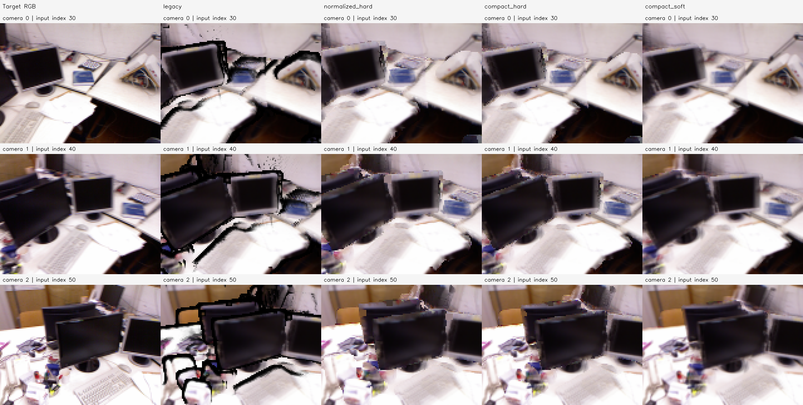
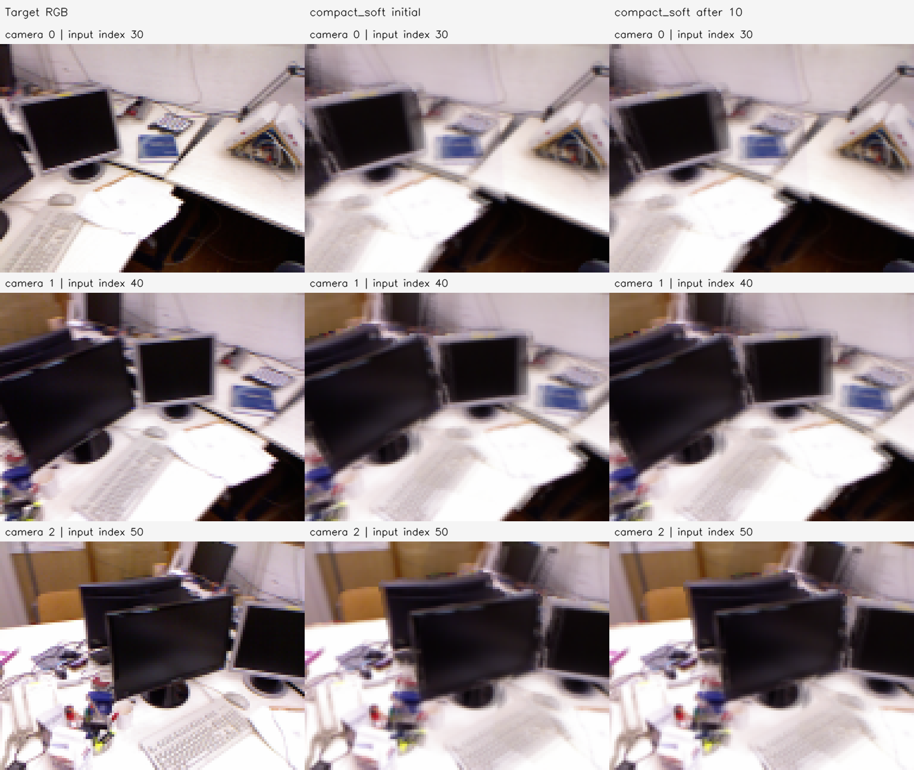

# P2c 결과 보고서 — tum-freiburg1_desk-P2c-20261112-001

**판정: compact_soft 렌더러가 사전에 고정한 합성·실제 미분 및 10회 최적화 조건을 통과했다(`ready_for_E3b=true`).** 실제 E0b 전체 점군에서 감소 방향의 미분이 유한차분과 일치했고, 10회 손실은 단조 감소했다. 이 판정은 수정 renderer로 E3b를 재실행할 수 있다는 뜻이며 실제 GT 기하 개선·장기 최적화의 성공을 의미하지 않는다.

## 목적·입력·비교 조건

P2b에서 확인한 검은 테두리와 E3b의 Autograd/실제 손실 방향 불일치를 분리해 확인한다. 부모는 `tum-freiburg1_desk-E3b-20261112-002/stages/E3b`다. 그곳에 보존된 **E0b 초기 341,325점·원본 관측 median RGB·active 135,193개·owner ray·3개 카메라·목표 영상·초기 학습 마스크**를 재사용했다. 실제 GT를 읽지 않고 기존 P2/E3b를 수정하지 않았다.

실행 전에 네 변형, tau, 유한차분 tolerance, 10회 Adam 설정과 E3b 재실행 허용 조건을 고정했다. 모든 변형은 같은 손실 픽셀과 같은 좌표에서 시작한다. 각 변형의 출력 모델이 다르므로 초기 RGB 점수 차이를 기하 개선으로 해석하지 않는다.

| 변형 | 색 합성 | 공간 지지 | 깊이/가림 |
| --- | --- | --- | --- |
| legacy | 기존 P2, 정규화 색×alpha | 기존 5×5 Gaussian | 최소 Z의 hard 3% gate |
| normalized_hard | alpha 곱 제거 | 같은 5×5 Gaussian | 같은 hard gate |
| compact_hard | 정규화 색 | 2px 원형 compact C1 kernel | hard gate 유지 |
| compact_soft | 정규화 색 | 같은 compact C1 kernel | 연속 exp(−Z/tau) 가중치 |

Compact kernel은 `exp(−r²/(2σ²)) × max(1−r²/R²,0)²`, σ=.65px, R=2px다. 지지 경계에서 값과 1차 미분이 0이어서 stencil이 바뀔 때 기여가 부드럽게 사라지도록 했다. 양수 Z·영상 픽셀 범위·무지원 영역 처리는 여전히 별도 경계가 있으므로 모든 가능한 상태에서 미분 가능하다고 주장하지 않는다.

Soft 가중치는 spatial×exp(−camera-Z/tau)를 픽셀별 정규화한다. log weight의 최댓값을 빼는 안정화 상수는 RGB/Depth의 비율에서 상쇄되므로 그 상수를 detach해도 비율의 수학적 미분은 유지된다. tau는 **초기 양수 camera-Z 중앙값×.1**로 카메라마다 한 번 계산해 고정했으며 각각 0.090411103 / 0.093571697 / 0.085729229 모델 단위다.

Compact 방식의 alpha는 **가림 전 spatial mass의 진단용 지원도**다. RGB에 곱하지 않으며, legacy의 가림 후 alpha와 같은 물리적 opacity 또는 coverage로 비교하지 않는다. 실제 손실은 기존 E3b의 초기 학습 마스크를 모든 변형·모든 Step에서 고정했다.

## 합성 검증

**약한 주변 전경점:** 실제 픽셀 중심에서 1.99px 떨어진 빨간 전경점(Z=1)과 중심에 있는 파란 배경점(Z=1.2)을 같은 카메라로 렌더했다. 기존 hard gate는 매우 약한 전경점이 배경을 완전히 제외해 legacy RGB가 약 `(0.00918,0,0)`, alpha 제거 후에는 `(1,0,0)`이 됐다. compact_soft는 약 `(0.00000565,0,0.99999435)`로 배경이 유지됐다. 2.4px 바깥 전경점도 compact 지지에서 제외됐다.

**강한 전경점:** 같은 픽셀의 빨간 전경점(Z=1)과 파란 배경점(Z=2)은 compact_soft에서 빨강 약 0.998729, 파랑 약 0.001271로 전경이 우세했다. 카메라 뒤/영상 밖 점만 있는 경우 지원도는 0이었다. 이 제어 예제를 모든 실제 가림의 정답으로 확대하지 않는다.

**Stencil 경계 미분:** 조밀한 배경 위의 전경점이 정수 픽셀 경계를 지나는 float64 검사를 수행했다. Autograd 0.028129861 대비 중심 유한차분은 epsilon=1e-4에서 0.028144403, 1e-5에서 0.028131315로 지정 tolerance를 통과했다.

**알려진 텍스처 평면:** 두 고정 카메라와 81개 고정 색 점의 공통 평면 깊이를 RGB 손실로 최적화했다. GT 깊이 2.4, 초기 2.6에서 100회 Adam 후 2.400748287이 됐다. 평균 3D 오차는 **0.204354493→0.000764579**, RGB MSE 합은 0.007908230→1.40838e-7로 감소했다. 평면 깊이 미분도 float64 유한차분과 일치했다. 이는 생성한 합성 장면에서 같은 renderer로 만든 목표에 대한 내부 회복 검증이다.

[합성 결과](synthetic.json), [평면 이력](synthetic_plane_history.json)에 수치·제어 판정을 모두 보존했다.

## 실제 E0b 전체 장면의 방향 미분

현재 카메라 3개의 Photo Charbonnier를 같은 비율로 합산했다. 시선 방향 log 거리 변수·고정 RGB·초기 마스크는 E3b와 같다. 초기 Adam 방향 `−g/(abs(g)+1e−8)`을 사용해 전체 renderer를 다시 계산했다.

| float32 변형 | Autograd 방향 미분 | epsilon=1e-4 유한차분 | epsilon=1e-3 유한차분 | +감소 방향의 실제 손실 |
| --- | ---: | ---: | ---: | --- |
| legacy | −0.072692633 | +0.020312145 | +0.008450821 | 증가 |
| normalized_hard | −0.046350900 | −0.002915040 | −0.029077753 | 크기에 따라 혼합, 1e-3에서는 증가 |
| compact_hard | −0.048870079 | −0.112359412 | −0.071594492 | 감소하나 미분 크기 불일치 |
| compact_soft | −0.056955334 | −0.056969002 | −0.056946184 | 두 크기 모두 감소 |

Alpha 곱 제거만으로 미분 문제가 해결되지 않았다. Compact 지지만 적용한 hard gate도 유한차분과 불일치가 남았다. compact_soft는 float32의 epsilon 1e-5/1e-4/1e-3에서 모두 실제 손실이 감소했다.

| compact_soft float64 | Autograd | 유한차분 | 상대 오차 |
| --- | ---: | ---: | ---: |
| epsilon=1e-5 | −0.056955291597 | −0.056955291411 | 3.25893e-9 |
| epsilon=1e-4 | −0.056955291597 | −0.056955271077 | 3.60282e-7 |

사전 tolerance `abs error≤1e−5 + .01×abs(Autograd)`를 모두 통과했다. 이 값은 **실제 초기 전체 점군의 한 방향 미분** 검증이며 모든 학습 상태·모든 방향의 보장은 아니다. [float32 방향 검사](real_float32_directions.json), [float64 검사](real_float64_direction.json) 참조.

## 같은 조건의 실제 10회 이동

각 변형을 독립적으로 초기화해 Adam lr=.001, clip norm=1, delta∈[−.05,.05], 10회를 적용했다. 카메라·색·점 수·활성 인덱스·학습 마스크는 고정했다. 실제 이동 좌표는 별도 파일에 저장했으며 원본 E0b/E3b에는 적용하지 않았다.

| 변형 | 초기 손실 | 10회 손실 | 1e-8 이상 실제 이동 점 | 고정 마스크 지원도 최대 감소 |
| --- | ---: | ---: | ---: | ---: |
| legacy | 0.059157047 | 0.071562141 | 125,834 | 2.956%p |
| normalized_hard | 0.053513460 | 0.055449126 | 125,593 | 2.897%p |
| compact_hard | 0.047410185 | 0.047693170 | 124,587 | 0%p |
| compact_soft | **0.042625068** | **0.042087066** | 133,555 | 0%p |

compact_soft는 **10회 모두 손실이 감소**했고, 누적 감소는 약 1.26%다. Active 변위 평균은 0.007990421, 최대는 0.027503284 모델 단위였다. 고정된 학습 픽셀에서 compact spatial-support는 초기/마지막 모두 100%였다. 이 지원도는 새로운 진단 정의로, 동일한 실제 표면 coverage나 가림 정확도 100%를 의미하지 않는다.

| 카메라 | compact_soft 초기 E1 고정 PSNR | 10회 PSNR |
| --- | ---: | ---: |
| 0 | 19.752dB | 19.844dB |
| 1 | 21.446dB | 21.496dB |
| 2 | 21.830dB | 21.863dB |



왼쪽부터 목표/legacy/alpha 곱 제거/compact+hard/compact+soft다. **이 그림의 변형 간 차이는 초기 좌표 이동이 아니라 renderer 변경**에 따른 것이다. 검은 띠와 약한 주변점의 가림이 줄었지만 soft 가림은 배경색 혼합·흐려짐·점 밀도 의존성을 남길 수 있다.



행은 Camera 0/1/2, 열은 목표/compact_soft 초기/10회다. 128×96을 최근접 4배로 표시했다. 짧은 이동의 영상 차이는 작지만 좌표와 손실 이력으로 실제 변경을 확인했다. [10회 전체 이력](short_optimization.json)에 모든 변형의 각 Step 점수·지원도를 보존했다.

## 판정·검증·제한

실행 전 지정한 조건인 합성 미분·평면 회복·가림 제어, 실제 float64 방향 미분, float32 실제 감소, 10회 손실 감소와 지원도 감소≤.5%p를 모두 통과했다. 따라서 [판정](decision.json)은 **`ready_for_E3b=true`**다. 다음 E3b 재실행은 E0b 초기값과 현재 검증한 compact_soft·고정 카메라별 tau를 사용하고 새 Run ID `...E3b-20261112-003`으로 구분할 수 있다. 이번에는 200회 E3b를 실행하지 않았다.

기존 P2 renderer와 E3b `...-002`는 보존했다. 실제 GT 깊이/전체 3D·독립 시점·벽 두께·장기 학습 안정성은 평가하지 않았다. 같은 입력 시점 RGB 손실 감소는 기하 정확도 개선 증거가 아니다. Soft 깊이 가중치는 엄밀한 불투명 표면 렌더링이 아니며 적절한 tau/공간 반경의 일반성도 검증하지 않았다.

2026-11-12, Asia/Seoul, **샌드박스 밖 호스트 RTX 5060**에서 실행했다. 전체 실험 wall time은 약 12.239초, peak allocated 800.882MiB, reserved 1094MiB다. PyTorch 2.15.0+cu132 / Python 3.11.18 / NumPy 1.26.4 / OpenCV 4.11.0이다. 모델 동시 추론은 없다.

```bash
.venvs/p0-py311/bin/python experiments/pointmap_refinement/P2c/run.py \
  --run-id tum-freiburg1_desk-P2c-20261112-001
```

부모 입력 해시·기존 renderer 재현(캐시와 최대 RGB 차이 약 1.14e-6)·동일 초기값/마스크/활성점·inactive 고정·유한 gradient·PLY/NPZ/PNG 재로딩 검증을 통과했고 실행 종료 코드는 0이다. [설정](config.json), [검증](verification.json), [환경](environment.json), [Manifest](manifest.json)을 보존했다. 두 패널을 직접 열어 행·열·검은 띠·10회 결과를 확인했다.

로컬 루트는 `results/pointmap_refinement/tum-freiburg1_desk-P2c-20261112-001/stages/P2c/`다. `artifacts/maps/compact_soft_short_source_mix.ply`와 `compact_soft_short_final.npz`가 실제 10회 이동 결과다. 다른 세 변형의 마지막 좌표/PLY, 모든 Step delta, 초기/마지막 RGB·Depth·지원도·고정 마스크, 합성 평면 GT/초기/마지막과 실행 소스도 보존했다. 코드·보고서·소규모 그림은 GitHub에 반영하고 대용량 PLY/NPZ는 로컬에 보존한다.
