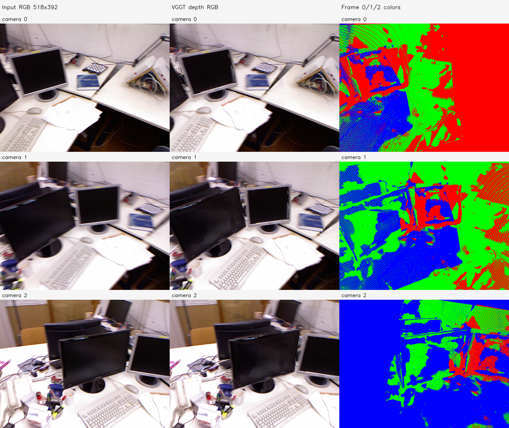

# V0 — 일반 VGGT 실내 3장 공동 추론·PLY

실행 `tum-freiburg1_desk-V0-20261113-002`. **PLY_CREATED_VERIFIED**. C 계열 FoV/융합 방법은 사용자 요청으로 종료했으며 이 파일은 별도 육안 비교다.

- 모델: 원본 공식 [facebook/VGGT-1B](https://huggingface.co/facebook/VGGT-1B), revision `860abec7937da0a4c03c41d3c269c366e82abdf9`.
- 체크포인트 SHA-256: `d15bf50a8615c8225ed48b51ea5cac673d82442ec0309036df555a053253afe0`. HF LFS 해시·크기 대조 통과.
- [공식 소스](https://github.com/facebookresearch/vggt/tree/a288dd0f14786c93483e45524328726ab7b1b4ce) commit `a288dd0f14786c93483e45524328726ab7b1b4ce`. strict state-dict load 통과.
- 기존과 동일한 원본 이미지 index 30/40/50을 같은 순서로 **동시에 3장, 배치 1개, forward 1회** 입력했다. 원본 파일 해시도 일치한다.
- 공식 crop 전처리: 원본 640×480 → **518×392**. Omega E0의 512×384와 격자가 다르며 해상도를 맞춘 모델 우열 실험은 아니다.
- 각 geometry는 프레임별 203,056점, 총 **609,168점**이다. confidence 필터·융합·FoV/정점 보정·ICP·GT 정렬은 적용하지 않았다.
- 호스트 GPU `NVIDIA GeForce RTX 5060`, autocast `torch.bfloat16`. 공동 forward 1.196초, peak allocated 5.590 GiB.

## PLY 선택

| 파일 | 의미 |
| --- | --- |
| `vggt_depth_rgb.ply` | **주 비교 파일**. 공식 Depth+카메라 역투영, 원본 RGB |
| `vggt_depth_frames.ply` | 같은 XYZ, 프레임 0 빨강·1 초록·2 파랑 |
| `vggt_pointhead_rgb.ply` | 같은 forward에서 직접 예측한 point-head 좌표, 원본 RGB |
| `vggt_pointhead_frames.ply` | 직접 point-head 좌표, 프레임별 색 |
| `frame_0/1/2_depth_rgb.ply` | 주 점군을 프레임별로 분리한 파일 |

실제 파일 디렉터리: `results/vggt_baseline/tum-freiburg1_desk-V0-20261113-002/stages/V0/artifacts/maps`. 큰 PLY/NPZ는 로컬 results에, 코드·보고서·그림·수치·해시는 GitHub에 보관한다.

## 검증과 비교 제한

공식 모델의 카메라/Depth/point-head 배열이 finite임을 확인했다. PLY를 다시 읽어 XYZ·RGB·프레임 ID·점 수를 대조했고, NPZ 재로딩과 자기 카메라 재투영/Z-depth를 확인했다. 세 원본 영상은 `frames.json`과 입력 해시로 추적된다.

비교 기준은 기존 Omega 원본 E0의 `results/pointmap_refinement/tum-freiburg1_desk-E0-20261112-001/stages/E0/artifacts/geometry/all_observations.ply`다. 서로 다른 모델의 원점·회전·scale이 동일하다고 가정하지 않는다. 원본 좌표를 보존했으므로 뷰어에서 각각 같은 형태의 시점/배율로 살펴본다. 실제 기하 정확도나 어느 모델이 더 우수한지는 판정하지 않았다.
