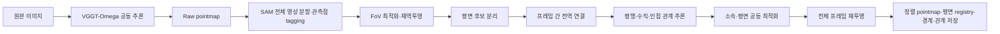

# VGGT-Ω 화면 전체 자동 평면 정렬·Pointmap 생성 실험 계획

> 작성일: 2026-11-13 KST<br>
> 상태: **I0~I9 및 두 실내 구간 A0~A6 실행 완료 · A4 가시성 보존 실패, retained=initial · GT 미평가**<br>
> 실험 계열: `global_planar_pointmap`<br>
> 목표: **영상 전체에서 평면 후보와 관측점 소속을 자동으로 판단하고, 모든 프레임이 공유하는 평면으로 pointmap을 정렬한다. 사용한 평면·공간 경계·관측 관계는 점군과 함께 영구 보존한다.**

[실행 결과·canonical run·판정·PLY 경로](experiments/global_planar_pointmap/index.md). 이후 사용자의 I0~I9 실행 요청에 따라 진행했다. 원계획과 실제 구현의 split·effective fit 지원 보완 및 제외 run을 결과 문서에서 구분한다.

## 1. 출발점과 검증 범위

H4f/H4g에서 사용자는 평면 재투영 후 벽의 정합과 형태가 크게 좋아진 것을 확인했다. H4f는 큰 깊이 오류도 이동 상한 없이 보정할 수 있음을, H4g는 서로 꺾인 벽을 다른 평면에 소속시켜야 함을 보여줬다. 이번에는 이 효과를 특정 벽과 사람의 plane 선택에서 **화면 전체의 자동 처리**로 확장한다.

기존 결과의 육안 개선·기술 검증과 실제 GT 정확도·다른 장면으로의 일반화는 구분한다. I 계열의 질문은 평면 투영이 유용한지를 다시 묻는 데 그치지 않고, **어떤 면인지·같은 면인지·어떤 관계인지·어디까지 적용할지를 사람이 지정하지 않고 정할 수 있는가**다.

- 원본 픽셀 RGB·관측 ID·픽셀 좌표·점 수를 유지한다. 이번 주 실험에서 점 추가·삭제·융합은 하지 않는다.
- FoV 단계 이후 K·pose·카메라 중심을 고정하고, 최종 이동은 자기 카메라의 픽셀 광선 방향으로 한다.
- 확정된 평면 소속에는 H4f처럼 **이동 상한을 두지 않는다**. 큰 깊이 오류를 이유로 벽의 소속을 다시 탈락시키지 않는다.
- 모든 픽셀에서 후보를 탐색하지만 모든 물체를 평면으로 만들지는 않는다. 곡면·동적 물체·반사·지지 부족·모호한 관측은 별도 상태로 남긴다.
- 사용자가 지정한 camera 번호·왼쪽/오른쪽 영역·특정 두 벽의 90° 관계는 자동 주 실험 입력에 넣지 않는다. H4g는 수동 참고군으로만 보존한다.
- 폴리곤을 위한 평면·경계·관계 데이터를 저장한다. 실제 mesh 생성·구멍 메우기·watertight 보장은 후속 실험으로 분리한다.

[H 종합 결과](experiments/c3a_plane_refinement/summary.md) · [H4f](experiments/c3a_plane_refinement/H4f/tum-freiburg1_desk-H4f-20261113-001/report.md) · [H4g](experiments/c3a_plane_refinement/H4g/tum-freiburg1_desk-H4g-20261113-001/report.md)

## 2. 전체 파이프라인



사용자가 제안한 순서를 주 경로로 고정한다. SAM은 RGB에서 분할하고 raw의 `(frame_id, pixel_uv)`에 tag를 붙인다. FoV가 변해 XYZ가 다시 계산돼도 **동일 픽셀·관측 ID의 tag는 그대로 이어진다**. FoV 이후에 기존 XYZ로 nearest-neighbor tagging을 다시 하는 방식은 쓰지 않는다.

공동 최적화는 평면과 소속을 갱신하고, 최종 전체 점 이동은 뒤에서 한 번 수행한다. 최적화 중 필요한 광선 교차는 임시 평가값이며 원본 pointmap을 덮어쓰지 않는다.

## 3. 데이터·기준선·자동화 조건

| 항목 | 주 조건 |
| --- | --- |
| 주 실내 | TUM `freiburg1_desk` index 30/40/50, RGB 3장 공동 추론 |
| 주 처리 격자 | Omega 512×384×3 = 589,824 관측점 |
| 추가 실내 | 기존 index 100/110/120 구간, I0에서 입력/hash 동결 후 전이 평가 |
| 후속 야외 | 기존 UAVScenes HKairport01/AMtown01 캐시를 사용하는 별도 I9b; 초기 필수 범위에 합산하지 않음 |
| raw | 기존 E0 원본 모델 출력·depth·confidence·K/pose·frames manifest |
| FoV 기준 | 기존 C3a의 **실제 proposed**; selected=β1과 구분 |
| 수동 참고 | H4g 두 벽 결과; 자동 알고리즘 입력이나 모델 선택에 사용하지 않음 |
| 재현성 | seed0, 입력/모델/코드/환경 hash, stage별 새 run 및 실패 보존 |

추가 실내는 과거에 사용한 구간이므로 완전히 새로운 독립 데이터라고 부르지 않는다. 해당 결과를 보고 주 구간의 threshold를 교체하지 않는다. 기존 실험은 재작성하지 않고 새 결과에서 출처를 참조한다.

기본 비교 좌표계는 C3a와 같은 Omega world/model units다. 미터 단위는 검증된 scale/정렬이 있을 때만 사용한다. 모든 R/t 규약·전처리 resize/crop·depth의 Z 정의는 I0에서 배열 단위로 확인한다.

자동 실행에는 영역 좌표, plane 개수, 특정 frame의 우선권, 수직 벽 쌍을 수동 입력하지 않는다. 사람이 만든 ROI/annotation은 I0에서 평가용으로만 동결하고 알고리즘은 읽지 않는다. 실행 후 육안 검토는 별도로 기록한다.

## 4. I1: 화면 전체 SAM 분할과 tag 보존

### 4.1 벽 이외의 대상까지 후보 탐색

두 경로를 함께 사용한다.

1. GroundingDINO+SAM의 고정 prompt: `wall. floor. ceiling. door. window. table. cabinet. shelf. screen. whiteboard. blackboard.`
2. SAM Automatic Mask Generator의 영상 전체 point grid. prompt 목록에 없는 책 표지·상자 면·가구 면도 후보로 남길 수 있게 한다.

두 경로의 원본 결과는 분리 저장하고 합칠 때 출처를 유지한다. 자동 마스크 생성은 평면 판정기가 아니며, semantic class가 없으면 `unknown` tag를 허용한다. wall/table이라는 이름이나 SAM predicted-IoU를 평면성 확률로 해석하지 않는다. 전체 탐색에도 SAM 누락이 있을 수 있으므로 uncovered pixel map을 산출한다.

I0에서 고정할 최초 설정:

| 항목 | 기본값·의미 |
| --- | --- |
| SAM | 기존 공식 ViT-H checkpoint·source revision 재사용, hash 재검증 |
| detector | 기존 공식 GroundingDINO Swin-T HF 변환 checkpoint·버전 기록 |
| detector threshold | box0.25 / text0.2 |
| SAM box mode | `multimask_output=False` |
| automatic grid | `points_per_side=32`, `points_per_batch=16`, `crop_n_layers=0` |
| automatic quality | `pred_iou_thresh=0.88`, `stability_score_thresh=0.95` |
| automatic NMS | 공식 box/crop NMS0.7; 내부 제거 결과와 가능한 pre-NMS 후보 이력도 기록 |
| mask mapping | 원본 RGB→처리 격자 nearest-neighbor, transform 명시 |
| sensitivity | I1a grid64 또는 crop1을 한 항씩 변경, 주 결과와 분리 |

GPU는 호스트에서 실행하고 모델을 순차 로드한다. OOM이면 batch16→8→4만 낮추며 point grid·quality·모델을 바꾼 경우에는 별도 보조군으로 기록한다. 실제 결과 동일성은 hash/수치 비교로 확인하며 단순 batch 변경을 무조건 bitwise 동등하다고 가정하지 않는다.

### 4.2 중첩 마스크를 삭제 대신 계층으로 보존

H4f/H4g의 핵심을 반영한다. 작은 wall 마스크와 큰 wall 마스크는 같은 물체의 중복일 수도 있고, 큰 마스크에 서로 다른 두 면이 섞인 것일 수도 있다.

- GroundedSAM raw mask는 NMS 이전부터 모두 보존한다. 포함/겹침 관계를 DAG로 저장한다.
- 완전히 같은 후보는 alias로 정리할 수 있지만 원래 mask ID·hash·제거 이유는 남긴다.
- 포함된 작은 마스크를 무조건 삭제하거나, 작은 마스크만 남겨 큰 영역을 버리지 않는다.
- 큰-minus-작은 영역, 교집합, 연결 성분을 I3의 분리 후보로 제공한다. 차집합이 항상 다른 plane이라는 가정은 하지 않는다.
- raw tag는 many-to-many다. 한 점이 여러 SAM mask에 속할 수 있다. 최종 plane 소속을 이 단계에서 확정하지 않는다.
- 작은 마스크를 지우는 duplicate 규칙과 작은 표면의 실제 분리 규칙을 별도 이벤트로 기록한다.

태그 연결은 `observation_id → [sam_mask_id, semantic_tag, model_scores]`이며 sparse CSR/RLE로 저장한다. label=unknown과 plane_id=-1은 서로 다른 개념이다.

## 5. I2: tag를 유지한 FoV 최적화

카메라 중심·회전·주점·원본 Z-depth를 고정하고 카메라별 fx/fy의 역초점거리 배율 β를 최적화한다. 우선 기존 C3a solve를 같은 입력·split·설정으로 재현하고 실제 proposed를 I2 초기 기준으로 쓴다. 새 태그는 유지하되 기본 FoV 목적함수를 임의로 바꾸지 않는다.

- β 이전/이후 K·XYZ와 tag/ID 불변을 저장한다. raw XYZ와 FoV XYZ를 별도로 유지한다.
- 대응이 적거나 해가 퇴화하면 `LOW_SUPPORT`를 기록하고 실제 proposed와 β1 대안을 둘 다 보존한다. 자동 선택이 원래 값인 경우도 명시한다.
- semantic mask를 활용한 FoV 대응 가중치 변경은 I2a로 분리한다. 주 파이프라인 순서와 tagging 효과를 solver 변경 효과와 섞지 않는다.
- 이후 I3~I9에서는 이 K/R/t를 고정한다. 평면과 FoV를 동시에 바꿔 잘못된 소속을 카메라 변수로 상쇄하지 않는다.

## 6. I3: 평면 후보 분리·평면성 판단

### 6.1 방향이 다른 면과 같은 방향의 다른 면을 구분

평면 후보는 semantic tag, 중첩 마스크 계층, RGB 경계/선분, 다중 크기 법선, 원본 depth의 robust 잔차를 함께 사용한다.

- 법선7×7/21×21은 seed/신뢰도 판단에 사용한다. depth 오류 때문에 법선이 틀렸다는 이유만으로 SAM 전체 이동 영역을 영구 제외하지 않는다.
- 방향이 다른 면: 지역 법선 분포·RGB 모서리·소실방향과 다중 평면 가설로 분리한다.
- 방향이 같아도 다른 높이/위치인 면: centroid의 상호 plane 거리와 이미지/3D 연결성·가림·다른 물체 tag를 확인한다. 같은 normal만으로 합치지 않는다.
- 책상 상판·모니터 화면·캐비닛 면처럼 작은 대상과, 벽·바닥처럼 큰 대상을 같은 고정 pixel 수 하나로 평가하지 않는다.
- 구부러진 벽 depth와 실제 곡면을 구분한다. noisy depth에 잘 맞는 작은 plane을 과도하게 늘리는 해도 후보 복잡도 비용으로 억제한다.
- 유리/화면/광택 면은 SAM 영역이 선명해도 depth 신뢰도가 낮을 수 있다. 별도 material 상태와 위치 불확실성을 기록한다.

초기 후보의 최소 면적은 화면0.1%(주 격자197px), fit 관측 최소50개로 시작한다. 0.05/0.2% 면적 민감도는 보조군이다. 같은 광선/한 줄에만 놓인 점은 개수가 충분해도 퇴화로 판정한다. 자동 출력은 `planar / multi_plane / curved / low_support / ambiguous / material_uncertain` 상태를 가진다.

### 6.2 평면 적합 지지와 재투영 영역 분리

적합은 원본 FoV pointmap의 신뢰할 지지점과 fit 대응에서 한다. 이동은 최종 plane 소속 전체에서 한다.

- 적합 지원에는 confidence·경계 erosion·균형 표본추출을 사용할 수 있다. 원래 관측은 삭제하지 않는다.
- 주 적합은 unit normal의 `n·X+d=0`, seed0 RANSAC/SVD-Huber를 기본으로 한다. 정규화 분모는 최초 원본 Z로 고정한다.
- 초기 normalized inlier/Huber0.005, 최소 inlier 비율0.7, 최대RANSAC2000, 최종IRLS20을 출발 설정으로 둔다.
- 한 점의 원래 depth 오차0.5%를 넘었다고 최종 보정 소속에서 탈락시키는 규칙으로 쓰지 않는다. 이것은 fit seed 품질 기준이다.
- 원본 depth만으로 지지가 부족하지만 영상·다중시점 증거가 강한 후보는 `weak_geometry`로 유지한다. 다른 시점/독립 방향·선분 제약으로 재평가하며 강한 관측과 같은 신뢰도로 취급하지 않는다.
- 여러 프레임이 참여하면 프레임별 총 가중치를 같게 하고, 가림/분리 면이 섞인 경우에는 별도 모델을 유지한다.

한 SAM 영역에서 1/2/3개 plane 및 미보정 모델을 비교한다. 모델 수를 화면 전체에5개로 고정하지 않는다. 이 출발 가설 수를 넘는 경우 재귀 분할을 하되 모델 복잡도·최소 영역 조건을 기록한다. 후보 평면의 계수/지지점·모델 score·탈락 이유를 모두 보존한다.

## 7. I4: 모든 프레임의 평면 후보 전역 연결

각 `(frame_id, region_id)`를 node로 하고 같은 물리적 표면일 가능성을 edge로 만든다. 처리 순서나 특정 frame의 우선권으로 같은 면을 결정하지 않는다.

연결 근거는 양방향 마스크/후보 plane의 유한 영역 투영, fit 점 대응, RGB 경계/가림, 방향·offset의 불확실성이다. 원래 depth의 3% 일치 같은 좁은 gate를 주 소속의 필수 조건으로 다시 넣지 않는다. 큰 depth 오차는 낮은 가중치의 한 증거로 취급하고, 영상에서 일관된 별도 면 후보를 남긴다.

- 동일 semantic tag나 같은 색만으로 shared ID를 만들지 않는다.
- 여러 모서리를 넘는 큰 SAM 마스크는 여러 plane node에 대응할 수 있다.
- A-B와 B-C 연결만으로 A-C까지 무조건 병합하지 않는다. 그룹 전체의 geometry·가림·동일 source의 상충 소속을 평가한다.
- 평행한 별개 벽, 책상과 바닥, 앞뒤가 다른 문/박스 면은 별도 plane ID로 유지한다.
- 한 시점에만 보인 면도 버리지 않고 `single_view` plane으로 보존한다. 다중시점 확인 plane과 결과를 구분한다.
- 최종 한 관측은 plane 하나 또는 unknown에만 hard 소속된다. 모서리의 복수 후보는 별도 uncertainty 목록으로 남기고 두 번 이동하지 않는다.

공유 plane ID는 처음 배정 후 재사용하지 않는다. 병합/분할은 새 ID와 parent/alias 이력으로 추적한다.

## 8. I5: 구조 관계 자동 추론

사용자가 지정한 ‘두 벽은90°’를 입력하지 않는다. 다음 증거로 `free / parallel / orthogonal / uncertain` 관계 가설을 만든다.

- 서로 다른 관측 영역/시점의 robust 법선 방향 분포.
- RGB 선분의 소실방향과 추정 K에서 얻는 방향 관계.
- 같은 물체의 면 경계, 실제 맞닿는 모서리의 영상 지지와 plane 교선의 투영.
- 반복되는 장면 구조 방향과 plane 위치·가림의 양립 가능성.

초기 탐색 범위는 평행≤15°, 수직으로부터 편차≤20°이며 **가설을 만들기 위한 범위**다. 깊이 오류가 큰 후보는 RGB 방향 근거가 있으면 이 범위를 넘는 별도 가설도 기록한다. 이 각도로 점을 이동 소속에서 잘라내지 않는다.

각 쌍의 자유/평행/수직 모델을 training likelihood·모델 복잡도·영상 모서리 근거로 비교한다. validation 결과로 관계를 선택하지 않는다. 한 noisy normal만으로 90°를 hard 강제하지 않고, 서로 독립적인 두 종류 이상의 증거가 있을 때 주로 soft 관계를 사용한다. 독립성은 같은 depth에서 만든 normal과 plane 잔차를 두 근거로 세는 방식으로 부풀리지 않는다.

비스듬한 모니터·문·테이블·경사면도 허용한다. 모든 면을 Manhattan 축에 강제하지 않는다. 증거가 부족한 관계는 `uncertain`으로 남기고 자유 plane을 유지한다. 구조 관계를 켠/끈 비교군을 함께 실행한다.

## 9. I6: 전역 소속·평면 공동 최적화

### 9.1 변수와 근거

주 변수는 plane 집합 Π, 지역의 소속 z, 구조 관계 h다. 카메라와 RGB는 고정한다. 각 plane은 unit normal2자유도+offset, 관측의 보정 XYZ는 해당 plane과 고정 광선의 교차로 계산한다.

```text
E(Π,z,h) = λimage Eimage + λraw Eraw + λnormal Enormal
          + λcross Ecross + λedge Eedge
          + λstruct Estruct + λcomplex Ecomplex + λunknown Eunknown
```

| 항 | 사용하는 고정 근거·역할 |
| --- | --- |
| Eimage | 원본 SAM의 포함/중첩·RGB 경계·semantic 양립성. raw SAM score를 보정된 확률로 부르지 않음 |
| Eraw | **최초 FoV XYZ의 fit 지지점**에 대한 robust plane 잔차. confidence·불확실성 가중, 큰 오류 영향 제한 |
| Enormal | 고정된 region 방향 prior의 불확실성 가중 손실. 보정 후 스스로 만든 normal을 독립 근거로 사용하지 않음 |
| Ecross | fit 대응점의 보정된 3D/다른 시점 재투영, plane 유한 영역의 양방향 마스크 일관성 |
| Eedge | 관측된 RGB 모서리/경계와 plane 교선 투영의 양립성, 다른 물체를 가로지르는 소속 억제 |
| Estruct | 선택된 평행/수직 관계의 신뢰도 가중. 근거가 약하면 비활성/자유 모델 유지 |
| Ecomplex | 불필요한 plane 추가·영역 과분할·과도한 관계를 억제하는 모델 비용 |
| Eunknown | 모든 관측을 unknown으로 버리는 해와 무리한 강제 소속의 균형. unknown을 실제 허용 |

**이미 plane으로 옮긴 점에 다시 plane을 맞춰 잔차0을 만드는 것만으로 목적함수를 구성하지 않는다.** 그러면 어떤 잘못된 plane도 자기 일관성만 만족할 수 있다. 원래 fit 지지·독립적인 이미지/다중시점 근거가 위치와 소속을 계속 제약해야 한다. H4g의 자유73.13°/강제90° 사례처럼 원래 depth와 구조 prior의 상충도 기록한다.

원래 depth 가까이 남으라는 강한 점별 quadratic prior나 최대 이동 gate를 주 목적에 넣지 않는다. 잘못된 depth를 고칠 수 있게 하고, 부정확한 원래 XYZ는 robust anchor로만 사용한다. 수치적으로 양의 교차가 불가능하거나 plane 위치가 관측으로 결정되지 않는 경우는 미확정으로 남긴다.

### 9.2 계산·선택·종료

각 항은 관측 수/카메라 쌍 수로 정규화하고, 거리·픽셀·각도 잔차는 별도 scale로 무차원화한다. I0의 합성 제어에서 이 scale·가중치·모델 비용을 확정한 뒤 주/추가 실내 결과를 보기 전에 `config_resolved.json`으로 동결한다. 이 계획에는 아직 실행하지 않은 최적 λ가 존재한다고 가정하지 않는다. λ 후보 grid·선택에 사용한 합성 사례·탈락값도 남기며 실제 장면 validation으로 tuning하지 않는다.

1. 이미지/기하 근거에서 얻은 여러 초기 plane/소속 모델을 준비한다.
2. plane 고정 상태에서 전역 그래프 소속·unknown·관계 가설을 갱신한다.
3. 소속을 고정하고 모든 프레임의 fit 근거로 plane 계수·활성 관계를 최적화한다.
4. 병합/분할/되돌림 제안은 동일 목적함수+복잡도 비용으로 평가하고 이력을 저장한다.
5. objective가 줄어드는 제안만 수용하며 20 outer iteration 또는 relative decrease<1e-5/소속 변화<0.1%가3회 연속이면 종료한다. 내부 연속 solver는 회당 max200 evaluations로 제한한다.

관측/plane 순서를 바꾼 반복·여러 초기값에서 label permutation을 제외한 안정성을 비교한다. 전체 plane을 독립적으로 차례차례 확정하는 greedy 방식과 주 공동 방식을 분리한다. 여기서 전역은 모든 frame/영역을 함께 고려한다는 뜻이며 비선형·이산 문제의 수학적 전역 최적해 보장을 의미하지 않는다.

## 10. I7: 전체 프레임 hard 재투영

```text
x_camera = R_i X_world + t_i
C_i = -R_i^-1 t_i
q_i(u,v) = R_i^-1 K_i^-1 [u,v,1]^T
X_old = C_i + D0 q_i
D_plane = -(n·C_i+d)/(n·q_i)
X_new = C_i + D_plane q_i
```

D는 ray 길이가 아닌 자기 카메라 Z-depth다. 같은 plane ID에 속한 모든 frame의 관측은 **같은 world 계수**를 사용한다. frame별로 새 plane에 독립 투영하지 않는다.

- 최종 소속 전체에 적용하며 fit에서 제외된 낮은 confidence·큰 깊이 오류·mask 경계도 소속이 확정되면 이동한다.
- 주 실험은 `max_relative_move=None`; 100% 초과도 허용한다.
- finite·양의 Z·수치 평행 방지 |cos|≥1e-8만 이동의 수치 조건으로 둔다.
- 원래 depth/법선/참조 depth 차이는 새로운 이동 한도로 쓰지 않는다.
- 다른 면/가림/곡면/모호한 관측은 소속 단계에서 처리하고, 보정하지 않은 XYZ는 FoV 결과와 bitwise 동일해야 한다.
- RGB는 원본 픽셀색 그대로다. 색 평균·색 학습·중복점 삭제는 하지 않는다.
- initial/proposed/retained를 모두 구분한다. 가시성 기준에 실패해 retained가 initial이어도 실제 proposed와 plane registry를 보존한다.

## 11. I8: 점군과 plane registry를 함께 영구 저장

### 11.1 저장 묶음

일반 XYZ/RGB PLY 하나에 plane 정보를 숨겨 넣지 않고, 다음 bundle을 상호 hash로 연결한다.

```text
artifacts/bundle/
  manifest.json
  pointmap.npz                 # raw/FoV/refined XYZ, pixel RGB, K/pose, observation_id
  pointcloud_pixel_rgb.ply      # xyz/rgb/observation_id/frame_id/pixel_uv/plane_id
  pointcloud_frame_colors.ply
  pointcloud_plane_colors.ply
  observation_mask_links.npz    # many-to-many raw SAM tag links
  assignments.npz              # observation_id -> region_id/plane_id/status/reason
  planes.json                  # current plane definitions + uncertainty/evidence
  plane_versions.jsonl         # initial/proposed/retained/iteration/version lineage
  plane_support.npz            # fit/holdout/assigned observation IDs
  plane_boundaries.json        # finite footprints in plane-local coordinates
  plane_relations.json         # shared/adjacent/parallel/orthogonal/intersection
  view_masks/                  # frame별 plane 영역, raw tag와 분리
```

PLY의 확장 필드를 지원하지 않는 뷰어도 RGB pointcloud를 볼 수 있게 하고, NPZ/JSON을 데이터의 정식 연결 원본으로 삼는다. `observation_id`·`plane_id`의 정수형 범위와 sentinel -1을 schema에 명시한다. PLY를 다시 읽어 추가 property가 실제 보존됐는지 검사한다.

### 11.2 각 plane에 보존할 정보

| 분류 | 필수 항목 |
| --- | --- |
| 식별·상태 | global plane ID/UUID, version, active/single_view/ambiguous/rejected/merged/split, parent/alias ID |
| 좌표·계수 | coordinate frame, model/metric units, unit normal n, offset d, sign convention, local origin/tangent u/v basis |
| 기원 | source frame/region/raw mask ID, 모델·데이터·code hash, seed, 생성·병합·분할 이유 |
| 관측 | fit/holdout/전체 assigned IDs, frame별 개수, 가림/미수용 이유, single/multi-view 구분 |
| 품질 | fit/holdout 잔차, 추정 방향/위치 불확실성 또는 bootstrap 범위, 구조 prior 강도·선택 근거 |
| 유한 영역 | 관측 경계 loops, holes, disconnected components, projected contour provenance, visible footprint |
| 관계 | 인접 plane IDs, 평행/수직의 추정 신뢰도, 교선과 관측된 유한 구간, 공유 vertex 후보 |
| 변화 | 적용 전후 깊이/XYZ 통계·source별 이동, initial/proposed/retained 간 연결 |

사용한 plane은 결과가 좋지 않아도 삭제하지 않는다. 모델이 병합되거나 분할돼도 이전 ID의 레코드는 남기고 `inactive/merged/split` 상태와 후속 ID를 연결한다. 현재 active 목록과 전체 이력을 분리해 읽을 수 있게 한다.

### 11.3 폴리곤 재구성 준비

무한 평면의 n/d만으로 실제 면의 크기나 구멍은 알 수 없다. plane-local 좌표계에서 **여러 외곽선·구멍·분리된 영역**을 보존한다. 단일 convex hull로 책상 뒤 가림이나 떨어진 면 사이를 자동으로 메우지 않는다.

경계는 `observed_surface_edge / occlusion_boundary / image_border / segmentation_uncertain`로 구분한다. 모니터가 벽을 가린 영역은 벽의 실제 구멍이라고 단정하지 않는다. 서로 다른 frame에서 보이는 범위를 합칠 때 미관측 영역과 실제 면의 연장을 구분한다.

plane 교선은 무한 line과 관측 지지 interval을 함께 저장한다. 실제 꼭짓점으로 쓸 수 있는지는 근거/불확실성을 기록하고, 억지로 watertight 면을 만들지 않는다. pointmap과 registry만으로 소속·평면식·기본 경계를 다시 복원하는 round-trip을 I8 필수 검증으로 둔다.

## 12. 실험 코드와 산출물

| 코드 | 검증 목적 | 완료 기준 |
| --- | --- | --- |
| **I0** | 입력/좌표/tag·split·합성/목적함수 계약 | raw/C3a 재현, 가중치·평가 split 동결, 수학·자동 입력 분리 검사 |
| **I1** | 전체 영상 SAM 분할·tagging | semantic/automatic 후보·중첩 계층·uncovered map·관측 연결·모델 비용 |
| **I2** | FoV 최적화와 tag 전달 | β/K/XYZ 재현, 원래 tag/ID 유지, low-support·대안 기록 |
| **I3** | 평면 후보 분리·평면성 판단 | 벽/가구/작은 물체·곡면 분리, 다중 모델/퇴화·전체 후보 registry |
| **I4** | 전역 plane ID·관측 소속 연결 | 동일 면 연결·다른 면 유지·cycle/가림/unknown·순서 영향 검사 |
| **I5** | 구조 관계 추론 | 자유/평행/수직/uncertain의 자동 선택·근거·오탐 제어 |
| **I6** | 소속·평면 공동 최적화 | 고정 objective 감소·반복/초기값 안정성·소속/plane 전체 이력 |
| **I7** | 전체 프레임 재투영 | 무제한 hard 이동·point/RGB/K/pose/ID·비대상 보존·실제 PLY |
| **I8** | plane registry·폴리곤 준비 export | 계수/지원/유한 경계/교선/관계·ID lineage·round-trip 검증 |
| **I9** | 종합 비교·추가 실내 전이 | 카테고리·plane·view별 수치·육안·비용·PLY inventory·실패 포함 보고 |

I1a/I2a 등은 한 요인 변경의 보조 검증으로 분리한다. 원계획 작성 당시에는 I0를 포함해 미실행이었다. 이후 사용자의 명시적 I0~I9 실행 요청에 따라 [실제 실행 결과](experiments/global_planar_pointmap/index.md)를 별도 보존했다. 선택 민감도 I1a/I2a 및 야외 I9b는 이번 필수 범위에 합산하지 않았다.

## 13. 비교군: 자동화 각 단계의 효과 분리

| 군 | 조건 | 비교 목적 |
| --- | --- | --- |
| B0 | Omega raw | 최초 출력 보존 |
| B1 | C3a 실제 FoV proposed | 평면 투영 전 기준 |
| M1 | H4f 실제 단일 wall plane | 수동 SAM 선택·잘못된 두 벽 소속의 역사적 참고 |
| M2 | H4g 수동 분리·수직 prior | 자동 결과가 따라가야 할 해당 벽의 정성 참고; 전체 장면 정답은 아님 |
| A0 | 전체 SAM 영역을 분리 없이 같은 semantic별 plane에 연결 | H4f형 과병합을 의도적으로 드러내는 진단; 주 출력으로 사용하지 않음 |
| A1 | 자동 후보·frame별 독립 plane | 같은 면의 층이 남는지 확인 |
| A2 | 자동 후보·전역 ID, 구조 관계 없음, 공동 갱신 없음 | 전역 연결 효과 |
| A3 | A2 + 자동 구조 관계 | 구조 prior 효과 |
| **A4** | A3 + 전역 소속/plane 공동 최적화 + 전체 재투영 | 주 파이프라인 |
| A5 | A4에서 구조 관계 항을 끔 | 공동 최적화와 수직/평행 제약 효과 분리 |
| A6 | A4에서 automatic mask 경로 제거, semantic prompt만 사용 | 전체 화면 후보 누락/계산 비용 영향 |

A0~A6는 공통 raw/tag 후보·split에서 시작하고 제거하는 요소만 명시적으로 다르게 한다. A6는 후보 subset 차이가 의도된 비교다. 모든 군에 동일한 source ID·원본 RGB·후보 출력 상태를 적용한다. 자동 plane 개수나 정답 소속을 H4g 결과에서 복사하지 않는다.

## 14. 기술 검증·독립 평가

I0의 필수 합성/회귀 제어:

- 한 벽·수직/비스듬한 두 벽·서로 평행한 다른 면·작은 평면·실제 곡면·반사/동적 unknown.
- 큰/작은 중첩 SAM mask, 한 큰 mask에 두 면, 여러 작은 mask가 같은 면, 가림·미관측 hole·영상 border.
- depth의 50/100/500% 오류가 있어도 소속 근거가 충분하면 plane까지 이동할 수 있음.
- 실제 비수직 면을90°로 강제하지 않음. 관계 증거 부족을 unknown/free로 남길 수 있음.
- 거의 순수 회전/작은 baseline·법선 평행·한 줄 지지의 퇴화. 출력이 평평해도 위치가 관측으로 결정됐다고 주장하지 않음.
- frame/mask/plane 순서 변경, merge/split ID 충돌, registry 로드 후 이전 버전 복원.
- 광선 교차·자기 투영·unit normal·coordinate transform·색/ID/관측 수·비대상 bitwise 보존.

fit/validation은 **관측과 알려진 전체 track 단위**로 I0에서 동결한다. FoV·plane·관계의 적합과 모델 선택은 공통 fit 근거만 사용하고 validation 잔차는 선택에 사용하지 않는다. 법선/거리 기반 fit 후보의 지지 계산에서도 보류 관측 주변이 재유입되지 않도록 기록한다. 같은 공동 추론 결과·원본 RGB를 쓰는 내부 보류 정합성 평가이므로 완전히 독립적인 장면/표면 GT 검증으로 부르지 않는다. 타일 경계에 걸친 track은 모든 관측과3px 주변을 holdout으로 전파하고 mixed=0을 검사한다. 주/추가 구간을 합쳐 plane/관계나 hyperparameter를 선택하지 않는다.

| 평가 | 측정과 해석 |
| --- | --- |
| 전체 화면 적용 | 전체/카테고리/plane별 검색·후보·확정·unknown·이동 비율, 누락/과분할/과병합 |
| 소속·plane 선택 | I0에서 동결한 평가 annotation이 있을 때 label permutation을 맞춘 소속·경계·면 수 평가; 학습 입력과 분리 |
| 다중시점 정합 | 고정 보류 matching의3D/양방향Z/재투영, 보정/비대상 분리, view·plane별 지원 수 |
| 표면 정리 | 고정 원래 ID·원래 참조 평면의 source 간격/두께·잔여 굴곡·원래 boundary 변화 |
| 평면식 일치 | 수용점의 assigned plane 잔차<1e-9(model units, float64 상대 허용 병기); 이는 기술 검증이며 정확도 증거가 아님 |
| 구조 관계 | 관계 오탐, 강제 전/후 각도, free 대안과 원본/독립 근거의 상충, 사용자 prior 유입 여부 |
| 보존 | 전 관측 수/RGB/ID/pixel_uv/K/pose 불변, unknown·비수용 XYZ=FoV initial bitwise |
| 가시성 | frustum 관측 유지와 실제 pixel coverage 별도; B1(FoV initial) 기준 loss≤0.5 percentage point를 보존 참고 기준으로 기록 |
| polygon 준비 | plane/ID·origin/basis·rings/holes·교선/인접·미관측 구간·version round-trip |
| 비용 | 모델 로딩/추론·tagging·FoV·후보·연결·공동 solve·투영/export의 시간·host/GPU peak·저장 크기 |
| GT 기하 | TUM depth/pose timestamp·distortion/resize/K·scale를 검증했을 때만 실제 정확도 평가 |

GT 정렬은 보정 전 B1에서 구한 변환/scale/마스크를 모든 군에 공통 적용한다. 군별 재정렬로 오류를 숨기지 않는다. GT가 준비되지 않으면 `GT_NOT_EVALUATED`를 명시하고 육안·내부 정합 범위로 결론을 제한한다.

기존 G6 벽 ROI는 역사적 참고로 유지하되 화면 전체 개선의 대표 지표로 쓰지 않는다. 새 카테고리 ROI와 평가 annotation은 보정 결과 전에 동결한다. 모든 점을 plane에 억지로 소속해 적용률만 높인 결과를 성공으로 세지 않는다.

최종 보고서는 **자동 소속/구조 추론 성공**, **표면 정리**, **가시성·경계 보존**, **GT 정확도**를 각각 판정한다. 한 수치로 전체 PLY의 육안 품질을 기각하지 않고 지표 상충·시점별 근거를 함께 제시한다.

## 15. 산출물·실행 규칙

```text
experiments/global_planar_pointmap/I0/ ... I9/
results/global_planar_pointmap/{dataset}-{code}-{YYYYMMDD}-{seq}/stages/{code}/
  config_resolved.json  environment.json  manifest.json
  logs/
  artifacts/{source,raw,tags,fov,regions,planes,associations,relations,optimization,bundle,projections}/
  evaluation/
docs/experiments/global_planar_pointmap/{code}/{run_id}/report.md
docs/experiments/global_planar_pointmap/index.md
results/global_planar_pointmap/ply_review/
```

각 단계는 입력·모델·코드·schema version과 hash, parent run, 실패·선택 근거를 남긴다. plane registry와 점군의 state/version/hash가 다르면 export를 거절한다. initial/proposed/retained의 plane registry도 각각 해당 pointmap과 맞아야 한다.

GPU는 샌드박스 밖 호스트에서 실행하고 CPU geometry와 구분한다. 기존 환경과 호환성을 확인한 후 필요한 설치만 하며 변경 버전을 기록한다. 완료 단계마다 코드·경량 결과·보고서를 GitHub에 커밋·푸시한다. 대형 NPZ/PLY·모델·전체 mask 캐시는 로컬에 보존하고 Git에는 경로·크기·hash를 저장한다. 계획 작성 당시의 미실행 상태와 이후 실제 실행은 canonical 결과 문서에서 구분한다.

## 16. 공식 방법과 자체 확장 구분

- [PlanarGS 논문 §3.2](https://arxiv.org/html/2510.23930v1#S3.SS2): 영상 후보와 법선/거리 기반 기하 검사 원리를 참고한다.
- [공식 마스크 정제 코드](https://github.com/SJTU-ViSYS-team/PlanarGS/blob/a68f22043e95146c4f1c52cc0e471a6a90e86f73/lp3/mask_refine.py): 중첩·법선 cluster·연결 성분 처리의 참고이며 우리 전역 plane registry/관계 solver와 동일하지 않다.
- [SAM 전체 영상 자동 마스크 생성](https://github.com/facebookresearch/segment-anything/blob/dca509fe793f601edb92606367a655c15ac00fdf/segment_anything/automatic_mask_generator.py): point grid의 class-agnostic 후보 생성에 사용한다. 평면성·물체 종류·같은 물리적 면을 보장하지 않는다.
- [기존 PlanarGS 이식 조사](research/planargs_reuse_review.md): 공식 계산·현지 변경·한계를 구분한 기록이다.

영구 전역 plane ID·자동 구조 관계·소속/plane 공동 최적화·평면/폴리곤 준비 bundle은 **이번 프로젝트의 자체 설계**다. 공식 PlanarGS 전체 재현이나 자동 전역 최적해 보장으로 표시하지 않는다.
